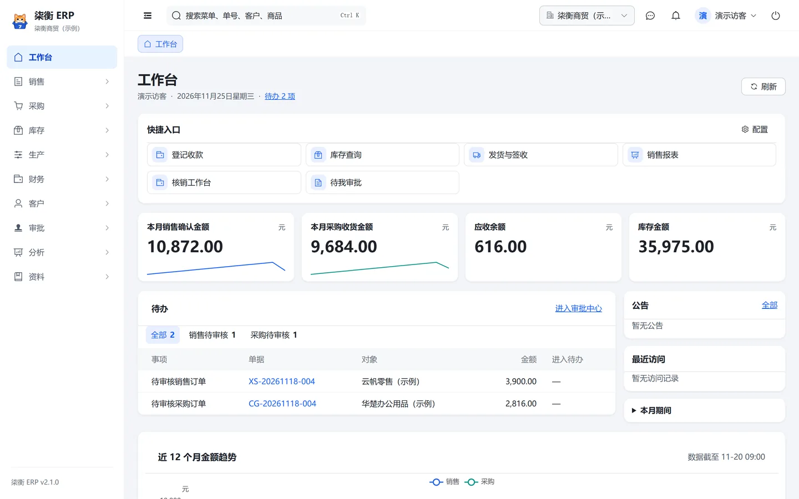
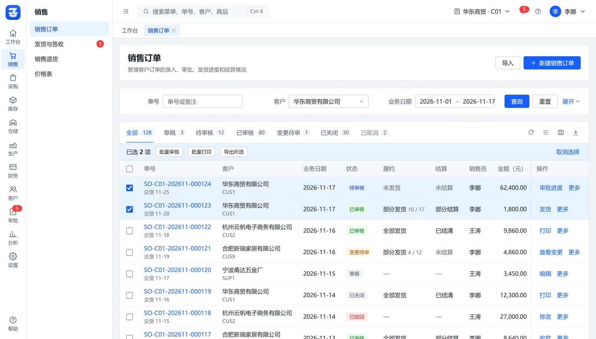
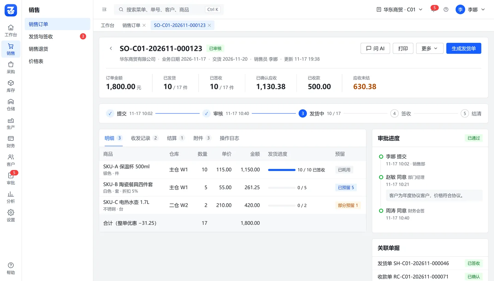
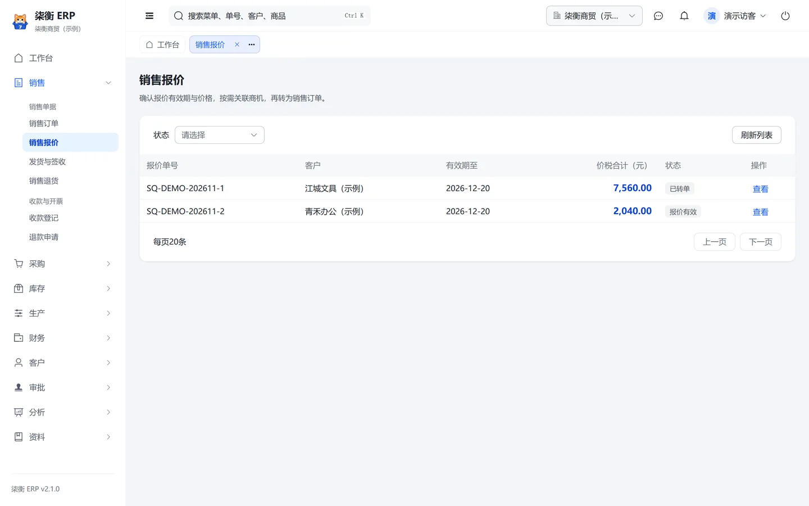
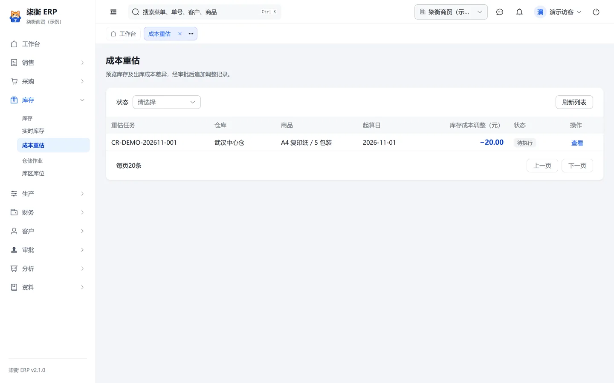

<div align="center">
  
  <h1>柒衡 ERP · Qiheng ERP</h1>
  <p><strong>面向商贸、批发与轻制造团队的开源业财管理系统</strong></p>
  <p>从报价、采购到仓储、生产与总账，让订单、库存、成本和资金相互对应。</p>
  <p>
    <a href="https://qiheng.site/experience/"><strong>在线演示</strong></a> ·
    <a href="https://qiheng.site/">项目官网</a> ·
    <a href="https://github.com/qingyu6688/qiheng-erp/releases/tag/v2.0.0-rc.2">下载部署包</a> ·
    <a href="docs/README.md">文档目录</a>
  </p>
</div>

<p align="center">
  <a href="https://github.com/qingyu6688/qiheng-erp/actions/workflows/verify.yaml"></a>
  <a href="https://github.com/qingyu6688/qiheng-erp/releases/tag/v2.0.0-rc.2"></a>
  
  
  <a href="LICENSE"></a>
</p>

[界面预览](#界面预览) · [在线体验](#在线体验) · [主要能力](#主要能力) · [快速开始](#快速开始) · [技术架构](#技术架构) · [文档导航](#文档导航)

## 界面预览

工作台汇总待办、购销趋势、往来余额和库存金额。以下界面使用虚构演示数据。

[](https://qiheng.site/experience/)

<details>
<summary><strong>展开更多界面：销售订单、右侧详情、报价与成本重估</strong></summary>

| 销售订单 | 订单详情 |
| --- | --- |
|  |  |
| **销售报价** | **成本重估** |
|  |  |

</details>

## 在线体验

**[打开只读演示 →](https://qiheng.site/experience/)**　无需注册或登录，可直接浏览业务单据、报表和 AI 回答样例。

- **看业务流程**：从采购、入库、销售到收付款，查看单据之间的关联与金额变化。
- **看处理结果**：库存、应收应付、成本和总账使用同组样例数据，关键金额与状态单独突出。
- **看详情与知识**：单据和来源在右侧抽屉打开；知识百科、知识库与 AI 对话样例均可浏览。

> [!NOTE]
> 在线演示使用独立模拟数据，开放只读浏览。AI 对话为预设回答样例，正式 AI 助手需配置独立服务与模型。

| 入口 | 当前状态 | 适合用途 |
| --- | --- | --- |
| **主分支 `main`** | `2.1.0` 开发版 | 查看最新实现、从源码运行与二次开发 |
| **[部署包 v2.0.0-rc.2](https://github.com/qingyu6688/qiheng-erp/releases/tag/v2.0.0-rc.2)** | 2.0 预发布版 | 按发布说明部署和验证该版本 |
| **[在线演示](https://qiheng.site/experience/)** | 精选模块，只读体验 | 快速了解业务流程与界面 |

## 主要能力

柒衡 ERP 将购销、库存、仓储、生产和财务放在同一套业务规则下。仓储任务可按仓启用，AI 服务按需独立部署。

| 业务模块 | 核心能力 |
| --- | --- |
| **销售管理** | **报价转订单**、价格与审批、库存预留、发货签收、退货退款；按单查看履约进度、已核销金额与未清余额。 |
| **采购管理** | 请购、采购审批、**供应商价格表与数量阶梯**、质检收货、采购退货、供应商退款及付款核销。 |
| **库存与仓储** | 多仓库存、调拨、盘点、批次与序列号追溯；上架、波次拣货、复核装箱、移库、补货与 PDA 扫码。 |
| **价格与成本** | **购销调价、采购费用分摊、受控成本重估**；区分在库成本与已出库差异，保留来源和处理记录。 |
| **往来与发票** | **账期与到期日、进项发票多对多核对、无原单退货与信用额退款**；支持应收应付、核销、账龄及红字联动。 |
| **财务总账** | 按公司维护人民币账套，支持凭证生成、双人复核、记账、辅助核算、账簿、财务报表、结转与关账。 |
| **轻制造** | 多版本 BOM、替代料、生产工单、领退料和分批完工入库，核算在制、费用分摊与生产成本差异。 |
| **客户与门户** | 线索、商机、合同与跟进记录；合同分批转订单，客户在独立门户查看所属订单、物流、发票与对账单。 |
| **审批与权限** | 流程设计、多级审批、会签、条件分支与转办；按企业、公司、仓库、部门和角色校验访问，支持 MFA、SSO 与操作审计。 |
| **AI 与知识** | **知识百科、内部知识库与带来源的回答**；在当前授权范围内查询业务数据、解释业务拦截原因，业务查询工具采用只读授权。 |
| **报表与集成** | 经营驾驶舱、购销存与财务报表、业务预警、后台导入导出、自定义打印和批量 PDF；提供签名开放接口与 Webhook。 |

**采购到付款**：请购 → 采购审批 → 质检收货 → 入库与应付 → 付款核销。

**销售到收款**：报价 → 销售审批 → 拣货发货 → 签收与应收 → 收款核销。

更详细的业务口径见[业务规则](docs/产品/业务规则.md)；2.1 新增能力及验证记录见[实施进度](docs/规划/业务完整性实施进度.md)和[更新日志](docs/更新日志.md)。

## 快速开始

### 使用发布包

前往 **[v2.0.0-rc.2 发布页](https://github.com/qingyu6688/qiheng-erp/releases/tag/v2.0.0-rc.2)** 下载部署包与 SHA-256 校验文件，校验后按[部署说明](docs/运维/部署说明.md)安装。该包对应 2.0 预发布版；体验 2.1 新功能请使用当前主分支源码或在线演示。

### 从源码运行（Windows）

准备 Git、PowerShell 7、JDK 21、Maven、Node.js 24、npm、MySQL 8.0.46 和 Redis。首次初始化先按[环境检查](docs/运维/环境检查.md)准备建库与授权账号，在当前终端设置 `DB_USERNAME`、`DB_PASSWORD`；以下路径替换为本机安装位置。

```powershell
git clone --branch main --single-branch https://github.com/qingyu6688/qiheng-erp.git
cd qiheng-erp
pwsh -NoProfile -File ./scripts/prepare-local.ps1 -JavaHome 'D:/tools/jdk-21' -RedisDirectory 'D:/tools/redis'
npm --prefix erp-web ci
```

在仓库根目录打开两个终端，分别启动后端与管理端：

```powershell
# 终端一：业务服务
pwsh -NoProfile -File ./scripts/project.ps1 server
```

```powershell
# 终端二：管理端
pwsh -NoProfile -File ./scripts/project.ps1 web
```

打开 **[本机工作台](http://127.0.0.1:5173)**。默认开发企业编码为 `DEMO`、用户名为 `admin`，初始密码保存在本机私有 `.env` 的 `ERP_DEV_ADMIN_PASSWORD` 中。

部署后的员工工作台入口为 `/`，客户门户为 `/portal.html`，移动端 H5 为 `/mobile/`。移动端与 AI 服务的构建、配置及启用方式见对应模块文档。

### 跑通第一笔业务

1. **准备资料**：选择公司，维护仓库、客户、供应商、商品和结算账户，确认业务日期处于开放期间。
2. **录入期初**：按需导入库存及往来余额，复核并过账。
3. **完成购销**：审批订单，办理收货或发货签收，再登记实际收付款并核销。
4. **核对结果**：回到订单、库存、往来及总账，检查来源、金额和未清余额。

## 技术架构

业务服务采用模块化单体，API 与 Worker 可合并或分开运行；Nginx 提供 HTTPS、静态资源及 API 代理，AI 服务按需独立部署。

| 源码目录 | 技术与职责 |
| --- | --- |
| [`erp-web/`](erp-web/) | Vue 3、TypeScript、Vite、Element Plus、Pinia 与 ECharts；管理端和客户门户。 |
| [`erp-server/`](erp-server/) | Java 21、Spring Boot 4.1.2、MySQL 8.0.46、Redis、Flowable 与 Flyway；业务 API、审批和后台任务。 |
| [`erp-mobile/`](erp-mobile/) | uni-app、Vue 3、TypeScript 与 Wot Design Uni；H5 与 Android PDA 作业。 |
| [`erp-ai/`](erp-ai/) | Spring AI、Apache Tika、知识检索与 Wiki；可选 OpenSearch，业务查询调用 ERP 只读工具。 |
| [`qiheng-website/`](qiheng-website/) | Vue 3、TypeScript 与 Vite SSG；项目官网。 |
| [`deploy/`](deploy/) · [`scripts/`](scripts/) | Docker Compose、systemd、Nginx、发布与升级脚本，以及按需启用的监控配置。 |

GitHub Actions 持续执行安全扫描、后端、AI、前端、移动端和真实浏览器回归。查看[当前构建状态](https://github.com/qingyu6688/qiheng-erp/actions/workflows/verify.yaml)与[测试报告](docs/测试/测试报告.md)。

## 文档导航

| 你想做什么 | 建议入口 |
| --- | --- |
| **了解与试用** | [项目官网](https://qiheng.site/) · [在线演示](https://qiheng.site/experience/) · [用户使用手册](docs/产品/用户使用手册.md) |
| **部署与升级** | [部署说明](docs/运维/部署说明.md) · [运维手册](docs/运维/运维手册.md) · [1.x 升级到 2.0](docs/运维/1.x升级到2.0指南.md) |
| **二次开发与集成** | [业务规则](docs/产品/业务规则.md) · [详细设计](docs/设计/详细设计/README.md) · [接口设计](docs/设计/接口设计.md) · [数据库设计](docs/设计/数据库设计.md) |
| **使用移动端与 AI** | [移动端说明](erp-mobile/移动端使用说明.md) · [AI 使用与验收](docs/使用说明/M13人工智能使用与验收.md) |
| **查看进度与变更** | [2.1 实施进度](docs/规划/业务完整性实施进度.md) · [更新日志](docs/更新日志.md) · [完整文档目录](docs/README.md) |

## 参与与许可

欢迎通过 [Issues](https://github.com/qingyu6688/qiheng-erp/issues) 反馈问题，通过 [Pull Requests](https://github.com/qingyu6688/qiheng-erp/pulls) 提交改进。反馈时请附版本、操作步骤和预期结果，便于复现。

项目采用 **[AGPL-3.0-only](LICENSE)**，第三方依赖按[各自的许可条款](docs/产品/第三方依赖许可.md)分发。
