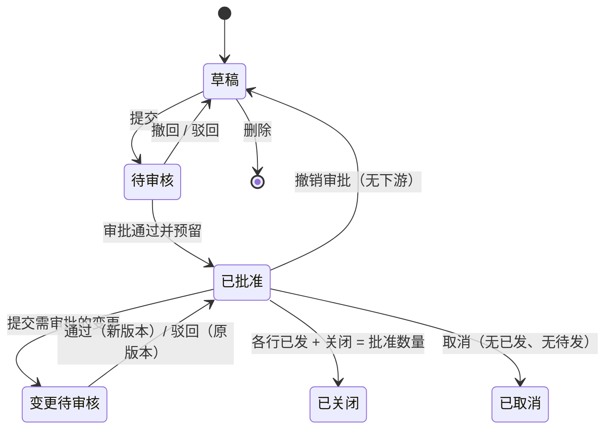

# ERP 业务规则说明

> 文档版本：1.10.0；核对日期：2026-11-23；对应工程：2.1.0 开发版（已接入 B-04 进项核对和 B-02 销售调价；整体验收状态见实施进度）。本文保留首期规则编号，当前范围以第 1 节及后续模块补充为准。

## 范围变更记录

| 生效范围 | 规则 | 当前行为与依据 |
|---|---|---|
| M12 财务总账与信用管理 | S06、S08、R1-08 | 总账支持资产负债表、利润表、现金流量表；信用额度按客户配置，超额或超期执行提示、审批或禁止策略。见 `gl/GlQueryService`、`ar/CreditService`。 |
| M16 数电发票 | S05 | 已实现数电开票、红字及进项采集等网关流程；真实服务商仍待配置和对接验收，不能把本机受控测试视为真实开票验收。发票不重复确认应收应付。 |
| M17 仓储追溯 | S03 | 批次、序列号、保质期和库位已支持，按商品及仓库配置启用。见 `inventory/InventoryDimensions`。 |
| M18 生产 | S01 | 在商贸进销存上增加 BOM、生产工单、领退料、完工和月末成本，并支持经复核的短交关闭。 |
| 2.0.1 开发版 B-01 | T01—T06 | 新增角色账期、公司默认账期、订单审批快照与到期日口径；历史空到期日不自动回填。 |
| 2.1.0 开发版 B-02 采购侧 | R6、R8-06、Q13 | 已过账收货可通过独立采购调价单复核及过账；销售侧见 SP01—SP08。 |
| 2.1.0 开发版 B-03 | R6-11、F01—F08 | 采购随单费用按收货进度资本化，事后费用通过费用单分摊；不回溯原已确认费用。 |
| 2.1.0 开发版 B-04 | I01—I08、R8-05 | 手工与数电进项多对多核对，来源变化保留释放历史，未到票报表按截止日还原；默认不自动生成暂估凭证。 |
| 2.1.0 开发版 B-02 销售侧 | SP01—SP08、R8-06、Q13 | 已签收未退数量通过独立销售调价单补收或折让，原成本保留；净开票与整票红字联动，真实服务商仍单列验收。 |

### 销售调价与销项红字

#### SP01 调价来源和金额

销售调价只针对已签收未退货的发货行，最多100行。新含税单价与含税调整金额二选一，按原交易单位和原税率计算：补收为正，折让为负，金额、税额及尾差遵循R3。原订单、原签收及原应收事实保留，不能直接改已履约原单的价格。

#### SP02 审批、过账和权限

销售调价须提交审批，由另一人复核，审批不自动过账。复核和过账需要当前公司的完整仓库、部门范围及对应销售调价权限，不要求成本查看权限。过账重验开放期间、单据版本、来源版本和当前权限；来源已变时须刷新重做，不能使用旧预览绕过校验。

#### SP03 往来、到期日和报表

销售调价过账后，补收追加正向应收，折让追加客户信用额，继承原应收到期日，不自动核销；原价为零且没有原应收时取订单审批冻结的账期。销售调价不改变库存和原销售成本，总账只调整应收、收入和销项税。销售与毛利报表单列调价，调价行数量和成本为零；门户对账单显示当前客户的调价来源。

#### SP04 调价后的退货计价

销售调价后的退货，货款和税额使用剩余未退数量的新计价基准，累计舍入，末次退货补足尾差；已退金额不重算。退货成本仍按原签收成本计算，不能用新售价代替成本。退货业务日期不能早于当前计价基准日期，调价不重写历史退货。

#### SP05 已开票折让与数电红字

已开票来源发生销售折让，须先完成原票整票红字；一张票包含多条来源时必须核对全部来源，不能只处理本次调价行。数电红字沿原开票请求申请，服务商确认完成才释放占用；待确认、处理中、结果未知或仅普通作废登记，都不算已完成红字。真实服务商沙箱尚未验收，本机受控测试不代表第三方开票通过。

#### SP06 手工整票红字

手工整票红字登记实际取得的红字票号、日期及原因，金额和税额须等于整张原蓝票。登记后仍保留蓝字占用，由另一人财务确认后仅释放一次。登记人不能确认自己的红字，未确认记录可由登记人撤回；历史保留。旧普通作废票可以补录真实红字，但不能重复释放开票额度；数电票不能通过手工红字释放。

#### SP07 退货、折让后的净开票额度

可开票额度按发货行归组，原应收加正调价，减退货和负调价；未税额和税额分别按原应收、历次补价顺序扣减。每笔和整组共同限额，历史超占时可用额为零，付款结清不影响可开票额度。手工与数电使用相同净额，不改原应收；候选重点显示可开金额和累计舍入后的税额，零额度不展示但保留更多来源分页。候选不是额度预留，保存时重新校验。

#### SP08 冲销、右侧详情与未知结果

销售调价过账后只能申请冲销，先处理有效核销、后续退货及后续调价；撤销正补价时同样核对整票红字要求。冲销追加反向往来和总账，恢复上一计价基准，原销售成本不变。原发货有调价下游时不能直接冲销。查看在右侧抽屉打开，关闭保留列表筛选和分页。提交结果未知时保留原载荷、版本及幂等键，不能关闭或切换公司；沿原键确认结果后重新读取当前详情。

### 进项发票核对与未到票

- **I01** 数电同步和手工登记的进项发票与采购应付多对多：一票多单、一单多票、部分分配均支持。手工登记选择本企业启用的供应商及供应商角色，填写票号、销方识别号、开票及接收日期、价税合计、税额；登记不依赖服务商网关。手工票仅在没有有效核对关系时允许按版本更正，作废必须填写原因，保留票面及分配历史。
- **I02** 每行分别记录票面分配未税额、票面分配税额、应付覆盖未税额、应付覆盖税额。两侧未税和税额分别限额，不能互借。公司核对容差默认 1.00 元，检查整票全部分配行的未税差异与税额差异绝对值合计，不能正负抵销或分次保存绕过。容差内记录尾差，超容差拒绝并提示采购调价或退回供应商，不自动追加应付、资金或总账。
- **I03** 付款结清不等于已到票。可到票净额度取采购事实，货款按原收货行归组，结合采购退货、正负调价逐分分配净额；费用按费用应付计一次，不因分摊到多张收货重复金额，也不默认随商品退货退还运费。票面 99.99 覆盖应付 100.00 时，差异为 −0.01，应付覆盖额为 100.00，不遗留一分未到票；原应付、资金和成本快照不变。
- **I04** 采购调价、采购退货及收货、调价、退货、费用的有关冲销过账，与核对共用公司核对锁。成功过账后释放整张受影响发票的当前分配，回到待核对并显示原因；保留全部已释放历史，仅申请或批准冲销不释放。原有有效核销、下游业务及库存依赖仍按原顺序处理，不能凭核对解除绕过冲销校验。
- **I05** 数电来源只能由服务商同步更新。服务商改变票面金额、销方识别号、作废或红冲时释放当前关系；重复同步相同内容不增版、不重复释放，终态票不会被普通正常数据复活。同号码手工票与数电票冲突时整批回滚，不覆盖手工票。数电票核对要求供应商资料税号与票面一致，缺失或空白税号不能关联。
- **I06** 发票显示待核对、部分核对、已核对、有差异，同时单列票面是否全部分配；有差异不能掩盖尚未分完。核对需完整公司仓库和部门范围，并复核来源和成本可见范围；有一笔相关来源不可见时不展示较大的可用额度。登记、更正和作废另有独立权限，旧幂等响应同样检查当前权限与全部历史来源。
- **I07** 已收货未到票报表按供应商及采购来源列出净可到票、已到票、未到票的未税额和税额，只列仍有未到票余额的正向来源。按来源日期筛选后，仍完整计算同收货行的退货和调价；截止日依据来源业务日期以及核对、释放日期恢复。供应商对账增加截至结束日的到票状态。旧版迁移缺少精确核对日期时按旧更新时间还原并提示边界；暂估默认只提供报表，不自动生成总账凭证或次月冲回。
- **I08** 登记、核对和历史均在右侧抽屉查看，保存后保留列表筛选、页码与滚动位置。核对修改后须重新服务器预览，保存持锁重算；未知网络结果锁定原载荷与幂等键，重试确认后重新读取当前详情。未保存修改有离开保护，请求结果未确认时不能关闭或切换公司；跨公司旧响应不能回填。

### 采购费用分摊

- **F01** 公司参数“采购费用计入存货成本”默认开启，公司未保存参数时也使用此默认。关闭后尚未开始确认的随单费用仍在首次收货整笔确认并记采购费用，结果沿用原规则；已开始资本化的费用继续确认剩余部分，历史已确认费用不追溯。手工费用单用于资本化，关闭时不允许新增、提交或过账，普通费用使用费用付款登记。
- **F02** 随单费用仅处理采购订单我方承担的部分，按累计收货进度确认，本次确认额只分摊到同一订单的本次收货行。超收不额外增加费用，订单加量后不倒退已确认额，完成收货补齐尾差。随单费用沿原订单账期计算本次应付到期日；仓库经办人不需要全公司财务或成本查看权限。
- **F03** 分摊方式支持金额、基本数量、重量。金额权重为尚未退货部分的未税货款并包含有效调价；重量为基本数量乘 SKU 每基本单位重量。权重合计为零时要求更换方式或补齐资料，不静默均分。逐分舍入，尾差优先落在分摊金额最大的一行，税额不超过该行含税金额。
- **F04** 一般纳税人未税费用进成本，小规模纳税人含税费用进成本。来源尚在库部分增加库存成本，已出库及在途部分记成本差异；借存货或成本差异、借可抵扣进项税、贷应付。原收货货款、单位成本和原出库快照保留，采购退货不自动向商品供应商索退运费。
- **F05** 事后费用选择启用供应商角色的承运商，可与商品供应商不同，可引用同公司多张收货单。费用单批准时冻结承运商账期，按费用日期计算到期日，不沿用原收货的供应商账期，也不自动核销原商品货款。
- **F06** 手工费用草稿提交后须另一人复核，再在开放期间过账；来源版本、剩余数量、退货、有效调价和重量变化需要更新草稿或作废后重做。成本预览、批准及过账要求完整公司仓库、部门范围和成本权限；详情、审批、财务、报表和旧幂等结果检查全部来源仓与实际成本归属仓。
- **F07** 手工费用只能统一冲销，先处理核销、后续退货和库存使用；原收货被有效手工费用引用时须先处理费用单。随单费用只读，不独立审批或冲销，随原收货整体冲销，并只退回该批已确认费用进度。进项核对关系随成功冲销释放并保留历史，不阻止合法冲销，见 I04。
- **F08** 采购费用详情在右侧抽屉打开，关闭保留列表和筛选；收货明细显示货款成本、分摊费用及含费成本。未知网络结果使用原载荷与幂等键重试；成本预览按当前库存计算，过账持锁重算。

### 采购价格调整

- **P01** 仅调整已过账收货尚未退货的数量，同单供应商及仓库一致；新含税单价或调整金额二选一。税率沿原行，金额及税额按 R3 计算。原收货货款、税额和单位成本快照保留。
- **P02** 制单、提交、另一人复核后才能过账，复用现有工作流和系统默认审批。提交、批准及过账均检查来源版本；来源退货或另一次调价后，应更新草稿或作废后重做。
- **P03** 过账产生独立应付货款或供应商信用额，沿用原往来到期日，不自动核销。成本按实际过账顺序追踪原收货份额，在库部分调库存成本，已出库及在途部分进成本差异，不回写原出库成本。
- **P04** 调价后的采购退货按新的剩余金额及税额基准累计分摊，最后一次补齐尾差；再次调价重设剩余基准。历史未调价行保持原算法，退货日期不得早于当前调价日期。
- **P05** 采购调价只允许通过统一冲销追加反向事实。已核销、后续退货、后续调价或库存使用均先处理下游，再冲销；冲销恢复上一退货基准。进项核对关系在成功冲销后释放并保留原因，不能用原幂等重试恢复已释放的关系，见 I04、I08。
- **P06** 成本预览、批准和过账需要完整公司仓库、部门范围及成本权限。详情、列表、往来、报表、穿透及旧幂等结果均按当前范围重验实际成本归属仓。详情在右侧抽屉打开，关闭保留原列表。

### 账期与到期日

- T01：客户和供应商角色可分别配置账期。支持按天（0—365 天）和月结次月固定日（1—28 日）；按天 0 天为现结。角色未设时取公司默认，两处均未设则没有到期日。
- T02：订单审批前可覆盖账期或明确选择无账期。审批时冻结账期快照，审批后修改往来资料或公司默认不改变该订单；审批后不能修改快照。
- T03：签收按签收业务日期计算应收到期日，收货过账按收货业务日期计算应付到期日；随单费用采用相同口径。按天用业务日期加天数；月结用业务日期所在月的次月固定日，例如 2026-11-23 月结次月 28 日，到期日为 2026-12-28。
- T04：退货及冲销沿用原往来项到期日。期初往来允许手填到期日，未填时按过账时角色或公司账期计算。
- T05：账龄默认按业务日期，也可按到期日。按到期日时排除无到期日项，未来及当天到期的逾期天数为 0；驾驶舱只把到期日早于统计日的未清余额算作逾期。应付即将到期预警默认提前 7 天，应收、应付分别校验对应报表权限。
- T06：存量空到期日不自动回填。管理员先用只读工具生成预览和 SQL，财务核对后人工决定是否执行，原有已填写日期不覆盖。

## 生产工单短交关闭

部分完工或已开始生产的工单可申请短交。经办人填业务日期、原因和成本处理方式，并逐行说明净领料的耗用、报废数量。净领料以已过账领料扣减已过账退料计算。复核人必须另有授权且与经办人不同。复核同时核对公司、部门、材料仓、工单版本、期间和未处理的生产单据。短交关单后停止该工单的领退料、完工和生产冲销。

关闭期间的期末在制清零。选择「计入生产成本差异」时，本期可结转成本按本期完工量与「本期完工量 + 工单未交数量」之比归集到完工品，余下成本计入生产成本差异。本期没有完工量时，剩余在制全部转差异。选择「摊入完工品」时关闭期间须有完工量，剩余成本按原有成本分配路径归入本期完工品。前期已过账结转保留。

## M19 经营指标、打印和预警

销售额采用销售汇总的确认口径，毛利为未税收入减原报表归集的成本。结束月份按整月同比和环比，本月按同日比较。库存金额为授权仓的实物快照，呆滞与周转统计还要求完整部门范围。受限 CRM 用户查询当前可见对象，避免客户移交后使用旧缓存。

自定义打印模板只可引用当前单据类型白名单中的字段，成品 PDF 与 HTML 预览使用相同排版数据。成本及银行账号按当前权限填充。后台打印冻结模板及初始可见范围，领取、生成、状态与下载继续核对当前权限。

预警按公司、规则及业务对象合并同一次问题。触发条件解除后自动解决，重新出现时恢复待处理。主管可以确认或填写原因后忽略。公司可以单独维护 SKU 的安全库存。投递通过原消息中心，以当前授权核对来源；临期提醒与催收提醒改由预警规则扫描，库存过期冻结继续独立运行。

## M18 生产、库存和月末成本

- BOM 数量先按父项基准量、各行单位和损耗率换算，虚拟件逐层穿透，落到叶子节点时向上取到 6 位小数。普通半成品由自己的工单生产，在上层工单作为库存用料。工单下达后冻结配方、单位、替代比例及各物料对应仓库。替代比例按每个原料行单位对应的替代料行单位填写。
- 工单净领料量等于累计领料减累计退料。超过应领数量时由匹配的超领流程审核，未配置时由另一人审核。退料按原领料单剩余数量和原始金额计算，最后一次退料补足分币，库位、批次和序列号沿用库存追溯规则。完工累计量上限为计划量乘以 `1 + 超收比例 / 100`。
- 完工入库先从已领净材料成本和计划完工量计算估算材料单价。有上一结算期间同 SKU 的已完工数据时，加上该期实际人工与制造费用的加权单价；首次没有历史费率时，先按材料金额估算。期末费用池可录入金额，或取当前账套已记账凭证的对应科目借方净额。支持按工时、当期产量和净材料成本分摊，逐分舍入，分摊行合计等于费用池。
- 期末在制品可选只留材料或约当产量。只留材料时，有当期完工的工单按当期完工量与尚未完工量分摊材料，未完工部分结存在制；无本期完工的工单保留已归集成本。约当产量以尚未完工量乘以填报的期末完成比例。完工实际成本等于期初在制加本期净材料、工单滚入差异、人工和制造费用，再减期末在制。
- 完工差异按库存移动加权的数量份额追踪。留库存的份额增加或减少当前库存成本，转入其他本期工单的半成品差异继续参与该工单成本，已出库的份额入 `PRODUCTION_VARIANCE`。调拨需处理关联在途，跨期半成品用料须先按会计顺序结算。成本过账锁定本期生产单据。需冲回时先重开会计期间，再冲回成本凭证和库存差异；已有后续成本或已使用差异金额的库存流水须按会计顺序先处理。

## M11 业务员、消息与平台规则（未发布）

| 编号 | 规则 |
| --- | --- |
| X01-01 | 业务员只用于业务统计，不更改冻结制单归属或增加公司、仓库和部门权限。新单默认当前用户，下游继承来源；来源不一致必须明确选择。 |
| X01-02 | 仅草稿可换业务员，已审批订单变更也不能换。新选择须为本企业、当前公司可访问的启用用户；历史停用人员保留名称。历史无法确认保留0。 |
| X01-03 | 销售、采购、毛利汇总和CSV使用同一事实与权限过滤，先求授权交集，再筛业务员和聚合。退货与冲销按原有实际方向计算。 |
| Y03-01 | 字典维护分类、来源等可配置标签，审批、签收、过账状态不进字典。预置行只读，本企业可覆盖启停；引用后的值不改，不物理删除历史引用。 |
| Y04-01 | 公告正文白名单清洗；收件对象、公司、部门或角色变化、撤回和到期均在阅读时复核；重要公告按用户确认。 |
| Y05-01 | 消息只能由收件人读取，待办以来源动作及版本去重。工作台读取消息中心，计数和分页前复核来源权限和状态，旧已读通知不能旁路访问失权单据。 |
| Y06-01 | 站内提醒不能关闭；短信邮件按个人订阅、启用模板及当前验证绑定投递；投递载荷加密，目标掩码，失败按1/5/15分钟重试，原始错误及密钥不入日志。 |
| Y06-02 | 企业微信机器人仅走固定官方域名，禁止自定义投递URL及重定向；仅发通用提醒，不向未经验证的群成员推送业务明细。 |
| Y07-01 | 在线标识不可用作登录凭据。强退先撤销再删除会话；同请求清理当前会话对象；密码版本和账号状态仍逐请求核对，跨企业会话不可管理。 |
| Y08-01 | 省市区使用MCA-2024官方代码及现有层级，保留原文本地址；客户端传入虚构代码拒绝保存。 |
| Z01-01 | 平台参数有类型、版本、幂等及审计；敏感值加密，不返回明文；不得覆盖权限、会话或既有公司政策。 |
| Z02-01 | 任务只能执行固定登记动作；按企业维护定义租约和单次请求租约，手动请求执行前复核账号及权限；原业务幂等继续生效。 |
| Z03-01 | 访问日志保存路径模板，不存原始ID路径、查询值或正文；异常不存原始消息，日志失败不改变主业务结果。 |
| Z04-01 | WebSocket校验同源和会话，Redis广播仅变更摘要；业务读取继续通过REST权限检查；断线恢复重新拉取当前收件箱。 |

## M11 Y-02 部门数据范围（未发布）

以下规则为当前1.2.0开发增量，与首期业务规则同时生效；不改变金额、库存过账和两人复核口径。

| 编号 | 规则 |
| --- | --- |
| Y02-01 | 角色按公司设置全部、本部门、本部门及下级、仅本人、自定义。未配置角色等同全部；多个启用角色取并集，再与企业、公司、仓库及操作权限取交集，不能因组织任职扩大授权。 |
| Y02-02 | 本部门取当前公司所有启用任职部门；主部门仅用于新单归属。含下级按当前部门路径展开，人员调动、部门移动和角色撤权在下一请求生效。 |
| Y02-03 | 17类业务头冻结制单人和该公司主部门，客户端不能指定。受限用户无主部门或主部门不在可写范围时新建返回422。冲销继承原单归属；后续任职变更不回写历史。 |
| Y02-04 | 历史按创建人当前公司主部门回填，无法归属时为0，只有全部范围可见。本人模式也不能读取部门为0的历史记录。 |
| Y02-05 | 列表、计数、来源候选、详情、命令、旧幂等结果、打印和附件均执行范围检查。查询在分页及汇总前过滤；单据越权返回404。核销须两端未清项均可见。范围外下游引用仍阻止冲销，但错误中隐藏标识和单号。 |
| Y02-06 | 销售、采购、毛利、未签收、账龄、往来对账单、资金流水及库存收发事实按来源归属过滤。库存当前余额和可用量属于公司仓库共享实物快照，继续按公司仓库授权展示；范围内收发事实不能当作全仓余额。受限用户不返回资金账户全公司余额。 |
| Y02-07 | 后台导出在发起范围与即时范围的交集中生成，文件下载前后复检。导入逐行读取即时权限并保留初始部门边界；扩大后不能越出发起范围。附件对象读取后复检，期间撤权不交付字节。工作台缓存键包含部门范围摘要。 |
| Y02-08 | 角色部门范围维护须有role:assign_permission及当前公司全部部门范围，按公司独立版本，具有CSRF、幂等和审计保护。至少保留一位各公司已有的全范围有效角色管理员；撤销角色、权限、公司范围及停用用户也不得绕过保护。全公司关账、对账、运维和包含整单快照的公司审计仅对全部门范围开放。 |

详细实现与验收见[部门数据范围实施设计](../设计/部门数据范围实施设计.md)及[M11部门数据范围本机验收报告](../测试/验收记录/M11部门数据范围本机验收报告.md)。文档维护：maorongkang@gmail.com。

- 历史基线：文档 1.5.0 的首期规则来自工程 0.7.0；当前版本及后续能力见本文题头和范围变更记录。
- 编写日期：2026-11-15，Asia/Shanghai。
- 1.4.1 修订：B06 验收措辞与接口 6.2 对齐，客户端计算字段由服务端忽略并重算，金额规则不变。
- 定位：落实《重构设计方案》第 3 节，补齐首期业务规则和数字样例。按方案第 14 节，本文的规则有样例、关键异常有处理，才进入阶段 B。
- 1.1.0 修订：设计数据库时修正 R3-08，补充 R4-03，新增 R4-10、R4-11、R7-12 和 Q16—Q18。各规则在数据库中的落点见《数据库设计》第 5 节。
- 1.2.0 修订：Q01 已确认，销售应收改为**按客户签收确认**。重写 R2 组，新增签收与签收差异规则 R2-09—R2-13，相关的 R3-08、R4-07、R5-02、R7-12、状态机、权限、测试同步调整，新增 Q19—Q21。
- 1.3.0 修订：Q02 已确认，库存在**订单审批通过时**预留。R1-01 改为【定】，新增 R1-10 提交时可用量提示、R1-11 待审核需求展示。
- 1.3.1 修订：第 1 节范围假设编号为 S01—S08；面向业务方的问题汇总见《待确认清单》。
- 1.4.0 修订：用户授权按最合理方案确认全部待确认项，S01—S08、Q03—Q21 均采用默认取值，标为已确认。
- 文档维护：maorongkang@gmail.com。

## M11 Y-01 部门与岗位

- Y01-01。部门属于公司，上级和子树不能跨公司；根深度为1，最多20层、每公司最多1000个部门。移动和排序是一个版本化事务，禁止移入自身或后代。
- Y01-02。岗位定义属于企业，任职关系属于公司。同一用户在不同公司的部门、岗位及组织配置版本相互独立；非空部门集合恰好一个主部门，唯一约束限制每公司最多一个。
- Y01-03。组织配置不授予业务数据范围，成员和负责人必须已有当前公司范围。失去公司范围时同事务清理任职和负责人引用并记录审计，保留组织版本以拒绝旧请求。
- Y01-04。其他企业、其他公司的对象及引用返回404；无操作权限返回403。岗位维护使用企业权限，部门维护使用公司上下文。新建、编辑、移动、状态及组织分配具有幂等、CSRF、版本及审计保护。
- Y01-05。有任何子部门或成员时不能停用部门；有任职关系时不能停用岗位。新任职仅选择启用部门和岗位；部门负责人须为启用用户。资料写入先锁企业管理屏障，与数据范围调整串行。

## M10 默认账户与工作台金额

- M10-X05-01。每家公司可分别指定一个启用的默认收款账户和一个默认付款账户，同一账户可用于两种用途。切换默认账户在同一事务中按公司串行处理，清除旧标志后设置新标志，并校验目标版本。停用账户同时清除默认用途。新收付款草稿自动带出对应默认账户，操作人可以另选。
- M10-X06-01。工作台销售金额采用签收确认的销售报表口径，采购金额采用已过账收货报表口径，退货和冲销按原事实的反向金额计入。业务日期按北京时间切分，展示今日、昨日、本月、本年及最近十二个月。销售、采购块分别按现有报表权限和当前公司仓库范围计算。
- M10-X06-02。金额汇总缓存最多五分钟，缓存键包含企业、公司、用户、仓库范围、可见金额块、北京时间日期和月份数。权限校验在读取缓存前完成，未授权块不返回。备库配置及数据时间随统计结果提供给使用者。

## M7 报表与文件处理约定

本轮补充查询、文件处理与审计规则，销售、采购、库存、往来及资金确认时点沿用既有业务规则。实现和 M7 集中验证已完成，详见《测试报告》。

1. 报表从现有业务事实生成，显示统计时点。库存、销售、采购等报表按当前仓库范围过滤；公司财务报表须有整家公司范围。毛利报表必须有成本权限，其他报表无成本权限时不显示成本。每次最多 50000 行，日期范围最多一年；不同查询页重新获取当时快照。
   销售、采购默认按客户或供应商、SKU 和业务日期汇总，逐单行通过 `detail=true` 查询；费用组通过 `feesOnly=true` 精确穿透，不混入商品行。
2. 导出只由原操作人查看和下载。提交时捕获公司、仓库和成本权限，执行时与当前授权取交集；交付时当前范围须覆盖整个文件实际范围，授权收窄后不能读取原来更宽范围的文件。文件自生成成功起保留 24 小时，未完成任务自创建起最多等待 24 小时，每人最多同时 3 个待处理任务。导出 CSV 带 UTF-8 BOM，文本单元格防公式，业务编码和十进制值保持原始精度。
   报表成品只输出白名单内的中文业务列，不输出内部 ID、URL；无成本权限时不输出成本及毛利表头。下载必须有五分钟有效票据，缺少或失效时不能交付文件。
3. 导入使用真实模板，首期支持 UTF-8 CSV，单文件最多 20MB、10000 数据行。SKU 引用已有商品与单位，往来单位明确客户或供应商角色；必填、列数、精度、引号和资料状态均在服务端校验。每个有效期初行只生成一张草稿，不自动审核、过账或增减库存。草稿必须继续完成提交、另一人审核和过账。
4. 行失败时整行回滚，其他有效行可成功；同时有成功与错误时状态为 `partial`。错误清单只给出行号、列名和中文原因。源文件相同且类型、仓库和业务日期相同时，服务器指纹防止更换幂等键重复生成期初。领域目标与行断点同事务提交，租约恢复不重复处理已成功行。源仓 503、数据库瞬态故障最多自动执行 3 次并按 2、4 秒退避，不能将依赖故障判为业务错行；恢复依赖或授权后，原操作人可幂等重试仍有未处理行的失败任务，已成功或已判错的行保持原结果。修正错误行后另存新文件重传。
5. 创建、执行和查询导入任务都复核导入权限、实际对象创建权限、原操作人和当前公司范围；期初和含采购价的 SKU 导入还需要成本权限。原操作人停用、撤权或仓库范围失效时后台停止，其他人不能通过任务或通用附件读取源文件。
6. 附件只属于白名单内的业务单据，单文件 20MB、每单最多 20 个。PDF、JPG/JPEG、PNG、XLSX、CSV 校验扩展名及实际内容；文件名不能包含路径。上传、删除与下载均验证所属单据权限和范围。存储键由服务器生成，五分钟票据绑定当前用户、公司、用途与资源，持有链接仍需有效会话和即时授权。
   删除与回收候选在同一元数据事务提交，附件立即不可下载；一小时后补偿任务在确认没有有效附件引用时删除物理对象，失败保留候选继续重试。
7. 打印由固定版式和服务端打印数据组成，需单据查看及打印权限；打印数据沿用详情字段过滤，成本、联系方式和完整账号不因打印权限扩大。打印只记录审计，不变更单据状态或账务。
8. 公司审计快照只向拥有整家公司范围的审计人员开放；查询时继续按当前成本、联系方式、完整账号权限过滤，密码、令牌、存储键等始终剔除。失败事件管理按当前公司归属隔离，须有完整公司范围，事件重放写入审计并遵守既有 Inbox 幂等。

## 0. 使用约定

规则编号格式为 `R<分组>-<序号>`，例如 `R3-04`。领域代码注释、测试用例名、接口错误码说明直接引用编号，规则变更时可以按编号找到全部受影响位置。

每条规则标注状态：

| 标记 | 含义 |
|---|---|
| 【定】 | 由《重构设计方案》已有约束推出，或属于金额、库存正确性底线，业务方不确认也不改 |
| 【默】 | 首期默认取值。业务方未提出异议就按此开发；确认改动时只改本文、对应参数和测试 |
| 【参】 | 做成公司级参数，首期给出默认值，上线后可按公司调整，调整本身记审计 |

2026-11-15 起，全部【默】项已经确认，效力等同【定】。保留【默】标记，是为了说明这些取值来自当时的默认选择；以后要改，按变更流程先改本文和测试，再改代码。

本文与页面原型冲突时以本文为准；与《重构设计方案》冲突时先修订方案，再修订本文。

除特别说明，样例均为人民币，金额保留 2 位小数，舍入方式为四舍五入（`HALF_UP`）。

## 1. 前提假设

下表按 2.1.0 开发版已实现能力维护，保留首期范围编号。业务方改变取值时，按最后一列和第 14 节评估返工范围。

| 编号 | 事项 | 首期取值 | 状态 | 取值不同时的影响 |
|---|---|---|---|---|
| S01 | 行业 | 商贸、批发、电商的多仓进销存，已扩展生产管理 | 【定】已实现 | 零售等新增场景另行确定规则 |
| S02 | 部署形态 | 按多租户设计数据隔离，首期按单租户交付 | 【定】已确认 | 对外 SaaS 需补计费、租户开通、配额，不改业务规则 |
| S02 | 法人和币种 | 一个租户下可有多家公司；只用人民币 | 【定】已确认 | 多币种需加汇率、汇兑损益，改金额值对象和报表 |
| S03 | 商品管理维度 | 仓库 + SKU，支持按配置启用批次、序列号、保质期和库位 | 【参】已实现 | 启停须遵守已有库存和追溯记录约束，不能抹掉历史维度 |
| — | 应收应付确认 | 应收按客户签收确认，应付按我方收货过账确认 | 【定】Q01 已确认 | 见 R2 组 |
| S04 | 成本方法 | 移动加权平均，按公司 + 仓库 + SKU | 【定】已确认 | 改 FIFO 需增加成本层表，出库取数逻辑重写 |
| S05 | 发票 | 数电开票功能已实现，真实服务商待对接验收；发票不重复产生应收应付 | 【定】功能已实现、外部验收待完成 | 服务商配置、授权及真实开票须单独验收 |
| S06 | 总账 | 每公司独立账套，支持资产负债表、利润表和现金流量表 | 【定】已实现 | 报表模板、科目映射和启用数据须由财务核对，不等同于自动完成法定申报 |
| S07 | 支付集成 | 只登记和核对，系统不主动调用银行或支付渠道 | 【定】已确认 | 接渠道后退款进入真实“处理中”，R5-08 生效范围扩大 |
| S08 | 信用额度 | 按客户配置额度、超期天数及提示、审批、禁止策略 | 【参】已实现 | 未配置信用策略时不控制，临时调增须复核并在有效期内使用 |
| — | 负库存 | 不允许 | 【定】 | 见 R4-01 |
| — | 库存预留时点 | 销售订单审批通过时 | 【定】Q02 已确认 | 见 R1 组 |

## 2. 口径统一

同一个词在页面、接口、报表里只能有一个意思。

### 2.1 组织

- **租户**：数据隔离边界。所有业务表带 `tenant_id`，任何查询都不能跨租户。
- **公司**：业务主体，承担应收应付、资金账户和库存成本。单号、会计期间、成本都按公司划分。
- **仓库**：归属唯一一家公司。一家公司的仓库不能存放另一家公司的货。

### 2.2 库存数量

```text
在库量 = 期初量 + 有效入库量 - 有效出库量
可用量 = 在库量 - 预留量 - 冻结量
```

- **预留量**：已批准订单占住、尚未出库的数量。
- **冻结量**：退回待检、质量隔离、盘点锁定的数量。冻结的货在库，但不能被预留或发出。
- 以上数量都按 SKU 的**基础单位**记录。页面按单据单位展示时，用单据保存的换算率快照折算。

### 2.3 订单行进度

| 量 | 含义 |
|---|---|
| 批准数量 | 当前生效审批版本的订购数量 |
| 关闭数量 | 手工关闭、不再履约的数量 |
| 已发数量 | 已过账发货单的累计数量，扣除签收差异（R2-11） |
| 待发占用 | 已提交、未过账发货单占住的数量 |
| 已签收数量 | 客户已签收的累计数量，应收按它确认（R2-01） |
| 已退数量 | 已过账退货单的累计数量 |
| 待退占用 | 已提交、未过账退货单占住的数量 |

```text
可发数量 = 批准数量 - 关闭数量 - 已发数量 - 待发占用
发出未签收 = 已发数量 - 已签收数量
可退数量 = 已签收数量 - 已退数量 - 待退占用     （按发货行计算，R5-02）
```

采购侧相同，把“发”换成“收”。

### 2.4 资金四类事实

- **应收 / 应付**：客户欠我们、我们欠供应商多少。由出入库产生，见 R2。
- **收款 / 付款**：哪个账户实际进出了多少钱。
- **核销**：某笔收付款分配给了哪些应收应付。核销不产生资金流动。
- **过账**：业务事实对账本的不可覆盖影响。

“客户已付清”在系统里的准确说法是“该客户应收已全部被核销”。

### 2.5 三个时间

| 时间 | 含义 | 用途 |
|---|---|---|
| 业务日期 | 业务实际发生日，用户填写 | 决定归属的会计期间、账龄起算日 |
| 过账时间 | 系统完成过账的服务器时间 | 决定成本计算顺序 |
| 创建时间 | 记录首次写库时间 | 审计 |

业务日期不能晚于当天，不能早于该公司最早的开放期间。

## 3. R1 库存预留

### 规则

- **R1-01** 【定】销售订单在**审批通过**时预留库存（Q02 已于 2026-11-15 确认）。草稿和待审核订单不占库存。
  理由：审核前的订单可能被改价、改量或驳回，提前占库存会让可用量长期失真；审核后才预留，审核人看到的可用量就是最终能否接单的依据。
  以后如果审批经常拖到第二天以后，并且常有多个业务员争抢同一批货，再评估改为提交时预留，同时设计待审核订单的自动释放。
- **R1-02** 【定】预留按**订单行**记录，一行一条预留记录，指明公司、仓库、SKU、数量。订单行未指定仓库时不能审批通过。
- **R1-03** 【定】审批时任何一行可用量不足，整张订单审批失败，所有行的预留回滚。错误信息列出不足的行、SKU、需要量和当时可用量。
- **R1-04** 【定】预留只能以四种方式减少：出库消费、关闭剩余量、取消订单、到期释放。每次减少写一条预留变动记录，预留余量不能为负。
- **R1-05** 【参】预留有效期默认 **30 个自然日**，从审批通过时起算。订单约定了交货日期的，有效期为交货日期后 7 天，两者取晚者。
- **R1-06** 【默】预留到期由后台任务释放，订单本身**不自动关闭**，订单行标记“预留失效”。用户重新预留时按当时可用量校验，可能失败。
- **R1-07** 【定】同一条预留的同一部分数量只能被消费或释放一次。到期释放和出库同时发生时，以数据库条件更新先成功的一方为准，另一方按剩余预留量处理。对应测试 T19。
- **R1-08** 【参】按客户配置信用额度与超期策略，未配置时不控制。信用暴露包括未清欠款、待审及未签收承诺；提交、审批、订单变更和发货均按即时事实重检。提示策略允许继续，审批策略须有当前有效的人工信用审批证据，禁止策略阻止继续。临时调增需另一人复核，过期不再使用；欠款总暴露只向具有信用查看权限的人返回。
- **R1-09** 【定】采购订单不预留、不影响可用量。在途采购量只在报表里单独展示，不能被销售预留。
- **R1-10** 【默】提交订单时逐行检查当时的可用量。不足时给出提示，例如“SKU-A 需要 60，当前可用 40，审批时可能失败”，但**不阻止提交、不占用库存**。审批时仍按 R1-03 重新校验。订单行没有指定仓库时，不做这项检查。
- **R1-11** 【默】库存查询增加“待审核需求”：同一仓库、同一 SKU 下，所有待审核订单的订购数量之和（基础单位），只用于展示，不影响可用量。首期不计入待审核变更单中增加的数量。

### 样例

SKU-A 在仓库 W1，初始在库 100，预留 0，冻结 0。

| 步骤 | 动作 | 在库 | 预留 | 可用 | 说明 |
|---|---|---:|---:|---:|---|
| 1 | 初始 | 100 | 0 | 100 | |
| 2 | 订单 SO-1 审批，订 60 | 100 | 60 | 40 | 预留成功 |
| 3 | 订单 SO-2 审批，订 60 | 100 | 60 | 40 | 失败，提示“SKU-A 需要 60，可用 40”，SO-2 仍为待审核 |
| 4 | SO-2 改为 40 后重新提交并审批 | 100 | 100 | 0 | |
| 5 | SO-1 发货 25 | 75 | 75 | 0 | 在库和 SO-1 预留同时减 25 |
| 6 | SO-1 关闭剩余 35 | 75 | 40 | 35 | 释放 SO-1 剩余预留 |
| 7 | SO-2 预留到期 | 75 | 0 | 75 | SO-2 行标记“预留失效”，订单仍为已批准 |

## 4. R2 应收应付的确认时点

### 规则

- **R2-01** 【定】销售应收在**客户签收**时确认（Q01 已于 2026-11-15 确认）。发货过账只出库，不产生应收；订单审批、开票也不产生应收。
- **R2-02** 【定】采购应付在**我方收货过账**时确认。我方收货即相当于签收，不另设签收环节。
- **R2-03** 【定】一个发货行（在签收时）或收货行只产生一条应收或应付。开票登记只关联已有应收，不新增应收；数据库对 `(来源单据类型, 来源行 ID, 过账动作)` 建唯一约束。
- **R2-04** 【定】预收款、预付款不产生应收应付，只形成该客户或供应商的**未分配资金**。应收产生后由用户或自动规则核销，见 R4-06。
- **R2-05** 【定】应收金额按 R3-08 的累计法从订单行**应收净额**拆分：本次应收 = 四舍五入(应收净额 × 累计签收数量 ÷ 批准数量) − 此前已确认应收。单价、优惠分摊、税率全部取订单行审批时的快照，不取商品资料的当前值。
- **R2-06** 【定】买方承担的运费是订单的一条费用行，在**第一次签收**时整笔确认应收。整单关闭且从未签收时，运费不产生应收。
- **R2-07** 【定】销售退货过账产生一笔负向应收（退货信用额），关联原发货行，见 R5-05。
- **R2-08** 【定】应收的账龄从**签收日期**起算。
- **R2-09** 【定】发货过账后、签收之前的货物是**发出商品**：已经不计入仓库的在库量，成本记在发出商品上，仍是本公司的资产。销售成本在签收时结转。库存金额报表单列“发出未签收”。
- **R2-10** 【默】一张发货单只签收一次：逐行登记签收数量和统一的签收日期，可以上传签收回单。签收日期不能早于发货日期、不能晚于当天，并且必须在开放期间内。签收数量不能超过发货数量。签收后不能修改，录错走冲销（R7-03）。
- **R2-11** 【默】签收数量少于发货数量时，差额进入“签收差异待处理”，逐行选择一种处理方式：
  - **拒收退回**：货退回原仓库，进入冻结量待检，按原出库单位成本入库（同 R5-09）。
  - **运输损失**：成本从发出商品转入损失。向承运方索赔不在首期范围。

  无论哪种方式，差额在**签收时**就从订单行的已发数量中扣回，重新变为可发数量。理由是客户没有收到这部分货，订单仍然有效。原预留不恢复（同 R7-12），补发时按当时的可用量出库。差异处理不改变已确认的应收。
- **R2-12** 【默】客户自提的发货单，发货过账时同时完成全数签收，签收日期等于发货日期。
- **R2-13** 【默】不自动签收。发货后超过 7 天（【参】）仍未签收的发货单，进入“待签收超期”提醒列表。

### 样例

订单 SO-3：SKU-A 10 件，应收净额 1000.00；无运费。客户先付预付款 300.00，收款时关联了 SO-3。

| 步骤 | 动作 | 新应收 | 未分配预收 | 应收余额 | 说明 |
|---|---|---:|---:|---:|---|
| 1 | 审批 SO-3 | 0 | 0 | 0 | 不产生应收 |
| 2 | 收款 300.00，关联 SO-3 | 0 | 300.00 | 0 | 形成未分配预收 |
| 3 | 发货 4 件并过账 | 0 | 300.00 | 0 | 只出库，4 件成为发出商品 |
| 4 | 客户签收 4 件 | 400.00 | 0 | 100.00 | 1000.00 × 4 ÷ 10；按 R4-07 自动核销关联的预收 300.00 |
| 5 | 开具 400.00 发票 | 0 | 0 | 100.00 | 只登记并关联步骤 4 的应收 |
| 6 | 收款 100.00 并核销 | 0 | 0 | 0 | |
| 7 | 发货 6 件并过账 | 0 | 0 | 0 | 6 件成为发出商品 |
| 8 | 客户签收 5 件，拒收 1 件 | 500.00 | 0 | 500.00 | 按 R3-08：1000.00 × 9 ÷ 10 − 400.00；拒收的 1 件从已发数量扣回，订单行可发 1 件 |
| 9 | 拒收的 1 件退回仓库 | 0 | 0 | 500.00 | 进入冻结待检，不影响应收 |
| 10 | 补发 1 件并签收 | 100.00 | 0 | 600.00 | 1000.00 × 10 ÷ 10 − 900.00；补发需要可用量 |

## 5. R3 价格、优惠、税额和尾差

### 规则

- **R3-01** 【参】单据有“含税价”标志，决定单价是否包含税额。新单据默认取客户或供应商资料上的设置，资料未设置时默认**含税**。单据审批后不能再改这个标志。
- **R3-02** 【定】税率默认取 SKU 资料，单据行可以修改，需要“修改税率”权限。审批时税率写入行快照，之后 SKU 税率变化不影响这张单据。
- **R3-03** 【定】精度：金额 2 位，单价 8 位，数量 6 位，单位换算率 6 位，单位成本 8 位。超出精度的输入直接拒绝，不在服务端悄悄截断。
- **R3-04** 【定】计算顺序固定为：

  ```text
  行金额   = 数量 × 单价，四舍五入到 2 位
  行净额   = 行金额 - 行优惠
  行应收净额 = 行净额 - 整单优惠分摊额
  费用行   单独列示，不参与优惠分摊
  税额     按行计算（商品行和费用行各自计算）
  单据合计 = Σ 行应收净额 + Σ 费用行金额
  ```

- **R3-05** 【定】行优惠可以录金额或折扣率，二选一。录折扣率时换算成金额后保存，金额为准。行优惠不能为负，不能超过行金额。
- **R3-06** 【定】整单优惠按行净额比例分摊到**商品行**，用最大余数法：先按比例算到分并舍去分以下部分，差额按被舍去部分从大到小逐分补给各行，被舍去部分相同时补给行号小的行。整单优惠不能超过商品行净额合计。
- **R3-07** 【定】税额按行计算，单据税额等于各行税额之和，不再用单据合计重新算一次税。
  - 含税价：未税金额 = 行应收净额 ÷ (1 + 税率)，四舍五入到 2 位；税额 = 行应收净额 - 未税金额。
  - 未税价：税额 = 行应收净额 × 税率，四舍五入到 2 位；含税金额 = 行应收净额 + 税额。
  - 开票时税务系统按整单重新计税产生的分差，在开票登记上记录，不回改单据。
- **R3-08** 【定】订单行分批签收、分批退货时用**累计法**：

  ```text
  本次金额 = 四舍五入(行金额 × 累计数量 ÷ 行数量, 2 位) − 此前已确认金额
  ```

  累计数量包含本次。签收时，“行金额、行数量”取订单行的应收净额和批准数量，累计数量是累计签收数量；退货时取原发货行的应收金额和签收数量。税额用同一公式单独计算，未税金额 = 本次金额 − 本次税额。

  累计数量达到行数量时，公式自然得到剩余金额，尾差全部落在这一次。关闭数量不参与计算，已关闭部分的金额不会被确认（R3-09）。

  1.0.0 版写的是“逐批按比例四舍五入，达到上限那一次取剩余”，有两个问题：有关闭数量时，“剩余”会把已关闭部分的金额算进来；逐批进位可能累加超过行金额，例如 0.05 元分 7 批，每批进位为 0.01，前 6 批已经是 0.06，最后一批变成 −0.01。累计法每次的结果都不小于 0，累计值也不会超过行金额。
- **R3-09** 【定】订单行有关闭数量时，已关闭部分的金额不再确认应收。订单的“已履约金额”取已确认应收之和，不用订单金额乘比例倒算。
- **R3-10** 【默】运费等费用有承担方：买方承担时作为费用行计入单据合计并产生应收（见 R2-06）；卖方承担时只登记，不计入单据合计。
- **R3-11** 【定】单价和数量是输入，行金额由服务端计算。前端可以提供“按金额反算单价”，反算结果按 8 位单价保存；服务端重算出的行金额与用户录入的金额不一致时，提示用户确认，不按用户录入的金额保存。
- **R3-12** 【定】保存和审批时校验：Σ 行应收净额 + Σ 费用行 = 单据合计；每行未税金额 + 税额 = 含税金额；整单优惠分摊之和 = 整单优惠。任一不成立拒绝保存。

### 样例：含税订单的完整计算

订单 SO-4，含税价，所有行税率 13%，整单优惠 100.00，运费 30.00 由买方承担。

| 行 | SKU | 数量 | 单价 | 行金额 | 行优惠 | 行净额 | 整单优惠分摊 | 行应收净额 |
|---|---|---:|---:|---:|---:|---:|---:|---:|
| 1 | SKU-A | 4 | 115.00 | 460.00 | 60.00 | 400.00 | 33.34 | 366.66 |
| 2 | SKU-B | 8 | 55.00 | 440.00 | 40.00 | 400.00 | 33.33 | 366.67 |
| 3 | SKU-C | 2 | 210.00 | 420.00 | 20.00 | 400.00 | 33.33 | 366.67 |
| 费用 | 运费 | — | — | 30.00 | — | — | 不分摊 | 30.00 |
| 合计 | | | | | 120.00 | 1200.00 | 100.00 | 1130.00 |

整单优惠分摊过程：每行按比例为 100.00 × 400.00 ÷ 1200.00 = 33.333…，舍去后各 33.33，合计 99.99，差 0.01。三行被舍去部分相同，补给行号最小的第 1 行。

税额：

| 行 | 含税金额 | 未税金额 | 税额 |
|---|---:|---:|---:|
| 1 | 366.66 | 324.48 | 42.18 |
| 2 | 366.67 | 324.49 | 42.18 |
| 3 | 366.67 | 324.49 | 42.18 |
| 运费 | 30.00 | 26.55 | 3.45 |
| 合计 | 1130.00 | 1000.01 | 129.99 |

如果用单据合计 1130.00 直接计税，未税为 1000.00、税额为 130.00，比行级合计多 0.01。按 R3-07，单据以行级合计 129.99 为准。

### 样例：分批签收的尾差

续 SO-4 第 2 行，8 件，含税 366.67，税额 42.18，分三批发货，每批全数签收。

| 批次 | 本次数量 | 累计数量 | 本次含税 | 本次税额 | 本次未税 | 计算方式 |
|---|---:|---:|---:|---:|---:|---|
| 1 | 3 | 3 | 137.50 | 15.82 | 121.68 | 366.67 × 3 ÷ 8 = 137.50125 → 137.50；42.18 × 3 ÷ 8 = 15.8175 → 15.82 |
| 2 | 3 | 6 | 137.50 | 15.82 | 121.68 | 366.67 × 6 ÷ 8 = 275.0025 → 275.00，减 137.50；42.18 × 6 ÷ 8 = 31.635 → 31.64，减 15.82 |
| 3 | 2 | 8 | 91.67 | 10.54 | 81.13 | 累计 8 件：366.67 − 275.00；42.18 − 31.64 |
| 合计 | 8 | | 366.67 | 42.18 | 324.49 | 与订单行一致 |

如果第 1 批之后关闭了 2 件，第 2 批仍发出并签收 3 件：本次 = 275.00 − 137.50 = 137.50。此时已发 6 件 + 关闭 2 件 = 8 件，该行履约完成，累计确认应收 275.00，已关闭的 2 件对应的 91.67 不确认。按 1.0.0 版的写法，第 2 批会被算成 229.17。

## 6. R4 负库存、超交、少交和超收款

### 规则

- **R4-01** 【定】任何仓库、任何 SKU 不允许负库存。出库过账用条件更新保证：消费本单预留的部分要求 `预留量 >= 消费量` 且 `在库量 >= 消费量`；没有预留的出库（调拨出、盘亏、其他出库）要求 `可用量 >= 出库量`。条件不满足整单回滚。
- **R4-02** 【定】销售不允许超发。创建发货单时校验第 2.3 节的可发数量，提交即占用。
- **R4-03** 【参】采购超收容差默认 **0%**，可设为 0%—10%。容差内超收的数量计入已收数量并产生应付；超出容差的收货单不能提交。订单审批时，按当时的容差算出每行的可收上限并写入订单行；之后修改公司参数，不影响已批准的订单。
- **R4-04** 【定】订单行可以关闭剩余数量（少交关闭），需要“关闭订单”权限并填写原因。关闭数量不能超过“批准数量 - 已发数量 - 待发占用”，关闭时同步释放对应预留。
- **R4-05** 【默】关闭不能撤销。需要继续供货时另开订单或走订单变更。
- **R4-06** 【定】收款金额可以大于应收余额，超出部分作为该客户的未分配预收。付款同理。
- **R4-07** 【默】收款单可以关联订单。签收产生应收时，同一事务内自动用**关联本订单**的未分配预收核销，多笔预收按收款业务日期先后使用。未关联订单的预收不自动核销，由财务手工核销。
- **R4-08** 【定】核销双方必须属于同一公司、同一往来单位、同一币种。单笔核销金额不能超过应收剩余额，也不能超过收款未分配额，两侧都在同一事务内用条件更新扣减。对应测试 T07。
- **R4-09** 【定】冻结库存的来源：退货待检、质量隔离、盘点锁定。冻结转可用、冻结转报废都要有单据和流水。
- **R4-10** 【默】资金账户的已确认余额不能为负。付款、退款、转出时余额不足，拒绝过账并提示当前余额。系统里的余额以已确认的收付款为准，银行实际余额更高时，先确认待确认的收款。
- **R4-11** 【默】首期应收和应付不互相核销：同一往来单位既是客户又是供应商时，欠我方的货款和我方欠它的货款分别结算。往来抵销属于 P1。

### 样例：超收款与自动核销

客户 C1 下单 SO-5，应收净额合计 1000.00。

| 步骤 | 动作 | 应收余额 | 未分配预收 | 说明 |
|---|---|---:|---:|---|
| 1 | 收款 400.00，关联 SO-5 | 0 | 400.00 | |
| 2 | 收款 200.00，未关联订单 | 0 | 600.00 | 其中 200.00 不会被自动使用 |
| 3 | SO-5 全数签收，应收 1000.00 | 600.00 | 200.00 | 自动核销关联 SO-5 的 400.00 |
| 4 | 财务手工核销步骤 2 的 200.00 | 400.00 | 0 | |
| 5 | 收款 500.00 并核销 | 0 | 100.00 | 超出的 100.00 留作预收 |

## 7. R5 退货与退款

### 规则

- **R5-01** 【默】销售退货必须引用原发货单行，首期不支持无源退货。采购退货必须引用原收货单行。
- **R5-02** 【定】可退数量按**发货行**计算：已签收数量 - 已退数量 - 待退占用。退货单提交即占用。未签收的货不能退货，问题在签收时按签收差异处理（R2-11）。对应测试 T10。
- **R5-03** 【默】销售退货不恢复原订单行的可发数量。需要补发时另开订单。
- **R5-04** 【默】销售退货入库默认进入冻结量（待检）。退货单上可直接填写质检结果：合格的过账时直接进可用，不合格的保留冻结，后续走报废或退供应商。
- **R5-05** 【定】销售退货过账产生退货信用额（负向应收），金额按 R3-08 从原发货行的应收拆分，关联原发货行和原应收。
- **R5-06** 【默】退货信用额过账后成为客户的贷方余额，系统不自动退款。财务可以把它核销到该客户其他未收应收，或发起退款申请。
- **R5-07** 【定】退款申请提交时占用额度，两条约束同时成立：
  1. 申请金额 ≤ 客户贷方可用余额（未分配预收 + 未使用的退货信用额 - 其他处理中退款占用）。
  2. 退款必须指定一笔原收款单作为退回路径，该收款单累计退款（含处理中）≤ 原收款金额。
- **R5-08** 【默】首期不接支付渠道。退款由财务在银行完成后登记“已退款”并填写银行流水号，登记即确认。以后接入渠道时，状态按《重构设计方案》6.4 节处理“处理中 / 待核实”，同一退款申请号不能换号重发。
- **R5-09** 【定】销售退货入库成本取**原出库行的单位成本快照**，不取当前平均成本。
- **R5-10** 【定】采购退货按原收货行的未税单价冲减库存成本，见 R6-08。采购退货要求仓库可用量足够，退货信用额冲减应付。

### 样例：部分退货和退款

续 SO-4 第 2 行。第 1 批发货 3 件并全数签收，应收 137.50（税额 15.82）。客户此前已付清全部应收。

| 步骤 | 动作 | 信用额 / 退款 | 客户贷方可用余额 | 说明 |
|---|---|---:|---:|---|
| 1 | 退第 1 批中的 1 件并过账 | 信用额 45.83，税额 5.27 | 45.83 | 137.50 × 1 ÷ 3 = 45.8333；15.82 × 1 ÷ 3 = 5.2733 |
| 2 | 申请退款 45.83，原路径为收款单 RC-1 | 占用 45.83 | 0 | 可用余额已全部占用 |
| 3 | 再申请退款 10.00 | — | 0 | 拒绝：可用余额不足 |
| 4 | 财务登记退款成功 | 已退 45.83 | 0 | |
| 5 | 退第 1 批剩余 2 件并过账 | 信用额 91.67，税额 10.55 | 91.67 | 累计退 3 件等于原发货数量：137.50 − 45.83；15.82 − 5.27 |
| 6 | 把 91.67 核销到客户另一笔未收应收 | — | 0 | 不产生资金流水 |

两次退货合计 137.50，与第 1 批应收一致。

## 8. R6 成本

### 规则

- **R6-01** 【默】成本按“公司 + 仓库 + SKU”核算，同一 SKU 在不同仓库有各自的平均成本。
- **R6-02** 【默】首期只用移动加权平均。
- **R6-03** 【定】入库：新总成本 = 原总成本 + 入库成本；新数量 = 原数量 + 入库数量；单位成本 = 新总成本 ÷ 新数量，保留 8 位。
- **R6-04** 【参】采购入库成本默认取收货行**未税金额**（一般纳税人进项可抵扣）。公司设为小规模纳税人时取含税金额。参数修改只影响之后过账的单据。
- **R6-05** 【定】出库：出库成本 = 出库数量 × 当前单位成本，四舍五入到 2 位；总成本减出库成本，数量减出库数量。单位成本和出库成本写入出库行快照。
- **R6-06** 【定】数量减到 0 而总成本不为 0 时，生成一条成本尾差调整记录，把总成本归 0。调整金额计入当期成本差异，报表单独列示。
- **R6-07** 【默】成本按**过账时间**顺序计算，不按业务日期。补录的历史业务日期单据只影响它过账之后的平均成本，不回溯重算之前的出库成本。需要回溯时走受控的成本重估任务，单独审批。
- **R6-08** 【定】采购退货按原收货行未税单价冲减。冲减后数量为 0 时按 R6-06 处理；冲减后数量大于 0 但总成本小于 0 时，本次改按当前单位成本出库，差额记成本调整。
- **R6-09** 【定】调拨：调出仓按当前单位成本出库，在途期间成本挂在途记录上，调入仓按同一金额入库。
- **R6-10** 【默】盘盈按当前单位成本入库；当前数量为 0 时取最近一次入库单价；从未入库过的 SKU 由操作人填写单价，需要审批。盘亏按当前单位成本出库。
- **R6-11** 【默】采购运费、装卸费及其他费用按 F01—F08 分摊进库存成本或已出库差异；公司可关闭资本化沿用原费用处理，历史数据不回溯。
- **R6-12** 【定】期初库存录入时数量和总成本一起录入，单位成本由系统计算。

### 样例：移动加权平均

SKU-A 在仓库 W1。单位成本保存 8 位小数，表中省略末尾的 0。

| 步骤 | 动作 | 数量变化 | 成本变化 | 结存数量 | 结存总成本 | 单位成本 |
|---|---|---:|---:|---:|---:|---:|
| 1 | 期初 | | | 0 | 0.00 | — |
| 2 | 采购入库 100 件，未税单价 10.00 | +100 | +1000.00 | 100 | 1000.00 | 10 |
| 3 | 采购入库 50 件，未税单价 13.00 | +50 | +650.00 | 150 | 1650.00 | 11 |
| 4 | 销售出库 30 件 | -30 | -330.00 | 120 | 1320.00 | 11 |
| 5 | 采购入库 30 件，未税单价 14.50 | +30 | +435.00 | 150 | 1755.00 | 11.7 |
| 6 | 销售退货 5 件，引用步骤 4 的出库 | +5 | +55.00 | 155 | 1810.00 | 11.67741935 |
| 7 | 销售出库 155 件 | -155 | -1810.00 | 0 | 0.00 | — |

步骤 6 退货按原出库单位成本 11 入库，不按当时的 11.7。步骤 7 出库成本为 155 × 11.67741935 = 1809.99999925，四舍五入为 1810.00，结存归 0。

### 样例：采购退货引起的成本尾差

SKU-B 在仓库 W1。

| 步骤 | 动作 | 成本变化 | 结存数量 | 结存总成本 | 单位成本 |
|---|---|---:|---:|---:|---:|
| 1 | 采购入库 10 件，单价 10.00（收货单 GR-1） | +100.00 | 10 | 100.00 | 10 |
| 2 | 采购入库 10 件，单价 14.00（收货单 GR-2） | +140.00 | 20 | 240.00 | 12 |
| 3 | 销售出库 15 件 | -180.00 | 5 | 60.00 | 12 |
| 4 | 退回 GR-2 的 5 件，按原单价冲减 | -70.00 | 0 | -10.00 | — |
| 5 | 按 R6-06 生成尾差调整 | +10.00 | 0 | 0.00 | — |

步骤 4 应付冲减 70.00，与库存成本冲减一致；平均成本和采购单价的差 10.00 计入当期成本差异。

## 9. R7 过账、撤回、冲销和关账

### 规则

- **R7-01** 【定】草稿可以随意修改和删除，不产生任何库存或资金影响。删除留审计记录。
- **R7-02** 【定】过账后的单据不能编辑、不能删除。更正只有两条路：录入错误用**冲销**，真实业务回退用**退货、退款**。
- **R7-03** 【默】冲销只能全额冲销整张单据，不做部分冲销。冲销生成一张冲销单，关联原单，原单状态改为“已冲销”。原单的库存流水、应收、账务分录全部保留，冲销单写入方向相反的记录。
- **R7-04** 【定】冲销前检查下游依赖，有依赖时拒绝并列出依赖单据（见 R8-05）。依赖要先解除：核销可以撤销，下游单据先冲销。
- **R7-05** 【定】核销可以撤销。撤销时原核销记录标记失效并记录撤销人和原因，两侧剩余额度同事务恢复，原记录不删除。
- **R7-06** 【定】冲销单的业务日期由用户选择，必须落在开放期间内。原单所在期间已关闭时，冲销记入当前开放期间，不回改已关闭期间。
- **R7-07** 【默】会计期间按自然月，每家公司独立管理，状态为“开放”或“已关闭”。只能按时间顺序关闭；可以重新打开**最近一个**已关闭期间，前提是它之后没有已关闭期间，需要管理员权限并填写原因。
- **R7-08** 【定】关账前系统检查以下各项，任一不通过不能关账：
  1. 本期没有“已提交未过账”的发货单、收货单、退货单、调拨单。
  2. 本期没有未确认的收款单、未完成的退款申请。
  3. 库存余额与流水重算结果一致。
  4. 资金账户余额与流水重算结果一致，应收应付余额与核销记录一致。
  5. 本期数量归零的成本尾差调整已生成。
- **R7-09** 【定】所有过账事务以共享锁读取期间状态，关账以排他锁修改期间状态。关账开始后，同一期间的过账要么在关账前提交，要么失败并提示期间已关闭。对应测试 T16。
- **R7-10** 【默】已批准、尚无下游单据的订单可以撤销审批，回到草稿并释放全部预留。订单已关联的预收不受影响，仍是客户的未分配预收。
- **R7-11** 【定】已提交未过账的发货单、收货单、退货单可以作废，作废释放它占用的可发、可收、可退数量。作废不能撤销。
- **R7-12** 【默】冲销发货单时，货物回到在库，订单行的已发数量相应减少，但原来被这张发货单消费掉的预留**不自动恢复**，订单行标记为“预留失效”。需要继续发货时，按当时的可用量重新预留，可能失败。理由：冲销通常发生在录错之后，冲销那一刻的库存可能已经被别的订单预留，自动恢复会凭空占用别人的货。已签收的发货单冲销时，签收确认的应收、结转的销售成本、签收差异的处理结果一并冲回；应收已被核销的，先撤销核销（R8-05）。

### 单据操作矩阵

| 单据 | 状态 | 编辑 | 删除 | 撤回 / 作废 | 冲销 | 退货 / 退款 |
|---|---|:---:|:---:|:---:|:---:|:---:|
| 销售订单 | 草稿 | ✓ | ✓ | — | — | — |
| 销售订单 | 待审核 | — | — | 撤回到草稿 | — | — |
| 销售订单 | 已批准 | 走变更单 | — | 无下游时撤销审批 | — | — |
| 发货单 | 已提交 | — | — | 作废 | — | — |
| 发货单 | 已过账（待签收） | — | — | — | 无依赖时 | 不能退货，签收时按差异处理 |
| 发货单 | 已签收 | — | — | — | 无依赖时 | 销售退货 |
| 收款单 | 待确认 | — | — | 退回草稿 | — | — |
| 收款单 | 已确认 | — | — | — | 无核销、无退款时 | 退款申请 |
| 核销记录 | 有效 | — | — | 撤销核销 | — | — |

## 10. R8 单据关系与变更

### 规则

- **R8-01** 【定】下游单据引用上游的**行 ID**，不引用单号或行号。
- **R8-02** 【默】一张发货单可以合并同一公司、同一客户、同一仓库的多张订单的行；一个订单行可以被多张发货单分批履约。收款和应收的核销可以多对多。采购侧相同。
- **R8-03** 【定】已批准的订单不能直接修改，通过变更单修改。变更单保存变更前后两个版本，审批通过前原版本继续生效。
- **R8-04** 【默】变更待审核期间，该订单不能新建发货单；已经提交的发货单不受影响，可以继续过账。
- **R8-05** 【定】有下游依赖时的限制：

  | 上游 | 存在的下游 | 限制 |
  |---|---|---|
  | 订单 | 已提交的发货单 | 不能取消；变更后数量不能低于“已发 + 待发占用” |
  | 订单 | 已过账的发货单 | 不能取消，只能关闭剩余数量 |
  | 发货单 | 退货单（任何未作废状态） | 不能冲销 |
  | 发货单 | 产生的应收已被核销 | 不能冲销，先撤销核销 |
  | 收款单 | 有效核销 | 不能冲销，先撤销核销 |
  | 收款单 | 退款申请（任何未取消状态） | 不能冲销 |
  | 采购来源 | 有效进项核对关系 | 合法冲销过账后释放整张票的当前分配，保留历史和待核对原因；申请或批准时不释放 |

- **R8-06** 【默】订单变更类型及处理：

  | 变更内容 | 是否重新审批 | 库存处理 | 限制 |
  |---|:---:|---|---|
  | 增加行数量、新增行 | 是 | 审批通过时追加预留，不足则审批失败 | |
  | 减少行数量 | 否 | 释放多出的预留 | 不低于已发 + 待发占用 |
  | 删除行 | 否 | 释放该行预留 | 该行无已发、无待发占用 |
  | 改单价、行优惠、整单优惠、税率 | 是 | 不变 | 有已发数量的行不能改原价；采购已收货部分使用独立采购调价单，销售已签收未退部分使用独立销售调价单 |
  | 改发货仓库 | 否 | 释放原仓预留，在新仓预留，新仓不足则变更失败 | 只对可发数量生效 |
  | 改交货日期、备注、收货地址 | 否 | 不变（交货日期变化重算预留有效期） | |
  | 改客户、公司、含税价标志 | 不允许 | — | 需要时取消后重开 |

- **R8-07** 【默】订单只有在没有已发数量、没有待发占用时才能取消，取消释放全部预留。订单取消不影响关联的收款，已收款项保留为客户的未分配预收，需要退回时走退款申请。对应测试 T09。
- **R8-08** 【默】单号格式为 `<类型前缀>-<公司编码>-<年月>-<6 位序号>`，例如 `SO-C01-202611-000123`。序号按租户、公司、单据类型、月份分别递增，允许因事务回滚产生断号，单号生成后不能修改。数据库唯一约束兜底，不使用全局锁。

## 11. 状态机

只有表中列出的迁移合法，其他迁移在服务端拒绝并返回 409。

### 11.1 销售订单生命周期



履约、结算、售后三个状态独立计算，不参与上图迁移：

| 维度 | 取值 | 计算方式 |
|---|---|---|
| 履约 | 未履约 / 部分履约 / 全部履约 | 比较各行已签收数量与“批准数量 - 关闭数量”；已发出未签收的计为部分履约 |
| 结算 | 未结算 / 部分结算 / 已结算 | 比较本订单产生的应收与其已核销金额 |
| 售后 | 无 / 处理中 / 部分退回 / 已完成 | 由关联退货单、退款申请的状态汇总 |

### 11.2 其他单据

| 单据 | 合法迁移 |
|---|---|
| 发货单 | 草稿 → 已提交（占用可发）→ 已过账（待签收）→ 已签收，或 → 签收有差异 → 差异处理完 → 已签收；已过账、已签收 → 已冲销；已提交 → 已作废（释放占用）；自提时过账直接到已签收（R2-12） |
| 收货单 | 草稿 → 已提交（占用可收）→ 已过账 → 已冲销；已提交 → 已作废（释放占用）|
| 销售退货单、采购退货单 | 草稿 → 已提交（占用可退）→ 已过账 → 已冲销；已提交 → 已作废 |
| 收款单、付款单 | 草稿 → 待确认 → 已确认（过账）→ 已冲销；待确认 → 草稿 |
| 退款申请 | 草稿 → 待审核（占用额度）→ 待支付 → 已退款；待审核 → 草稿（驳回，释放）；待支付 → 已取消（释放）|
| 调拨单 | 草稿 → 已提交 → 已调出（在途）→ 已调入；已调出 → 部分调入（差异待处理）|

“待确认”的收款单只是登记，不增加账户余额、不能用于核销；财务确认到账后才过账。接入支付渠道后，退款申请增加“处理中”“待核实”“失败”三个状态，按《重构设计方案》6.4 节处理。

## 12. 权限与经办复核

| 动作 | 独立权限点 | 经办与审核分离 | 说明 |
|---|:---:|:---:|---|
| 订单审批 | ✓ | 【参】默认要求 | 制单人不能审批自己的订单 |
| 修改行税率 | ✓ | | R3-02 |
| 关闭订单剩余量 | ✓ | | 必填原因 |
| 登记签收 | ✓ | | 由仓库或物流人员凭签收回单登记（R2-10） |
| 处理签收差异 | ✓ | | 拒收退回或确认运输损失（R2-11） |
| 收款确认到账 | ✓ | 【参】默认要求 | 登记人不能确认自己登记的收款 |
| 手工核销、撤销核销 | ✓ | | 撤销必填原因 |
| 退款审核 | ✓ | 【定】必须 | 首期所有退款都需审核，金额分级审批属于 P1 |
| 冲销 | ✓ | 【定】必须 | 冲销单单独审核 |
| 库存调整、盘点差异过账 | ✓ | 【定】必须 | |
| 成本重估 | ✓ | 【定】必须 | R6-07 |
| 关闭、重新打开会计期间 | ✓ | | 仅管理员 |
| 查看成本、毛利 | ✓ | | 无权限时接口不返回相关字段 |
| 查看客户联系方式 | ✓ | | |
| 导出 | ✓ | | 导出受同一数据范围限制 |

权限只决定能否发起动作。余额、额度、状态的校验始终在数据库事务里做，有权限也不能绕过。

## 13. 规则与测试对应

T 编号来自《重构设计方案》12.2 节。B 编号是本文新增的业务规则测试，后续写入测试用例文档。

| 规则 | 测试 | 测试要点 |
|---|---|---|
| R1-03 | T01 | 多行订单任一行不足，所有行预留回滚 |
| R1-05、R1-06 | B01 | 到期释放后订单状态不变，重新预留按当时可用量 |
| R1-07 | T19 | 到期释放与出库并发，预留只被用一次 |
| R2-03 | T03、T05 | 同一发货单重复签收只产生一条应收 |
| R2-01、R2-05 | B24 | 第 4 节样例：发货过账不产生应收，签收 4 件确认 400.00，签收 5 件拒收 1 件确认 500.00 |
| R2-06 | B02 | 运费在第一次签收时确认；从未签收就关闭时不确认 |
| R2-09 | B25 | 发出未签收的货不在在库量里，库存金额 + 发出商品金额与账本一致 |
| R2-10 | B26 | 签收数量超过发货数量、签收日期早于发货日期、签收日期在已关闭期间，均被拒绝 |
| R2-11 | B27 | 拒收退回进冻结并按原成本入库；运输损失转损失；两种情况订单行可发数量都恢复 |
| R2-12 | B28 | 自提发货单过账后直接为已签收，并确认应收 |
| R2-13 | B29 | 超过 7 天未签收的发货单出现在提醒列表 |
| R1-10 | B30 | 可用量不足时提交成功并返回提示，库存不被占用；审批时仍按 R1-03 失败 |
| R1-11 | B31 | 两张待审核订单各订 30 件，库存查询的待审核需求为 60，可用量不变 |
| R3-06 | B03 | 等额三行分摊 100.00 得 33.34 / 33.33 / 33.33 |
| R3-07 | B04 | 第 5 节样例，行级税额合计 129.99 |
| R3-08 | B05、T10 | 第 5 节分批样例，最后一批 91.67 / 10.54；有关闭数量时第 2 批为 137.50；0.05 元分 7 批每批不为负 |
| R3-12 | B06 | 客户端篡改计算金额字段不能影响保存结果；按接口 6.2 忽略这些字段，由服务端重算并验证落库勾稽 |
| R4-01 | T01、B07 | 无预留出库要求可用量足够，不出现负库存 |
| R4-02 | T02 | 两张发货单并发占用同一行可发数量 |
| R4-07 | B08 | 第 6 节样例，只自动核销关联订单的预收 |
| R4-08 | T07 | 核销两侧额度并发不为负 |
| R5-02 | T10 | 待退占用计入可退数量 |
| R5-05 | B09 | 第 7 节样例，两次退货合计等于原发货应收 |
| R5-07 | B10 | 并发退款申请两条约束都不越限 |
| R5-09、R6-05 | B11 | 第 8 节样例，退货按原出库成本入库 |
| R6-06、R6-08 | B12 | 采购退货后数量为 0、总成本为负时生成尾差调整 |
| R6-07 | B13 | 补录历史日期入库不改变已过账出库成本 |
| R7-03、R7-04 | B14 | 有依赖时冲销被拒绝；全额冲销后余额回到原值 |
| R7-08 | B15 | 每个关账检查项单独构造失败场景 |
| R7-09 | T16 | 关账与过账并发 |
| R8-04 | B16 | 变更待审核期间新建发货单被拒绝 |
| R8-05、R8-07 | T09、B17 | 有待发时取消被拒绝；取消后预收保留 |
| R8-06 | B18 | 变更表每一类各一条用例 |
| R8-08 | B19 | 多公司、多类型并发生成单号无重复 |
| 第 11 节 | B20 | 每张状态表的非法迁移返回 409 |
| R4-10 | B21 | 余额 100.00 时付款 100.01 被拒绝，付款 100.00 成功 |
| R4-11 | B22 | 同一往来单位的应收与应付核销被拒绝 |
| R7-12 | B23 | 冲销发货单后预留不恢复；重新预留按当时可用量 |

## 14. 待业务方确认

下列事项已于 2026-11-15 全部确认（用户授权按最合理方案选择，均采用默认取值）。以后如需改变，按“需要改动”列评估返工范围。第 1 节的范围假设 S01—S08、方案第 15 节的业务量问题 S09，与本节问题一起整理在《待确认清单》中，供业务方按批次、按角色答复。

| 编号 | 问题 | 首期默认 | 需要改动 |
|---|---|---|---|
| Q01 | 应收按出库确认还是按发票确认？ | **已确认（2026-11-15）：按客户签收确认**（R2-01） | — |
| Q02 | 库存在订单审批时预留，还是提交时、发货时？ | **已确认（2026-11-15）：审批通过时预留**（R1-01），补充 R1-10、R1-11 | — |
| Q03 | 预留有效期多长？过期后是否自动关闭订单？ | **已确认（2026-11-15）**：30 天，不关闭（R1-05、R1-06） | 只改参数默认值或后台任务行为 |
| Q04 | 价格默认含税还是未税？客户能否单独设置？ | **已确认（2026-11-15）**：默认含税，客户可设（R3-01） | 只改默认值 |
| Q05 | 采购入库成本取未税还是含税？公司是一般纳税人吗？ | **已确认（2026-11-15）**：未税（R6-04） | 只改参数 |
| Q06 | 采购允许超收吗？容差多少？ | **已确认（2026-11-15）**：0%（R4-03） | 只改参数 |
| Q07 | 预收是否按订单自动核销？未关联订单的呢？ | **已确认（2026-11-15）**：只自动核销关联订单的（R4-07） | 签收用例、B08 |
| Q08 | 退货后是否需要原订单自动补发？ | **已确认（2026-11-15）**：不恢复可发数量（R5-03） | 退货过账用例、订单进度计算 |
| Q09 | 退货是否必须质检？ | **已确认（2026-11-15）**：默认进冻结，可在单上直接填合格（R5-04） | 退货入库流程 |
| Q10 | 退货信用额是否自动退款或自动核销？ | **已确认（2026-11-15）**：都不自动（R5-06） | 退货过账用例 |
| Q11 | 是否需要无源退货？ | **已确认（2026-11-15）**：不支持（R5-01） | 新增无源退货单据、成本取数规则 |
| Q12 | 订单关闭后能否恢复？ | **已确认（2026-11-15）**：不能（R4-05） | 关闭用例、预留规则 |
| Q13 | 已履约行的价格调整怎么处理？ | **2026-11-23 更新**：采购已过账收货走P01—P06；销售已签收未退数量走独立销售调价单SP01—SP08，已开票折让须先完成整票红字 | 原订单、签收和销售成本保留快照 |
| Q14 | 单号能否断号？格式有无要求？ | **已确认（2026-11-15）**：允许断号（R8-08） | 不允许断号需改为预分配加作废登记，吞吐会下降 |
| Q15 | 制单与审核、登记与确认是否必须不同人？ | **已确认（2026-11-15）**：默认要求（第 12 节） | 只改参数 |
| Q16 | 资金账户能否出现负余额（透支）？ | **已确认（2026-11-15）**：不能（R4-10） | 去掉余额非负约束，透支额度另行设计 |
| Q17 | 冲销发货单后，是否自动恢复原预留？ | **已确认（2026-11-15）**：不恢复（R7-12） | 冲销用例增加重新预留，库存不足时的处理 |
| Q18 | 请购单是否必须审批？转采购订单时能否超过请购数量？ | **已确认（2026-11-15）**：必须审批，不能超过 | 请购状态和转单校验 |
| Q19 | 签收少于发货时怎么处理？差额是否回到订单可发数量？ | **已确认（2026-11-15）**：拒收退回或运输损失二选一，差额回到可发（R2-11） | 签收差异用例、订单进度计算 |
| Q20 | 客户自提是否发货即签收？ | **已确认（2026-11-15）**：是（R2-12） | 自提发货单的过账用例 |
| Q21 | 长时间未签收是否自动签收？提醒天数多少？ | **已确认（2026-11-15）**：不自动签收，7 天提醒（R2-13） | 增加自动签收任务，或只改参数 |

确认后更新本文版本号，并在《更新日志》记录变更的规则编号。

## M11 工作流和最低售价补充（未发布）

流程只增加审批环节，最终仍执行原命令。五类单据沿用原状态，退款仍pending_review→pending_payment、冲销创建即pending；不能统一改为pending或自动付款/过账。无匹配绑定沿用单级审核；匹配到停用模型则明确失败。经办复核分离、两人经手、原单依赖、期间及可用量规则保持服务端强制。自动处理不计人工审核，前后加签不能减少原复核环节。

最低价按折后含税行金额与最低价×基本数量比较。提示模式可继续、禁止模式阻止、需要审批模式必须有本轮有效人工价格证据；无流程不得降为提示。改最低价/公司策略/数量金额或撤回权限会使旧证据失效。已批准订单的旧变更入口不能转入未经批准的低价状态，需按新订单重新审核。信用审批在 M12 接入实际客户信用事实，按 R1-08 另行核对，不以最低售价审批代替。

配置、任务及单据操作见[M11工作流使用说明](../使用说明/M11工作流使用说明.md)。

## M12 财务强制规则（未发布）

- GL-01：每公司独立CNY账套，配置变更使财务确认失效；启用前历史期间关闭，有记账事实后不可反启用。
- GL-02：末级科目、必填辅助及现金流由服务器校验；凭证审核人不同于制单人，记账后只读，红字也须重新复核。
- GL-03：原运营journal只追加；自动业务凭证按journal唯一，失败可补齐，禁止手工改业务凭证或反改运营库存、资金与未清项。
- GL-04：财务整账要求操作权限、cost:view及全部公司仓库、部门；旧命令、文件和下载同样重查权限。
- GL-05：客户/供应商不跨辅助净额抵销，同辅助子科目先合并；利润表排除结转发生，现金流核对现金类余额变动。
- GL-06：原期间入口与财务向导同样校验；反结账只重开最近期间并追加结转红冲。
- AR-01：信用含待审与未签收承诺，提交/批准/变更/发货均重检；人工信用审批需有效指纹，临时调增复核后有效，普通人员不读欠款总暴露。
- AR-02：企业准备法与小企业实际损失分开；坏账核销用独立分配减少未清额，不改原应收，不允许独立撤销核销分配。

操作、公式与样例边界见[M12使用说明](../使用说明/M12财务总账使用说明.md)。
