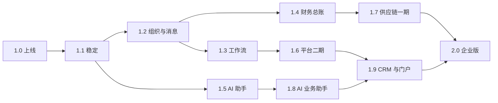

# 后续开发计划（1.0 → 2.0）

> 版本：1.0.0　　日期：2026-11-16
> 起点：1.0.0-rc.1 已完成本机演练，M10 第一批（O-21、O-28 本机接入、CI）已完成。
> 终点：2.0.0 企业版。
> 依据：《开发计划》（当前里程碑的勾选清单）、《功能扩展方案》（参照芋道的功能点，编号 X / Y / Z）、《企业级演进规划》（编号 E / F / S / A）、《优化文档》（编号 O）。
> 关系：本文档管**版本和顺序**；各版本的技术与功能设计见 `docs/详细设计/`（入口 README）；每个版本开工时，把对应任务展开成勾选清单写进《开发计划》。

---

## 1. 规划前提

1. **目标客户**：先按“商贸流通 + 轻制造（简单装配）”规划。如果确定只做商贸，从 2.0.0 中去掉生产一期，可省 25—35 人日；如果是以加工为主的制造企业，生产一期要提前到 1.7.0，并在 2.0 前加上工艺与报工。
2. **人手**：按“平台与工作流”“财务”“业务与 AI”三条线各一名开发者，另有一名兼职的实施 / 财务人员负责需求确认和验收。单人开发的时间见第 5 节。
3. **先上线后扩展**：1.0.0 正式上线并有真实客户使用后，再启动 1.2.0 以后的新模块。1.1.0 期间收集的客户问题可以调整后续版本的顺序。
4. **数据库保持 MySQL 8.0.46**，架构保持模块化单体 + 独立的 `erp-ai` 服务。

## 2. 版本规则

| 类型 | 规则 |
|---|---|
| 1.x 次版本 | 新增功能，**保持向上兼容**：接口只增不改，数据库迁移只增不改，现有权限码、配置项继续有效 |
| 1.x.y 修订版 | 只修 Bug 和安全问题，可随时发布 |
| 2.0.0 | 集中处理 1.x 期间积累的不兼容变更（见第 4 节），提前两个次版本公告 |
| 废弃流程 | 要移除的接口、配置或权限码，先在某个 1.x 版本标记“已废弃”（接口返回 `Deprecation` 响应头，管理端提示），至少保留两个次版本，到 2.0.0 才移除 |
| 维护期 | 2.0.0 发布后，1.x 最后一个版本继续提供 6 个月的安全修复 |

## 3. 版本总览

| 版本 | 主题 | 主要内容 | 粗估人日 | 计划时间（三人并行） |
|---|---|---|---:|---|
| **1.0.0** | 正式上线 | 目标环境、真实期初、试运行、发布 | 10 + 等待 | 2026-12 |
| **1.1.0** | 稳定与优化 | 容量、只读备库报表、8.4 试跑、监控上线、客户反馈修复 | 10—15 | 2027-01 |
| **1.2.0** | 组织与消息 | 部门岗位、部门数据范围、字典、公告、站内信、消息模板、登录日志、定时任务管理、业务员 | 20—25 | 2027-02 |
| **1.3.0** | 工作流 | Flowable 8 一期：钉钉式设计器、会签或签、驳回转办、超时提醒，业务单据接入 | 20—25 | 2027-03 |
| **1.4.0** | 财务总账 | 科目、辅助核算、手工凭证、账簿、结账、三大报表、信用额度 | 35—45 | 2027-04 ~ 05 |
| **1.5.0** | AI 助手 | `erp-ai`、模型网关、知识库与 LLM Wiki、AI 管理后台 | 25—35 | 2027-05 |
| **1.6.0** | 平台二期 | 单点登录与 MFA、自定义字段、编码规则、开放平台、工作流二期 | 30—40 | 2027-07 |
| **1.7.0** | 供应链一期 | 批次序列号保质期、来料检、其它出入库、品牌、库区库位、数电发票 | 30—40 | 2027-08 |
| **1.8.0** | AI 业务助手 | 智能查数、单据解释、AI 录单 | 20—30 | 2027-09 |
| **1.9.0** | 客户与 CRM | CRM 全套、客户门户、AI 客服、坐席辅助 | 40—50 | 2027-10 ~ 11 |
| **2.0.0** | 企业版 | WMS 作业与移动端、生产一期、经营驾驶舱、打印设计器、预警中心、不兼容变更、等保测评 | 70—95 | 2027-12 ~ 2028-02 |
| 合计 | | | 310—410 | 约 15 个月 |

三条线的分工：

| 线 | 负责版本 |
|---|---|
| 平台与工作流 | 1.2.0、1.3.0、1.6.0，2.0.0 的打印设计器、预警中心、不兼容变更 |
| 财务 | 1.4.0，1.7.0 的数电发票，2.0.0 的生产成本 |
| 业务与 AI | 1.5.0、1.7.0、1.8.0、1.9.0，2.0.0 的 WMS、驾驶舱 |

版本按顺序发布，但开发可以重叠：例如 1.4.0 财务与 1.3.0 工作流同时开发，谁先完成谁先合并，版本号按发布顺序取。

---

## 4. 各版本内容

### 1.0.0 正式上线（M9 剩余部分）

| 任务 | 说明 |
|---|---|
| 目标环境 | 服务器、域名证书、MySQL 主备与三类账号、Redis TLS、对象仓、告警渠道 |
| 恢复目标 | 业务方确定 RPO / RTO，按目标演练一次 |
| 容量复测 | 目标入口按真实单量复测，替换 S09 规划基线 |
| 多方式登录 | 如首期开启：真实短信、邮件、微信渠道验收 |
| 期初与试运行 | 按《上线准备清单》导入期初、八类对账零差异、试运行、批准放量 |

**发布门槛**：正式环境对账零差异；回退方案经过评审；打 `v1.0.0` 标签。

### 1.1.0 稳定与优化（M10 剩余部分）

- O-26：目标服务器 1000 RPS 连续三轮达标
- O-27：MySQL 8.4 兼容试跑
- O-28：目标环境的链路、看板、告警正式启用
- O-29 第一步：报表与导出改走只读备库，显示数据截止时间
- X-05 默认结算账户、X-06 工作台金额趋势（小功能，顺手上线）
- 上线后两周的客户问题修复；整理待排需求，必要时调整 1.2.0 以后的顺序

### 1.2.0 组织与消息（M11 前半）

| 编号 | 内容 |
|---|---|
| Y-01、Y-02 | 部门树、岗位、多部门用户；数据范围增加“本部门 / 本部门及下级 / 仅本人 / 自定义”，与仓库范围取交集，现有用户默认“全部”不变 |
| Y-03 | 数据字典（可配置下拉选项；业务状态不进字典） |
| Y-04、Y-05、Y-06 | 通知公告、站内信、短信 / 邮件模板与发送日志 |
| Y-07、Y-08 | 登录日志、在线用户与强制下线、省市区数据 |
| Z-01、Z-02、Z-03、Z-04 | 系统参数、定时任务管理页、API 访问与异常日志、WebSocket 推送 |
| X-01 | 销售员、采购员字段，报表按业务员汇总 |

**验收**：部门经理只能看本部门及下级的单据；导入完成、待办到达时铃铛实时提醒；强制下线后该会话立即失效。

### 1.3.0 工作流（M11 后半）

- 技术验证（先做，2—3 天）：Flowable 8.0.0 与现有业务事务同成同败；不通过则改用“流程结束后经 Outbox 回调业务命令”
- 钉钉式 SIMPLE 设计器；审批人按用户、角色、部门负责人、上级 N 级、发起人自选
- 会签、或签、依次审批；条件分支、并行分支；抄送、驳回、转办、委派、加减签、撤销、终止、超时处理、自动提醒
- 我的申请、待办、已办、抄送；单据详情显示流程进度
- 接入单据：销售订单、采购订单、退款、冲销、库存调整；X-03 最低售价控制（低于最低价进入流程）
- 硬规则（经办复核分离、两人经手、期间关闭）仍由服务端强制，流程只能加环节

**验收**：“金额 > 5 万需部门经理 + 财务会签”的销售订单流程，覆盖同意、驳回到发起人、重提、超时提醒全过程。

### 1.4.0 财务总账（M12）

- 账套、科目（预置会计准则科目）、辅助核算（客户、供应商、部门、项目、存货）
- 凭证字、摘要库、凭证模板；手工凭证录入、审核、记账、冲销；业务凭证在总账中只读可追溯
- 期初余额与试算平衡；总账、明细账、科目余额表、辅助核算余额表
- 期末结转方案；业务关账与财务结账合并为一个流程
- 资产负债表、利润表、现金流量表；财务指标
- 应收应付：账龄、信用额度与超额控制、催收计划
- 凭证导出到常用财务软件格式

**验收**：一个月样例业务加手工凭证，结转后三大报表平衡；利润表毛利与业务报表一致；信用超限的订单按配置拦截或进入审批。

### 1.5.0 AI 助手（M13）

- `erp-ai` 服务（Spring AI 2.0.1）、模型网关（多模型、限额、计费、审计）
- OpenSearch 混合检索；向量与重排模型私有化部署
- 知识库：上传、分段预览、召回测试；LLM Wiki 生成、审核、发布、体检
- AI 管理后台：模型与密钥、助手角色、工具授权、请求日志
- 内部知识助手：回答带引用，首批资料用现有业务规则和用户手册
- 评测集 200 条，跨租户、跨角色检索全部拦截

### 1.6.0 平台二期（M14 前半）

- E-04 单点登录（OIDC / LDAP）、管理员强制 MFA，与多方式登录合并为统一身份模型
- E-05 自定义字段（单据和主数据扩展字段，列表、筛选、导入导出、打印自动识别）
- E-06 编码规则（单号、物料编码可配置）
- E-08 开放平台：应用密钥与签名、限流、调用审计、Webhook（基于 Outbox）、接口文档门户
- 工作流二期：BPMN 设计器、包容 / 路由分支、子流程、触发器、表单字段权限、Z-05 表单设计器与通用审批（费用申请、用印申请等）

**验收**：外部系统通过开放平台创建订单并收到发货 Webhook；SSO 登录后权限与本地账号一致。

### 1.7.0 供应链一期（M14 后半）

- X-04、S-01：保质期、批次、序列号；近效期先出；正反向追溯
- S-03：来料检，不合格品处理，质检结果影响可用量
- X-02：其它入库、其它出库（赠品、样品、借出、内部领用）
- 品牌主数据；库区、库位（库存维度增加库位）
- F-07：数电发票开具与接收

**验收**：一个批次商品从来料检、入库、出库到客户的完整追溯；近效期批次优先推荐。

### 1.8.0 AI 业务助手（M15）

- A-02 智能查数：预定义只读查询工具，沿用当前用户权限，不让模型写 SQL
- A-03 单据解释：“为什么不能发货 / 关账为什么不通过”
- A-04 AI 录单：图片、PDF、邮件 → 草稿，低置信字段高亮，人工确认后提交
- 每个工具 20 条以上问法评测；AI 录单 100 份样本字段准确率

### 1.9.0 客户与 CRM（M16）

- CRM：线索、客户（与往来单位一份主数据）、公海与领取限制、联系人、商机与阶段、合同（走工作流，可生成销售订单）、回款计划与回款（关联收款单）、跟进记录、团队权限、业绩目标、七类统计
- 客户门户：联系人登录，查订单、物流、对账、发票
- A-05 AI 客服（门户 / 公众号 / 企业微信，转人工生成工单）、A-06 坐席辅助、Y-10 敏感词
- 支付（可选）：门户在线付款，回调生成收款单待财务确认
- 对外 AI 客服上线前完成合规评估

**验收**：线索 → 客户 → 商机 → 合同审批 → 订单 → 发货签收 → 收款核销 → 回款计划完成，业绩统计与收款一致；越权与提示注入测试 100% 拦截。

### 2.0.0 企业版

**新功能**

| 内容 | 说明 |
|---|---|
| WMS 作业 | 上架、拣货（按库位路径）、移库、条码标签打印 |
| 移动端 `erp-mobile` | uni-app：PDA 扫码收货、上架、拣货、盘点；移动审批 |
| 生产一期 | BOM（多版本、替代料）、生产工单、领料 / 退料、完工入库、生产成本归集（只做商贸时去掉） |
| 经营驾驶舱 | 销售、毛利、回款、库存周转、应收账龄、采购到货，ECharts 实现 |
| 打印模板设计器 | E-07，现有 17 类固定模板作为默认模板 |
| 预警中心 | E-10：信用超额、负毛利、低于安全库存、应收超期、批次临期，统一走消息中心 |

**不兼容变更**（在 1.6.0、1.8.0 公告，2.0.0 执行）

| 变更 | 原因 | 迁移方式 |
|---|---|---|
| 移除写死在代码中的单级审批配置 | 全部改由工作流配置 | 升级脚本为每类单据生成等价的默认流程 |
| 数据范围模型统一为“组织树 + 仓库 + 自定义维度” | 1.2.0 起新旧两套并存 | 升级脚本把旧的“公司 + 仓库”范围转换为新模型，转换报告供管理员确认 |
| 权限码整理 | 1.x 期间新增模块的权限码命名不完全统一 | 提供旧码到新码的映射，升级时自动改写角色权限 |
| 移除 1.x 中已标记废弃的接口 | 开放平台稳定版只保留一套 | 开放平台调用方按迁移说明切换，1.9.0 起管理端提示仍在调用废弃接口的应用 |
| 业务科目映射固定为正式科目 | 1.4.0 起业务凭证与总账并存 | 升级前必须完成科目映射，未完成时升级检查不通过 |

**发布前的企业级加固**

- 多实例 API + Worker 选主 + MySQL 主备切换 + Redis Sentinel，在目标环境做一次完整故障演练
- 等保 2.0 三级测评准备：审计日志防篡改（哈希链）、备份加密、敏感字段加密、密钥轮换、渗透测试
- 2.0 性能基线：按 1.x 期间真实单量的 3 倍复测
- 《1.x 升级到 2.0 指南》：升级前检查清单、升级脚本、回退方案，在客户数据副本上完整演练两次

---

## 5. 时间估算

| 人手 | 1.0.0 → 2.0.0 |
|---|---|
| 三条线并行 + 兼职实施 | 约 15 个月（2026-12 → 2028-02），即第 3 节的计划时间 |
| 两人 | 约 18—20 个月 |
| 单人 | 约 24—30 个月，建议只做到 1.4.0 后重新评估范围 |

按每月 21 个工作日计，310—410 人日的纯开发量单人约 15—20 个月；上线后维护线上和支持客户通常要占 20%—30% 的时间，版本之间的依赖也会让并行打折扣，上表已计入这些因素。人日为粗估，不含等待业务方和客户验收的时间。每个版本发布后按实际用时重新估算剩余版本，以重估结果为准。

## 6. 每个版本的发布门槛

每个次版本发布前全部满足才能发布：

- [ ] 后端 `mvn verify`、前端 `npm run lint` / `npm test` / `npm run build`、浏览器回归全部通过（CI 绿）
- [ ] 八类对账零差异；涉及库存或账务的新功能有样例数据逐分核对
- [ ] 从上一版本升级的演练通过（迁移脚本 + 数据核对 + 回退）
- [ ] 容量回归：主要接口 P95 不劣于上一版本 20% 以上
- [ ] 新增接口有权限测试和越权测试；涉及 AI 的有评测结果
- [ ] 《业务规则》《数据库设计》《接口设计》《用户使用手册》《更新日志》已更新
- [ ] 第二人完成代码评审（加锁顺序、过账、权限、AI 工具调用相关改动必须评审）

## 7. 分支与发布

- `main` 始终可发布；每个版本建 `release/1.x` 分支做发布前收尾和后续修订版。
- 功能在 `feature/…` 分支开发，合并到 `main` 前 CI 必须通过并有评审。
- 修订版从 `release/1.x` 修复后合回 `main`。
- 每个版本打标签 `v1.x.0`；发布记录写入《更新日志》，交付包附 SHA-256。

## 8. 风险

| 风险 | 影响 | 应对 |
|---|---|---|
| 1.0.0 迟迟无法上线 | 后续版本缺少真实反馈 | 1.2.0 中不依赖客户反馈的部分（部门、字典、站内信）可以先开发，但不发布 |
| 人手达不到三条线 | 2.0.0 推迟一年以上 | 按第 5 节缩减范围：优先保证 1.2.0—1.4.0，AI 和 CRM 顺延 |
| 客户类型和规划假设不符 | 做了用不上的模块 | 1.1.0 结束时复核第 1 节前提，调整 1.7.0 以后的顺序 |
| 工作流技术验证不通过 | 1.3.0 延期 | 准备好 Outbox 回调的替代方案 |
| 2.0.0 不兼容变更影响已上线客户 | 升级失败或权限错乱 | 提前两个版本公告；升级脚本在客户数据副本上演练两次；1.x 维护 6 个月 |

## 9. 修订记录

| 版本 | 日期 | 说明 |
|---|---|---|
| 1.0.0 | 2026-11-16 | 首版：1.0.0 到 2.0.0 的版本规划、版本规则、发布门槛和时间估算 |
