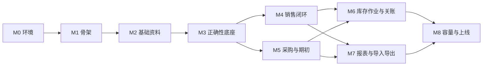

# ERP 开发计划

- 计划版本：1.7.0，对应工程 0.7.0。
- 编写日期：2026-11-15，Asia/Shanghai。
- 执行方式：单人开发。
- 依据：《重构设计方案》第 14 节阶段划分，《业务规则》1.5.0（全部问题已确认），《数据库设计》1.7.0，《接口设计》1.8.0，《待确认清单》1.1.1，《UI 设计规范》1.0.0。
- 用法：每个里程碑的任务都写成勾选框，完成一项勾一项。里程碑结束时按第 5 节收尾，再重新估算剩余工作量。
- 文档维护：maorongkang@gmail.com。

## 1. 现状

### 1.1 设计

| 内容 | 状态 |
|---|---|
| 范围与架构 | 《重构设计方案》1.0.1 |
| 业务规则 | 89 条规则，全部待确认问题已确认 |
| 数据库 | 建表草案已在目标版本 MySQL 8.0.46 上建成 80 张表，通过 54 项约束测试。M1 已在独立库验证 Flyway 和约束，多连接业务并发测试见 M3 |
| 接口 | P0 全部模块的接口清单、核心接口示例和错误码 |
| 代码 | 0.7.0 的 M7 功能已验收，后端 362 项、前端 101 项、浏览器 9 条流程通过；历史结果详见《测试报告》 |

### 1.2 本机环境（2026-11-15 复核）

| 项目 | 现状 | 需要做的 |
|---|---|---|
| JDK | `E:\JDK21` 已安装 JDK 21.0.3，当前终端默认使用 17.0.8 | 项目终端按《环境检查》选用 JDK 21 |
| Maven | 3.8.4，使用 JDK 21.0.3 运行 `mvn -v` 正常 | JDK 21 构建与测试已通过 |
| Node.js、npm | 24.9.0、11.6.0 | 可用 |
| pnpm | Git Bash 中找不到 | 首期统一使用 npm，不再引入 pnpm |
| Git | 2.47.1 | 已建立本地 Git 仓库 |
| MySQL | `127.0.0.1:3306` 服务端版本已核实为 8.0.46 | 使用现有实例，开发库与测试库分开 |
| Redis | 专用进程监听 127.0.0.1:6380 | 已验证项目凭据与 Redis 会话 |
| 项目路径 | `F:\桌面\ERP`，含中文 | 英文入口 F:/projects/erp 指向同一目录 |

## 2. 计划原则

1. **先底座，后功能。** 幂等、库存、核销、过账这些决定账对不对的部分，先单独做并测透（M3），业务单据再在上面搭（方案第 14 节阶段 C）。
2. **尽早打通一条完整业务。** M4 完成“销售下单 → 发货 → 签收 → 收款 → 退货退款”的全过程，用业务规则里的样例数字逐分核对（方案阶段 D）。
3. **每个里程碑都能运行、能演示、测试全绿。** 不在最后集中联调。
4. **不提前建空模块。** 包和表随里程碑需要建立；表结构一次建全（Flyway V1），代码按需增加。
5. **完成的标准**（全局规范第 8 节）：测试通过 → 构建成功 → lint 无错误 → 文档已更新。缺一项就不算完成。

## 3. 里程碑总览

| 里程碑 | 内容 | 对应方案阶段 | 粗估人日 | 完成后版本 |
|---|---|---|---:|---|
| M0 | 环境与仓库准备 | B 之前 | 1—2 | — |
| M1 | 工程骨架：登录、权限上下文、第一个完整增删改查 | B | 8—12 | 0.1.0 |
| M2 | 组织、权限与基础资料 | B | 8—12 | 0.2.0 |
| M3 | 正确性底座：幂等、库存、核销、账本、Outbox、对账 | C | 12—18 | 0.3.0 |
| M4 | 销售闭环：订单到签收、收款、退货退款 | D | 18—25 | 0.4.0 |
| M5 | 采购闭环、付款与期初 | E | 10—15 | 0.5.0 |
| M6 | 调拨、盘点、库存调整、冲销与关账 | E | 10—14 | 0.6.0 |
| M7 | 报表、导入导出、打印、附件、审计 | E | 10—15 | 0.7.0 |
| M8 | 容量、恢复演练与上线 | F | 8—12 | 1.0.0 |
| 合计 | | | 85—125 | |

**关于工作量**：按每月 21 个工作日计，约 4—6 个月。这是粗估，前提是单人全职、熟悉 Spring Boot 和 Vue，不含等待业务方、需求变更和学习新框架的时间。方案第 14 节不设无依据的工期，所以这里只作排期参考：**M1 和 M3 完成后，按实际用时重新估算剩余里程碑**，以重新估算的结果为准。

版本号在上线前使用 0.x.0，正式上线为 1.0.0（全局规范第 18 节）。

单人开发按 M0 到 M8 依次进行。M5 只依赖 M3，如果 M4 中途卡住等待某个问题，可以先做 M5。

## 4. 里程碑明细

### M0 环境与仓库准备

**目标**：开发、测试需要的工具齐全，项目进入版本管理。

- [x] 已验证本机 `E:\JDK21` 下的 `java`、`javac` 和选用该目录后的 Maven 均报告 Java 21.0.3
- [x] 已核实本机 MySQL 服务端版本为 8.0.46，端口为 3306
- [x] 在现有 MySQL 实例中准备独立的 ERP 开发库和测试库，用项目账号验证连接和权限
- [x] 使用项目凭据验证本机 Redis 连接
- [x] 通过 Windows 目录联接提供英文入口 `F:\projects\erp`，两个路径共享同一份源码。前端工具按实际路径运行
- [x] `git init`；`.gitignore` 包含 `.env`、`target/`、`node_modules/`、`dist/`、IDE 文件；第一次提交只包含 `docs/`
- [x] 新建 `.env.example`，列出《环境检查》中的环境变量，不写真实密码
- [x] 《环境检查》已记录项目使用的 JDK、MySQL、Redis 状态和包管理器 npm

**验收条件**为项目终端的 Java 和 Maven 均使用 JDK 21，项目账号能连接 MySQL 8.0.46 和 Redis，`git log` 能查到第一次提交。

### M1 工程骨架

**目标**：前后端工程建好，登录、公司切换和一个完整的增删改查能端到端跑通，测试基座可用。

后端 `erp-server`：

- [x] 第一天先建最小工程，验证依赖能共同工作：Spring Boot 4.1.x、Java 21、MyBatis Spring Boot Starter 4.0.x、Flyway（含 `flyway-mysql`）、Spring Security、Spring Session Data Redis、Spring Modulith、Bean Validation、Actuator。不兼容时退到 Boot 4.0.x 的最新补丁版本，记录到《环境检查》
- [x] 包结构按方案 5.1，本里程碑只建 `identity`、`masterdata`（仓库）、`shared`
- [x] Flyway：把 `docs/sql/schema-draft.sql` 拆成 `V1__init_schema.sql`、`V2__seed_ledger_account.sql`、`V3__seed_permission.sql`（权限码，接口设计第 8 节）
- [x] `shared`：时间有序的 64 位 ID 生成器；Money、Quantity 值对象；统一响应体；全局异常处理；数据库约束名到错误码的映射表（接口设计 3.3）
- [x] 认证：会话存 Redis、CSRF Cookie、登录、注销、`/auth/me`、修改密码、连续失败锁定（接口设计 2.2）
- [x] 公司上下文：读取 `X-Company-Id` 并校验数据范围。无权选择的公司返回 403，当前公司范围以外的仓库返回 404（接口设计 2.3）
- [x] 请求 ID、访问日志、健康检查；生产配置不返回异常堆栈
- [x] 仓库查询、新建、修改、启停，带版本号、审计日志，作为后续模块的样板

前端 `erp-web`：

- [x] Vue 3 + TypeScript（strict）+ Vite + Element Plus + Pinia + Vue Router + Axios；Tailwind 关闭 Preflight（方案 5.2）
- [x] 按《UI 设计规范》第 3、4 节配置 Element Plus 主题、字体和全局尺寸；`src/utils/format.ts` 实现第 6 节的数字显示规则
- [x] `src/api/http.ts`：基础地址、超时、`X-Company-Id`、CSRF、错误转换、幂等键（接口设计第 7 节）；幂等键用 `crypto.randomUUID()`，不引入 `uuid` 包
- [x] `src/types/api.ts` 公共类型
- [x] 登录页、主布局（菜单按权限显示）、公司切换器、401/403/404 页面，对照设计稿中的“登录”“导航组件”画板
- [x] 仓库列表和表单页，作为后续页面的样板
- [x] ESLint、Prettier、Vitest

测试与工程：

- [x] 集成测试使用 MySQL 8.0.46 的独立测试库，每个测试独立准备数据
- [x] 依据《数据库设计》第 5.1 节实现 54 项 JUnit 约束测试，其中 47 项对应历史编号，7 项按规则补建
- [x] Spring Modulith 模块结构测试
- [x] 后端 `mvn verify`、前端 `npm run lint`、`npm test`、`npm run build` 都能一条命令跑完
- [x] 新建《部署说明》，先写本地启动步骤

**验收**：

- Flyway 在 MySQL 8.0.46 的空测试库上迁移成功，迁移后的 54 项约束测试通过
- 登录 → 切换公司 → 仓库增删改查可用；访问其他公司的仓库返回 404
- 版本冲突返回 409，字段校验失败返回 400，响应格式符合接口设计 2.4
- 模块结构测试通过

M1 验收记录见[测试报告](测试报告.md)，运行方式见[部署说明](部署说明.md)。本次搭建使用并行开发和既有数据库草案，尚无单人业务模块交付样本。M2—M8 的初步区间合计为 76—111 人日，M3 后按实际工作量复核。

### M2 组织、权限与基础资料

**目标**：基础资料齐全，权限和数据范围在接口层生效。

- [x] 公司、公司参数（修改记审计）
- [x] 用户、角色、权限、数据范围；管理员重置密码后强制修改
- [x] 往来单位、客户和供应商角色、联系人；联系人电话、银行账号的字段级权限（接口设计 2.9）
- [x] 计量单位、商品分类、商品、SKU、单位换算、条码；已被单据引用的换算率不能修改
- [x] 结算账户（同时建立余额行）、收支项目
- [x] 会计期间：开启期间
- [x] 单号服务：独立短事务取号（数据库设计 9.1）
- [x] 审计日志写入；停用资料不能用于新单据
- [x] 前端对应的管理页面

**测试**：多公司、多类型并发取号不重复（B19）；跨公司、跨租户访问被拒绝（T15）；无权限时敏感字段不返回。

**验收**：本阶段操作权限、字段权限与数据范围可配置并生效。已建立后续单据使用的停用资料校验入口，审批与过账操作随业务里程碑接入。测试结果见《测试报告》。

M2 本机执行时间为 2026-11-15 10:28—10:58（Asia/Shanghai），采用并行开发和自动化验证。后续 M3—M8 沿用原粗估合计 68—99 人日，M3 完成后结合真实业务闭环的验证成本再评估。

### M3 正确性底座

**目标**：库存、往来、账本的核心服务单独完成并测透，后面的单据只需调用它们。这一里程碑主要是后端代码和测试。

- [x] 幂等：`Idempotency-Key` 处理、幂等记录、`GET /command-results`（接口设计 2.7）
- [x] 价格计算：行金额、行优惠、整单优惠最大余数法分摊、按行计税、分批累计法（R3 全组）
- [x] 库存服务：预留、释放、消费、到期释放；出入库条件更新加流水；移动加权成本，包括尾差和采购退货差额（R6 全组）；固定加锁顺序（数据库设计 6.4）
- [x] 往来服务：未清项、核销、撤销核销、退款额度占用和释放（数据库设计第 7 节）
- [x] 账本服务：过账、借贷平衡、同一来源只过账一次、期间共享锁（数据库设计 8.2、8.4）
- [x] Outbox 和后台任务：租约领取、重试退避、失败入死信、Inbox 去重（数据库设计 9.3）
- [x] 对账任务：数据库设计第 10 节的 8 类检查

**测试**：

- [x] 业务规则第 5、8 节的样例数字逐条写成单元测试：分摊 33.34 / 33.33 / 33.33、税额合计 129.99、分批 137.50 / 137.50 / 91.67、移动加权结存归零、采购退货尾差 +10.00
- [x] 并发测试：T01 抢最后一件库存、T02 两张发货单抢同一行、T07 核销并发、T19 预留到期与出库同时发生
- [x] 故障测试：T04 扣库存后抛错全部回滚、T06 后台任务中断后补投不重复、T13 Redis 不可用时核心约束仍然成立
- [x] 幂等和输入边界：T18 同一幂等键换参数或换用户被拒绝、不泄露原结果；T20 负数、超精度、超大金额、单位换算舍入被明确拒绝或正确处理

**验收**：上述测试全绿；并发测试连续运行 20 次结果稳定；构造的数据经对账零差异。

M3 本机实施时间为 2026-11-15 11:00—11:20（Asia/Shanghai），采用并行开发与真实 MySQL 测试。剩余 M4—M8 粗估合计 56—81 人日。M4 完成第一条销售全流程后，按联调及实际验收工作量重新估算。

### M4 销售闭环

**目标**：第一条完整业务跑通，样例数字与文档逐分一致。

**当前进度**：M4 已完成。后端199项、前端40项、浏览器3项全部通过，构建及lint通过，销售样例对账零差异。保留 JDK 21 和本机 MySQL 8.0.46。

后端：

- [x] 价格试算接口
- [x] 销售订单：新建、修改、提交（库存提示）、审批预留、驳回、撤回、撤销审批、关闭剩余、取消、变更单、重新预留；到期释放后台任务
- [x] 发货单：提交、作废、过账出库、签收、签收差异处理、客户自提；待签收超期查询
- [x] 收款：登记、提交、确认；签收时自动核销关联预收；手工核销和撤销
- [x] 销售退货；退款申请（提交占用、审核、登记已退款、取消）
- [x] 开票登记

前端：

- [x] 订单录入：实时试算、库存提示、待审核需求
- [x] 订单详情：进度、预留状态，按 `allowedActions` 显示按钮
- [x] 发货、签收、差异处理页面
- [x] 收款、核销工作台、退货、退款页面
- [x] 命令超时时显示“结果确认中”，按幂等键查询结果

**测试**：业务规则第 4—7 节的样例端到端执行；T03、T05、T08（同一退款重复登记）、T09、T10、T14；业务规则第 13 节中与销售相关的 B 类用例（B01—B11、B16—B18、B24—B31）；B20 非法状态迁移返回 409，从本里程碑起每类新单据都要覆盖。

**验收**：SO-3（含拒收后补发）、SO-4、退货退款三个样例在系统中完整走通，金额与文档一致，对账零差异。

- [x] 本轮后端、前端、浏览器测试全部完成，记录实际数量及结果
- [x] 销售样例对账、幂等、权限和并发回归完成后确认 M4 验收

M4 于2026-11-15完成，本机并行实现与验收约50分钟。订单变更、历史引用、幂等回放和浏览器联调的修正均补入回归。M5—M8 原粗估合计38—56人日保留为常规人力排期参考，采购闭环联调后再校准。

### M5 采购闭环、付款与期初

**当前进度**：M5 已完成。后端 241 项、前端 48 项、浏览器 4 项全部通过，lint 与构建成功，采购及期初样例八类对账零差异，详见《测试报告》。

- [x] 请购单：审批，采购草稿关联来源时原子占用请购可转数量，修改、删除和取消释放差量，不能超量（Q18）
- [x] 采购订单：草稿、审批、关闭、取消与变更；审批时冻结公司容差和行可收上限（R4-03）
- [x] 收货过账：提交占用、作废释放，过账入库、确认应付、更新移动加权成本
- [x] 采购退货：占用原收货可退量，按原金额与成本快照冲减，处理尾差（R6-08）
- [x] 供应商付款及其他支出、供应商退款收款、账户间转账、应付核销及关联预付自动核销
- [x] 期初：库存期初调整单、客户及供应商往来期初、资金期初，审核与过账
- [x] 请购、采购、收货、退货、付款、转账、期初及应付核销前端页面

**测试**：容差内外的超收；业务规则第 8 节两个成本样例和采购退货尾差（B12）；补录历史日期不改变已过账出库成本（B13）；R4-10 余额不足（B21）；应收应付不互相核销（B22）。

**验收**：采购到付款闭环走通；录入期初后对账零差异。

- [x] 完成含期初在内的后端全量回归、前端 lint/测试/构建及真实浏览器闭环，记录最终数量
- [x] 容差、税身份成本快照、单位换算、付款余额、应收应付隔离及幂等权限回归通过
- [x] 采购、资金、库存、往来和账本对账零差异后确认 M5 验收

M5 于 2026-11-15 完成，本机并行实现与验收约 40 分钟。收货来源变化、待收价税冻结、微小数量和页面异步定位问题均已补回归。剩余 M6—M8 继续保留 28—41 人日作为常规人力排期，重点风险为冲销依赖、关账并发和恢复演练；机器执行耗时不直接折算成人日，M6 验收后再复核。

### M6 调拨、盘点、库存调整、冲销与关账

**当前进度**：M6 已完成。后端 302 项、前端 70 项、浏览器 5 项通过，lint、类型检查及构建成功，样例八类对账零差异；统计与真实双 JVM 重启记录见《测试报告》。

- [x] 调拨：调出、在途、分批调入、最后一批少收转差异，退回或确认损失；每笔数量与成本事实持久化
- [x] 盘点：本期采用 `watermark` 水位方式，录入快照时点的实盘数，另一人审批，按差额过账，不覆盖期间收发货
- [x] 库存调整：期初、其他出入库、冻结、解冻、报废六种类型，共用审核与过账入口，建单后类型固定
- [x] 冲销单：依赖检查、审核、过账，覆盖接口设计 6.7 的八类单据；保留原事实，冲销发货单不恢复预留（R7-12），冲销自动核销不可单独撤销
- [x] 期间：五项关账预检查、同步去重投影、期间排他锁内再次复核、按顺序关账及重开最近一期，仅整家公司范围可操作

**测试**：T11 盘点期间仍有出入库；T12 调拨在途时服务重启；T16 关账与过账并发；B14 冲销依赖；B15 五项关账检查各一个失败场景；B23 冲销后不恢复预留。

**验收**：关账检查五项都有失败用例；关账与过账并发时期间规则不被绕过。

- [x] 完成 M6 后端全量回归、前端 lint/测试/构建、真实浏览器闭环并记录最终数量
- [x] T11、T12、T16、B14、B15、B23 及提交/审核期间屏障、当前权限和幂等回放回归通过
- [x] 调拨在途、盘点差额、八类冲销及关账样例八类对账零差异后确认 M6 验收

M6 于 2026-11-15 完成，本机并行实现与验收约 50 分钟。真实双 JVM 重启、关账提交屏障、阻挡单据明细和冲销抵销应收禁开票已补回归。剩余 M7、M8 继续保留 18—27 人日作为常规人力排期，机器执行耗时不直接折算人日；后续重点为报表口径、导入导出范围、容量及恢复演练。

### M7 报表、导入导出、打印、附件、审计

- [x] 十类报表及明细单据跳转，按公司、仓库和成本权限过滤
- [x] 异步 CSV 导出：最多 50000 行、每人同时 3 个任务、24 小时有效，执行及下载重新校验原操作人授权
- [x] SKU、往来单位和库存期初 CSV 导入：最多 10000 行，逐行错误、部分成功、指纹防重及断点续跑；依赖故障有限退避重试、恢复后人工幂等续跑；期初只生成草稿
- [x] 17 类单据打印数据接口和固定 A4 打印预览
- [x] 私有附件上传下载：内容类型校验、单文件 20MB、每单 20 个、五分钟下载票据、本机私有目录及可配置 S3
- [x] 审计筛选与快照字段过滤；按公司完整范围查看和重放失败事件

M7 于 2026-11-15 完成验收。新增 V28—V31；后端 362 项、前端 101 项、浏览器 9 条流程通过，lint、类型检查及构建成功。报表、文件限制和当前授权均经回归，详情见《测试报告》。后续按 M8 完成容量、备份恢复和生产部署。

**验收**：报表数字与样例、对账结果一致；导出不越权；附件限制生效。

### M8 容量、恢复演练与上线

**规划基线**（《待确认清单》S09，属于假设，取得实际数据后替换）：每家公司每天销售单不超过 1000 张、采购单不超过 200 张，平均 10 行、最多 200 行，最忙 1 小时占全天的 30%；SKU 不超过 2 万个。

- [ ] 按方案 11.3 的七个场景用 k6 压测，以规划基线确定验收线
- [ ] 每轮压测后运行全部对账：资金、库存差额，超量履约，重复过账，都必须为 0
- [ ] 故障演练：T13 依赖不可用、T17 备份恢复到指定时间点、后台任务中断
- [ ] 用压测数据复核慢查询和索引（数据库设计第 11 节）
- [ ] 生产部署：Nginx、应用、后台任务、MySQL 8.0.46 主备、Redis；HTTPS；关闭调试；数据库账号权限分离（数据库设计第 15 节）
- [ ] 文档：《部署说明》《用户使用手册》《测试报告》《项目总结》
- [ ] 上线：导入期初数据，试运行，确认无误后发布 1.0.0

**验收**：压测后对账零差异；恢复演练达到确定的恢复点和恢复时间目标；文档齐全。

## 5. 每个里程碑的收尾

- [ ] 后端 `mvn verify`，前端 `npm run lint`、`npm test`、`npm run build`，全部通过
- [ ] 接口、表结构、规则有变化的，同步更新对应文档
- [ ] 更新《更新日志》，打标签 `v0.x.0`
- [ ] 记录实际用时，与粗估对比，重新估算剩余里程碑
- [ ] 本里程碑新发现的需求放入第 7 节“二期候选”，不在当前里程碑扩大范围

## 6. 日常约定

- **分支**：`main` 始终可以运行；每个里程碑一个分支，例如 `feature/m1-skeleton`，完成后合并。
- **提交信息**：按全局规范，`feat: 新增销售订单审批`、`fix: 修复签收日期校验`。
- **数据库迁移**：已经合并到 `main` 的迁移文件不再修改，只追加新文件。
- **规则变更顺序**：先改《业务规则》，再改测试，最后改代码。
- **测试命名**：引用规则编号，例如 `R3_06_整单优惠按最大余数法分摊`，规则变化时能按编号找到受影响的测试。

## 7. 二期候选（首期不做）

依据方案中的 P1、P2 范围和《待确认清单》的结论：

- 批次、保质期、序列号、库位（S03）
- 先进先出成本（S04）
- 税控开票（S05）、凭证导出到财务软件（S06）、银行和支付平台对接（S07）
- 客户信用额度（S08）
- 无原单退货（Q11）、已发货改价的价格调整单（Q13）、自动签收（Q21）
- 价格表、客户协议价、多级审批、自定义打印模板
- 生产、零售收银

## 8. 风险与应对

| 风险 | 影响 | 应对 |
|---|---|---|
| Spring Boot 4.1 与 MyBatis、Spring Modulith 等依赖版本不兼容 | M1 卡住 | M1 第一天先用最小工程验证，不兼容时退到 Boot 4.0.x 的最新补丁版本 |
| 中文路径引起工具异常 | 构建或脚本莫名失败 | 后端可用英文联接入口，前端工具优先从实际目录运行 |
| 并发问题难以复现 | 上线后才暴露超卖或重复记账 | M3 集中写并发测试并重复运行；严格按固定顺序加锁 |
| 单人开发，范围不断扩大 | 延期 | 只做 P0；新需求进入第 7 节 |
| 实际业务与已确认的默认取值不符，例如其实需要批次管理 | 结构性返工 | 结构类问题越早暴露越好：M4 完成后用真实商品和单据试跑一轮，再决定是否调整 |
| 规划基线与实际业务量相差很大 | 服务器配置、压测标准失准 | M8 前用实际数据替换 S09 基线 |
