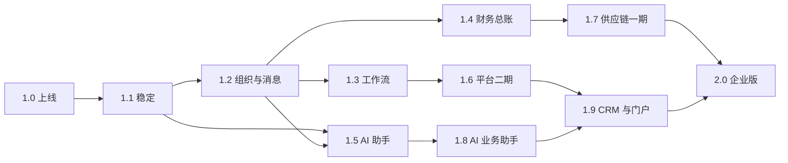

# ERP 开发计划

- 计划版本：3.0.4，对应 1.0.0 候选构建及 M10 本机优化、M11 前半本机验收；规划到 2.0.0 企业版。
- 编写日期：2026-11-16，Asia/Shanghai。
- 执行方式：目前单人开发；1.2.0 起工作量明显增大，建议按第 8 节扩充人手。
- 依据：`docs/详细设计/`（各版本的表结构、接口、页面设计）、《企业级演进规划》、《功能扩展方案》（参照芋道的功能点）、《优化文档》、《上线准备清单》、《业务规则》《数据库设计》《接口设计》现行版本。
- 用法：任务写成勾选框，完成一项勾一项。版本结束时按第 6 节的发布门槛收尾，再重新估算剩余版本。
- 文档维护：maorongkang@gmail.com。

> M0—M8 的本机部分已全部完成，各版本交付内容见《更新日志》0.1.0—0.9.0，测试结果见《测试报告》。原《后续开发计划》已并入本文档。

## 1. 现状

| 方面 | 现状 |
|---|---|
| 功能 | 销售、采购、库存作业、资金往来、冲销、关账、十类报表、导入导出、打印、附件、审计、工作台、多方式登录 |
| 质量 | 0.9.0 基线通过 410 项后端测试、155 项前端测试和 11 条浏览器流程；M9 验证见《测试报告》；八类对账零差异；本机容量、恢复演练和部署包已完成 |
| 代码状态 | M9 本机修改已分模块提交，1.0.0-rc.1 完成本机演练；项目已命名为柒衡 ERP，GitHub 基线为 `a79a104`；M10 第一批在 `codex/m10-observability` 推进 |
| 未完成 | 正式服务器、证书、主备切换、外部对象仓、真实期初与试运行、1.0.0 发布；技术优化见《优化文档》 |
| 环境 | JDK 21、Maven 3.8、Node.js 24 / npm 11、MySQL 8.0.46、Redis 6380，详见《环境检查》 |

## 2. 规划前提与原则

### 2.1 前提

1. **目标客户**：先按“商贸流通 + 轻制造（简单装配）”规划。确定只做商贸时，从 2.0.0 中去掉生产一期，可省 25—35 人日；以加工为主的制造企业，生产一期提前到 1.7.0，并在 2.0 前加上工艺与报工。
2. **人手**：按“平台与工作流”“财务”“业务与 AI”三条线各一名开发者，另有一名兼职的实施 / 财务人员负责需求确认和验收。其他人手下的时间见第 7 节。
3. **数据库保持 MySQL 8.0.46**，架构保持模块化单体 + 独立的 `erp-ai` 服务（见《详细设计》00）。

### 2.2 原则

1. **先把 1.0.0 发出去。** 正式环境和真实业务试运行按 M9 门槛验收；等待期间可以按第 9 节提前实现 1.2.0 的部门岗位、字典、站内信等基础功能，但不据此发布正式版本。工作流、总账、CRM 等大模块仍按版本前提推进，新需求先记入第 10 节。
2. **平台能力先于业务铺开。** 组织、消息、审批流先做，后面每个业务模块都会用到。
3. **财务优先。** 企业客户选 ERP，财务是否完整往往是决定因素，所以财务排在供应链深化和生产之前。
4. **沿用现有正确性做法。** 新模块继续使用命令 + 状态机 + 事实表 + 冲销、固定加锁顺序、同事务幂等、期间屏障，不为“企业级”换框架。
5. **AI 只出建议和草稿。** 任何过账、付款仍由人操作，两人复核规则不变。
6. **完成标准**：测试通过 → 构建成功 → lint 无错误 → 文档已更新，缺一项不算完成。

## 3. 版本规则

| 类型 | 规则 |
|---|---|
| 1.x 次版本 | 新增功能，**保持向上兼容**：接口只增不改，数据库迁移只增不改，现有权限码、配置项继续有效 |
| 1.x.y 修订版 | 只修 Bug 和安全问题，可随时发布 |
| 2.0.0 | 集中处理 1.x 期间积累的不兼容变更（见 4.11），提前两个次版本公告 |
| 废弃流程 | 要移除的接口、配置或权限码，先在某个 1.x 版本标记“已废弃”（接口返回 `Deprecation` 响应头，管理端提示），至少保留两个次版本，到 2.0.0 才移除 |
| 维护期 | 2.0.0 发布后，1.x 最后一个版本继续提供 6 个月的安全修复 |

## 4. 版本计划

### 4.0 总览

| 版本 | 里程碑 | 主题 | 详细设计 | 粗估人日 | 计划时间（三人并行） |
|---|---|---|---|---:|---|
| **1.0.0** | M9 | 正式上线 | 《上线准备清单》 | 10 + 等待 | 2026-12 |
| **1.1.0** | M10 | 稳定与优化 | 《优化文档》、01 第 2 节 | 10—15 | 2027-01 |
| **1.2.0** | M11 | 组织与消息 | 01 | 20—25 | 2027-02 |
| **1.3.0** | M11 | 工作流 | 02 | 20—25 | 2027-03 |
| **1.4.0** | M12 | 财务总账 | 03 | 35—45 | 2027-04 ~ 05 |
| **1.5.0** | M13 | AI 助手 | 04 | 25—35 | 2027-05 |
| **1.6.0** | M14 | 平台二期 | 05、02 二期 | 30—40 | 2027-07 |
| **1.7.0** | M14 | 供应链一期 | 06 | 30—40 | 2027-08 |
| **1.8.0** | M15 | AI 业务助手 | 04 | 20—30 | 2027-09 |
| **1.9.0** | M16 | 客户与 CRM | 07、04 | 40—50 | 2027-10 ~ 11 |
| **2.0.0** | M17—M19 | 企业版 | 08、09、10 | 70—95 | 2027-12 ~ 2028-02 |
| 合计 | | | | 310—410 | 约 15 个月 |

“详细设计”列的编号指 `docs/详细设计/` 下的文件。

三条线的分工：

| 线 | 负责版本 |
|---|---|
| 平台与工作流 | 1.2.0、1.3.0、1.6.0，2.0.0 的打印设计器、预警中心、不兼容变更 |
| 财务 | 1.4.0，1.7.0 的数电发票，2.0.0 的生产成本 |
| 业务与 AI | 1.5.0、1.7.0、1.8.0、1.9.0，2.0.0 的 WMS、驾驶舱 |

版本按顺序发布，开发可以重叠。1.5.0 的模型网关和服务骨架可在 1.1.0 后开展，完整知识库权限及 Wiki 验收依赖 1.2.0 的组织模型；总账信用超限审批依赖 1.3.0 工作流。人手不足时按版本号顺序串行。

### 4.1 1.0.0 正式上线（M9）

**目标**：在目标服务器上用真实期初数据试运行通过，发布 1.0.0。具体操作以《上线准备清单》为准，这里只列任务。

代码与版本

- [x] 按购销库存与财务、前端布局、登录权限、时区、部署工具和文档提交现有改动
- [x] 修复 O-25：接口时间统一带时区，导入任务列表按北京时间显示
- [x] 修复 O-22：登录渠道配置改用独立权限 `tenant:login_settings`
- [x] 处理 O-24 的换行规则，在临时 Git 索引执行归一化并核对真实索引未变化
- [x] 按 O-24 单独提交换行规则（`d79e1e8`）
- [x] 处理 O-23 的版本记录，把未发布条目置顶并核对 0.9.0 版本号
- [x] 构建并复验 1.0.0-rc.1 本机候选包。完成空库部署、模块试运行、停写恢复以及 V31 到 V33 升级。[本机上线演练报告](1.0.0候选版本本机上线演练报告.md)
- [ ] 正式发布时更新《更新日志》并打 `v1.0.0` 标签

目标环境

- [ ] 确定服务器规格、部署方式、正式域名和证书
- [ ] MySQL 8.0.46 主备、运行 / 迁移 / 备份三类账号、只读备库；切换演练一次
- [ ] Redis（TLS）、共享私有对象仓、告警渠道
- [ ] 业务方确定 RPO / RTO 目标，按目标做一次恢复演练并记录实际用时
- [ ] 在目标入口按真实业务量复测容量；用实际单量替换《待确认清单》S09 的规划基线

多方式登录（如果首期开启）

- [ ] 配置服务端加密密钥、SMTP 白名单、微信回调域
- [ ] 用试运行账号逐个验收短信、邮件投递和微信扫码绑定、登录（上轮只用了测试夹具）

数据与试运行

- [ ] 首个企业与管理员受控初始化，管理员首次登录改密
- [ ] 按《上线准备清单》第二节整理并核对库存、往来、资金期初和未完成订单
- [ ] 停写、备份、迁移，财务与仓库负责人签字确认期初，八类对账零差异
- [ ] 按试运行清单跑采购、销售、核销、库存作业、报表、导入导出、附件和审计
- [ ] 业务、财务、运维共同批准后放量，记录发布时刻和产物摘要

**验收**：正式环境八类对账零差异；试运行清单全部通过；回退方案经过评审；1.0.0 已打标签。

### 4.2 1.1.0 稳定与优化（M10）

**目标**：上线后第一个迭代，先把运行可见性和性能余量补上，同时收集真实用户反馈。

- [x] O-28 本机基础接入，增加独立指标端口、队列快照、Agent 配置、Grafana 看板及 Prometheus、Tempo、Loki、Alloy、Alertmanager 部署模板
- [x] O-28 本机链路与通知闭环，实际查询贯通 HTTP、Redis、SQL 和日志，Outbox 积压按原两分钟规则触发并恢复告警
- [ ] O-28 目标环境部署与正式告警渠道验收
- [x] O-26 本机优化：根据 JFR 缩减 JDBC 重复 SQL 解析开销，完成 1000 RPS 连续三轮复测，见《M10本机验收报告》
- [ ] O-26 目标服务器验收：按正式入口完成 1000 RPS 连续三轮复测
- [x] O-21：登录密钥用 HKDF 派生两把子密钥，兼容旧密文，读取后条件迁移并保护并发配置更新
- [ ] O-27：在 Linux 测试机上跑一次 MySQL 8.4 兼容试跑
- [x] O-29 第一步本机实现与演练：报表、导出和工作台金额支持只读备库，页面显示复制截止时间，真实 MySQL 8.0.46 主备完成暂停与追平验证
- [ ] O-29 目标环境配置与验收：部署只读账号、TLS 与复制监控，核对 API 和 Worker 均走备库
- [x] 建立 CI：每次提交自动跑后端、前端测试、构建和浏览器回归，工作流为 `verify.yaml`，合并前核对检查结果
- [x] X-05 默认收款 / 付款账户（01 第 2.1 节），含并发唯一、版本、审计和新单带入
- [x] X-06 工作台销售、采购金额与 12 个月趋势（01 第 2.2 节），含五分钟缓存、仓库范围、退货冲销与跨日校验
- [ ] 收集上线后两周的用户问题，整理进第 10 节待排需求，评估是否调整 1.2.0 起的顺序

**验收**：线上主要接口有链路和告警；容量复测达标；《优化文档》中 P0、P1 项清零。

### 4.3 1.2.0 组织与消息（M11 前半，详细设计 01）

- [x] Y-01 部门树、岗位、用户多部门与主部门：本机完成，未发布。部门与任职按公司隔离、岗位定义按企业共享；独立组织版本、撤权清理及权限/并发回归见《M11部门岗位本机验收报告》
- [x] Y-02 部门数据范围（全部 / 本部门 / 本部门及下级 / 仅本人 / 自定义）：本机完成，未发布。多角色并集后与公司、仓库及操作权限取交集；V37为17类单据冻结归属并回填历史，未配置角色默认全部；列表计数、候选、详情、命令、报表、文件及后台任务统一校验，补齐越权和完整回归，见《M11部门数据范围本机验收报告》
- [x] X-01 销售员、采购员，报表按业务员汇总：八类单据默认及继承、草稿调整、汇总筛选及CSV；不扩大Y-02数据范围
- [x] Y-03 数据字典（业务状态不进字典）：公共预置只读、企业扩展及覆盖、历史标签和引用保护
- [x] Y-04 通知公告；Y-05 站内信；Y-06 短信 / 邮件模板与发送日志、消息订阅：按当前来源权限过滤，重要公告确认，受控渠道、加密和重试
- [x] Z-04 WebSocket 推送（多实例经 Redis 广播）：两个真实API实例验证广播和会话关闭，前端心跳、重连及REST补读
- [x] Y-07 登录日志、在线用户与强制下线；Y-08 省市区：摘要标识、撤销防回写、MCA-2024官方3213条区划
- [x] Z-01 系统参数；Z-02 定时任务管理页；Z-03 API 访问与异常日志：类型与敏感值保护、9项固定任务及双实例租约、脱敏日志和请求号关联
- [x] 工作台待办改为读取消息中心；企业微信 / 钉钉机器人至少接一种：已接企业微信，仅发通用提醒，真实渠道上线前另验

以上均为本机完成、未正式发布。后端权限与完整回归、前端组件及浏览器、V37至V43增量升级和Nginx入口见[M11组织消息与运维本机验收报告](M11组织消息与运维本机验收报告.md)。实际短信/邮件账号和企业微信群、正式服务器及真实业务试运行仍须满足发布门槛。

**验收**：部门经理只能看本部门及下级的单据，越权访问详情返回 404；导入完成、待办到达时铃铛 2 秒内更新；强制下线后该会话立即失效；定时任务在两个 Worker 实例下手动触发只执行一次。

### 4.4 1.3.0 工作流（M11 后半，详细设计 02）

- [x] 技术验证（原估算2—3天）：四项真实同库事务门槛通过，采用Flowable 8.0.0同步业务回调；保留Outbox回调备用设计，未声称完成多日稳定性验证
- [x] 流程模型、版本发布、单据类型绑定
- [x] SIMPLE 设计器；审批人按用户、角色、部门负责人、连续多级上级、岗位、发起人自选、单据字段中的用户
- [x] 会签、或签、依次审批；条件分支、并行分支；抄送、驳回、转办、委派、加减签、撤销、终止、超时处理、自动提醒
- [x] 我的申请、待办、已办、抄送；单据详情显示审批进度
- [x] 接入单据：销售订单、采购订单、退款、冲销、库存调整；单据状态沿用原状态（订单/库存调整及冲销为pending，退款为pending_review），没有配置流程时保持现有单级审批
- [x] X-03 最低售价控制（提示 / 需要审批 / 禁止）
- [x] 经办复核分离、两人经手、期间关闭等硬规则仍由服务端强制，流程只能加环节

**验收**：“金额 > 5 万需部门经理 + 财务会签”的销售订单流程，覆盖同意、驳回到发起人、重提、超时提醒全过程，每个处理人收到站内信。

本机完成、目标1.3.0未发布。实现和真实事务、权限、并发、升级、完整回归结果见[M11工作流本机验收报告](M11工作流本机验收报告.md)，配置步骤见[使用说明](M11工作流使用说明.md)。正式服务器、真实渠道、大库迁移和业务人员试运行仍须满足原发布门槛。

### 4.5 1.4.0 财务总账（M12，详细设计 03）

- [x] 账套、科目（预置企业会计准则和小企业会计准则）、辅助核算（客户、供应商、部门、员工、项目、存货、自定义）、现金流量项目
- [x] 运营账户到科目的映射；运营分录自动生成只读业务凭证
- [x] 凭证字、摘要库、凭证模板；手工凭证录入、审核、记账、冲销；凭证号整理
- [x] 期初余额与试算平衡；总账、明细账、科目余额表、辅助核算余额表、多栏账、序时账
- [x] 期末结转方案；业务关账与财务结账合并为六步向导
- [x] 资产负债表、利润表、现金流量表（公式可配置）；财务指标
- [x] 应收应付：账龄区间配置、信用额度与超额控制（原 S08）、催收计划、坏账准备
- [x] 凭证导出到常用财务软件列格式（CSV/XLSX及可调映射；实际软件版本试导保留为上线条件）
- [x] 对账增加“总账试算平衡”“总账与运营账本一致”
- [x] 本机口径已由用户确认；生产启用前由财务确认实际科目、辅助核算、期初和公式

本机实现与验收见[M12财务总账本机验收报告](M12财务总账本机验收报告.md)，目标1.4.0未正式发布。

**验收**：一个月样例业务加手工凭证，结转后三大报表平衡；利润表毛利与业务毛利报表一致；信用超限的订单按配置拦截或进入审批。

### 4.6 1.5.0 AI 助手（M13，详细设计 04）

- [x] 新建 `erp-ai` 服务（Spring Boot 4.1.2 + Spring AI 2.0.1），以用户身份签名调用 erp-server 只读接口
- [x] 模型网关支持多模型配置、路由与降级、按租户限额和计费、请求日志；已实现私有兼容网关及受控 Claude 路由
- [ ] 在目标环境部署 OpenSearch 与私有向量、重排模型，核验已实现的中文混合检索及现场效果
- [x] 知识库上传、解析、切分、按租户和角色/部门过滤、分段维护、召回测试；回答带引用
- [x] LLM Wiki 在入库后建立待审稿，在线审核者触发自动加工，按权限人工发布，每周检查失效内容及数值冲突
- [x] 《业务规则》《用户使用手册》《运维手册》提供内置导入入口
- [x] AI 管理后台支持模型、密钥、助手角色、工具授权与用量
- [x] 右侧助手面板、Wiki 浏览与审核页
- [x] 256 条评测用例，记录正确率、引用准确率、拒答率与安全通过率
- [ ] 在目标模型和资料上运行正式质量评测

**验收**：评测集达到事先约定的线；跨租户、跨角色检索测试全部拦截；知识库外的问题明确回答“没有找到相关内容”。M13 的运行边界、部署步骤与实测范围见 [M13 人工智能使用与验收](M13人工智能使用与验收.md)。

### 4.7 1.6.0 平台二期（M14 前半，详细设计 05、02 二期）

- [x] E-04 统一身份、OIDC、LDAP / AD、企业扫码适配、按角色强制 TOTP 与恢复码。正式企业提供方留待目标环境验证
- [x] E-05 购销单据、销售明细与 SKU、往来单位的自定义字段，支持列表、索引筛选、打印、主数据导入和订单导出
- [x] E-06 可配置单号、SKU 及往来单位编码并实时预览
- [x] E-08 应用签名、防重放、IP 白名单、限流、调用审计、Outbox Webhook 和接口文档，应用身份无审批、确认或过账权限
- [x] 工作流二期：BPMN 画布与属性编辑、包容 / 路由分支、内嵌子流程、受控触发、延迟节点、表单字段权限、Z-05 表单设计与通用审批
- [x] 发布 2.0 不兼容变更预告（单级审批移除、数据范围统一、科目映射必填）

**验收**：外部系统通过开放平台创建订单并收到发货 Webhook；SSO 登录后权限与本地账号一致；管理员角色强制 MFA。候选实现、配置和生产接入验收见 [M14 平台二期使用与验收](M14平台二期使用与验收.md)。[2.0 不兼容变更预告](2.0不兼容变更预告.md)

### 4.8 1.7.0 供应链一期（M14 后半，详细设计 06）

- [ ] X-04、S-01：规格、重量、保质期、批次、序列号；FIFO / 近效期先出；正反向追溯；过期批次自动冻结
- [ ] S-03：来料检（检验项目、模板、规则、检验单），不合格品处理，冻结原因明细
- [ ] X-02：其它入库、其它出库（赠品、样品、借出、内部领用），纳入冲销框架
- [ ] 品牌主数据
- [ ] 库区、库位主数据，按库位记账和查询，库位标签打印
- [ ] F-07：数电发票开具（经服务商）、红字发票、进项台账
- [ ] 对账增加批次余额、冻结明细、库位余额

**验收**：一个批次商品从来料检、入库到指定库位、近效期先出到客户的完整追溯，从客户也能反查批次。

### 4.9 1.8.0 AI 业务助手（M15，详细设计 04）

- [ ] A-02 智能查数：预定义只读查询工具，沿用当前用户权限，不让模型写 SQL
- [ ] A-03 单据解释：“为什么不能发货 / 关账为什么不通过”
- [ ] A-04 AI 录单：图片、PDF、邮件 → 草稿，低置信字段高亮，人工确认后提交；销售订单增加来源字段
- [ ] 每个工具 20 条以上问法评测；AI 录单 100 份样本字段准确率
- [ ] 发布 2.0 权限码整理和废弃接口的公告

**验收**：越权测试全部拦截；查数结果与报表一致；AI 录单只生成草稿，不能直接提交。

### 4.10 1.9.0 客户与 CRM（M16，详细设计 07、04）

- [ ] CRM：线索、客户（与往来单位一份主数据）、公海与领取限制、联系人、商机与阶段、合同（走工作流，可生成销售订单）、回款计划与回款（关联收款单）、跟进记录、团队权限、业绩目标、统计
- [ ] 价格表与客户协议价（同时用于现有销售订单录入）
- [ ] 客户门户：独立入口和会话，查订单、物流、对账、发票，在线确认对账
- [ ] 客服工单；A-05 AI 客服（门户 / 公众号 / 企业微信，转人工生成工单）；A-06 坐席辅助；Y-10 敏感词
- [ ] 支付（可选）：门户在线付款，回调生成待确认收款单
- [ ] 对外 AI 客服上线前完成合规评估和内容安全审核

**验收**：线索 → 客户 → 商机 → 合同审批 → 订单 → 发货签收 → 收款核销 → 回款计划完成，业绩统计与收款一致；越权与提示注入测试 100% 拦截。

### 4.11 2.0.0 企业版（M17—M19，详细设计 08、09、10）

新功能

- [ ] M17 WMS 作业：上架、拣货、波次、复核装箱、移库、补货、标签打印
- [ ] M17 移动端 `erp-mobile`（uni-app）：PDA 扫码收货、上架、拣货、盘点；手机审批；设备令牌登录
- [ ] M18 生产一期：BOM、生产工单、领料 / 退料、完工入库、月末成本计算与差异调整（只做商贸时去掉）
- [ ] M19 经营驾驶舱、打印模板设计器（E-07）、预警中心（E-10）

不兼容变更（1.6.0、1.8.0 已公告）

| 变更 | 迁移方式 |
|---|---|
| 移除写死在代码中的单级审批配置 | 升级脚本为每类单据生成等价的默认流程 |
| 数据范围模型统一为组织模型 | 升级脚本转换旧范围，生成转换报告供管理员确认 |
| 权限码整理 | 旧码到新码的映射，升级时自动改写角色权限和开放平台应用 |
| 移除 1.x 中已标记废弃的接口 | 1.9.0 起管理端提示仍在调用废弃接口的应用 |
| 业务科目映射必须完整 | 升级前检查不通过时不能升级 |

发布前的企业级加固

- [ ] 多实例 API + Worker 选主 + MySQL 主备切换 + Redis Sentinel，在目标环境做一次完整故障演练
- [ ] 等保 2.0 三级测评准备：审计日志防篡改（哈希链）、备份加密、敏感字段加密、密钥轮换；第三方渗透测试，高中危清零
- [ ] 性能基线：按 1.x 期间真实单量的 3 倍复测
- [ ] 《1.x 升级到 2.0 指南》与升级工具：检查清单、升级脚本、回退方案，在客户数据副本上完整演练两次

### 4.12 2.0 以后

按《企业级演进规划》第 6 节第三、四阶段排期，每项开始前单独写需求和详细设计：

- 供应链：S-04 补货计划、S-05 SRM 与供应商门户、S-07 电商与物流对接
- 财务：F-04 存货成本（含先进先出，原 S04）、F-05 费用报销、F-06 固定资产、F-08 银企直连（原 S07）、F-09 预算、E-09 多币种与多语言
- 生产：二期工艺与报工、三期 MES 质检、四期设备与排班、MRP
- 集团：公司间交易、合并报表
- AI：A-07 经营摘要、A-08 异常检测、A-09 需求预测、A-10 主数据治理

## 5. 每个版本的工作方式

1. 开工前：读对应的详细设计，把任务展开到本文档第 4 节对应版本下；需要确认的业务问题先写入《业务规则》。
2. 开发中：先改《业务规则》，再改测试，最后改代码；表结构、接口变化同步更新《数据库设计》《接口设计》。
3. 结束时：按第 6 节发布门槛收尾，记录实际用时，重新估算剩余版本；新发现的需求进第 10 节，新发现的技术问题进《优化文档》，不在当前版本扩大范围。

## 6. 发布门槛

每个版本发布前全部满足才能发布：

- [ ] 后端 `mvn verify`、前端 `npm run lint` / `npm test` / `npm run build`、浏览器回归全部通过（CI 绿）
- [ ] 八类对账零差异；涉及库存或账务的新功能有样例数据逐分核对
- [ ] 从上一版本升级的演练通过（迁移脚本 + 数据核对 + 回退）
- [ ] 容量回归：主要接口 P95 不劣于上一版本 20% 以上
- [ ] 新增接口有权限测试和越权测试；涉及 AI 的有评测结果
- [ ] 《业务规则》《数据库设计》《接口设计》《用户使用手册》《更新日志》已更新；从《优化文档》删除已完成项
- [ ] 第二人完成代码评审（加锁顺序、过账、权限、AI 工具调用相关改动必须评审）
- [ ] 打标签 `v1.x.0`，交付包附 SHA-256

## 7. 时间估算

| 人手 | 1.0.0 → 2.0.0 |
|---|---|
| 三条线并行 + 兼职实施 | 约 15 个月（2026-12 → 2028-02），即 4.0 的计划时间 |
| 两人 | 约 18—20 个月 |
| 单人 | 约 24—30 个月，建议做到 1.4.0 后重新评估范围 |

按每月 21 个工作日计，310—410 人日的纯开发量单人约 15—20 个月；上线后维护线上和支持客户通常要占 20%—30% 的时间，版本之间的依赖也会让并行打折扣，上表已计入这些因素。人日为粗估，不含等待业务方和客户验收的时间，每个版本发布后按实际用时重估。

## 8. 团队与协作

- **人手**：1.0.0、1.1.0 单人可以完成；1.2.0 起建议三条线并行（见 4.0），另需一位懂业务的财务或实施人员参与需求确认和验收。
- **分支**：`main` 始终可发布；功能在 `feature/…` 分支开发，合并前 CI 必须通过并有评审；每个版本建 `release/1.x` 分支做发布前收尾和后续修订版，修复后合回 `main`。
- **评审**：涉及加锁顺序、过账、权限、AI 工具调用的改动必须有第二人评审。
- **提交信息**：`<类型>: <简短描述>`，例如 `feat: 新增审批流定义`。
- **数据库迁移**：已经合并到 `main` 的迁移文件不再修改，只追加新文件；并行开发时迁移版本号在合并时按顺序分配。
- **测试命名**：引用规则编号，规则变化时能按编号找到受影响的测试。

## 9. 风险与应对

| 风险 | 影响 | 应对 |
|---|---|---|
| 目标服务器、业务方确认迟迟不到位 | 1.0.0 无法发布，后续缺少真实反馈 | 1.0.0 中能在本机完成的任务先做完；等待期间可做 1.1.0 的技术项，以及 1.2.0 中不依赖客户反馈的部分（部门、字典、站内信），但不发布 |
| 人手达不到三条线 | 2.0.0 推迟一年以上 | 按第 7 节缩减范围：优先保证 1.2.0—1.4.0，AI 和 CRM 顺延 |
| 客户类型和规划假设不符 | 做了用不上的模块 | 1.1.0 结束时复核 2.1 节前提，调整 1.7.0 以后的顺序 |
| 部门数据范围改造影响现有权限 | 权限回归、越权风险 | 保持“公司 + 仓库”语义兼容；1.2.0 先补齐数据范围回归测试再改 |
| 审批流可配置后绕开两人复核 | 内控失效 | 硬规则在服务端强制，流程配置只能增加环节、不能减少 |
| 工作流技术验证不通过 | 1.3.0 延期 | 准备好 Outbox 回调的替代方案 |
| 财务口径与客户实际做账习惯不符 | 返工 | 1.4.0 开始前请财务人员确认科目、辅助核算和报表口径 |
| AI 回答错误或越权 | 业务损失、数据泄露 | 只读工具 + 草稿；评测集不达标不上线；越权与注入测试必须全部通过 |
| 对外 AI 客服合规要求 | 无法上线或被整改 | 1.9.0 开始前完成合规评估，选用已备案模型或私有化部署 |
| 2.0.0 不兼容变更影响已上线客户 | 升级失败或权限错乱 | 提前两个版本公告；升级脚本在客户数据副本上演练两次；1.x 维护 6 个月 |
| MySQL 8.0 已停止官方支持 | 安全补丁缺失 | 按《优化文档》1.1 节的部署约束执行；每个版本跑一次 8.4 兼容试跑 |

## 10. 待排需求

来自原二期候选和业务规则中暂缓的问题，尚未分配到版本，上线后按用户反馈排序：

- 无原单退货（Q11）、已发货改价的价格调整单（Q13）、自动签收（Q21）
- 零售收银
- 新收集的用户反馈（1.1.0 起补充）

## 11. 修订记录

| 版本 | 日期 | 说明 |
|---|---|---|
| 1.0.0—1.7.0 | 2026-11-15 | M0—M8 计划与执行记录（本机部分已完成，详见《更新日志》《测试报告》） |
| 2.0.0 | 2026-11-15 | 按当前状态重写：删除已完成的 M0—M8；新增 M9 上线收口、M10 稳定优化、M11—M16 企业级与 AI 里程碑 |
| 2.0.1 | 2026-11-16 | 开始 M10 第一批，完成 O-21 和 O-28 本机接入、链路与告警闭环，补充 CI 和目标环境待办 |
| 2.0.2 | 2026-11-16 | 里程碑版本号对齐 1.0 → 2.0 版本规划 |
| 3.0.0 | 2026-11-16 | 合并原《后续开发计划》：改为按版本组织（1.0.0—2.0.0），保留 M9—M19 里程碑编号；增加版本规则、发布门槛、时间估算；1.2.0 以后的任务按详细设计重写；M9、M10 已完成项保留 |
| 3.0.1 | 2026-11-16 | 补充 M10 本机查询、默认账户、金额趋势及报表主备验收，保留目标环境待办 |
| 3.0.2 | 2026-11-16 | 明确等待期间的基础功能开发边界，修正AI组织权限依赖；完成M11 Y-01多公司部门岗位、本机权限和并发验证，保留Y-02及正式发布门槛 |
| 3.0.3 | 2026-11-16 | 完成M11 Y-02五种部门范围、公司仓库交集、17类冻结归属、间接提权保护及文件任务收窄；通过V36到V37本机样例升级与完整回归，其他M11功能及正式发布门槛保留 |
| 3.0.4 | 2026-11-16 | 完成M11前半其余业务员、字典区划、公告消息、渠道模板、实时会话、参数任务和API日志；验证权限交集、双实例推送及租约、增量升级和完整浏览器回归。目标1.2.0未正式发布，真实渠道、生产门槛和M11后半工作流保留 |
| 3.0.5 | 2026-11-16 | 完成M11后半本机工作流及X-03：先验证Flowable同事务、SIMPLE组织选人及任务处理、五业务保留原状态、最低价人工证据、消息/超时、独立升级与完整浏览器回归；目标1.3.0仍未正式发布 |
