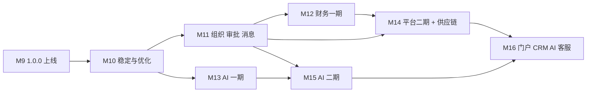

# ERP 开发计划

- 计划版本：2.0.0，对应工程 0.9.0。
- 编写日期：2026-11-15，Asia/Shanghai。
- 执行方式：目前单人开发；M11 起工作量明显增大，建议按第 6 节扩充人手。
- 依据：《企业级演进规划》1.0.0、《优化文档》2.0.0、《上线准备清单》、《业务规则》《数据库设计》《接口设计》现行版本。
- 用法：任务写成勾选框，完成一项勾一项。里程碑结束时按第 4 节收尾，再重新估算剩余里程碑。
- 文档维护：maorongkang@gmail.com。

> M0—M8 的本机部分已全部完成，本版删除了这些已完成的里程碑。各版本交付内容见《更新日志》0.1.0—0.9.0，测试结果见《测试报告》。

## 1. 现状

| 方面 | 现状 |
|---|---|
| 功能 | 销售、采购、库存作业、资金往来、冲销、关账、十类报表、导入导出、打印、附件、审计、工作台、多方式登录 |
| 质量 | 0.9.0 基线通过 410 项后端测试、155 项前端测试和 11 条浏览器流程；M9 验证见《测试报告》；八类对账零差异；本机容量、恢复演练和部署包已完成 |
| 代码状态 | 提交 `df5e4ca` 之后，0.9.0 多方式登录、上线准备以及 M9 本机修改仍在工作区，包含 V32、V33、初始化工具和部署脚本 |
| 未完成 | 正式服务器、证书、主备切换、外部对象仓、真实期初与试运行、1.0.0 发布；技术优化见《优化文档》 |
| 环境 | JDK 21、Maven 3.8、Node.js 24 / npm 11、MySQL 8.0.46、Redis 6380，详见《环境检查》 |

## 2. 计划原则

1. **先把 1.0.0 发出去。** 在真实业务跑起来之前，不启动大的新模块；新需求先记入第 5 节。
2. **平台能力先于业务铺开。** 组织模型、审批流、消息中心先做，后面每个业务模块都会用到。
3. **财务优先。** 企业客户选 ERP，财务是否完整往往是决定因素，所以财务排在供应链深化和生产之前。
4. **沿用现有正确性做法。** 新模块继续使用命令 + 状态机 + 事实表 + 冲销、固定加锁顺序、同事务幂等、期间屏障，不为“企业级”换框架。
5. **AI 只出建议和草稿。** 任何过账、付款仍由人操作，两人复核规则不变。
6. **完成标准**：测试通过 → 构建成功 → lint 无错误 → 文档已更新，缺一项不算完成。

## 3. 里程碑

### 3.1 总览

| 里程碑 | 内容 | 粗估人日 | 完成后版本 |
|---|---|---:|---|
| M9 | 1.0.0 上线收口 | 10—15（另含等待服务器和业务方的时间） | 1.0.0 |
| M10 | 上线后稳定与技术优化 | 10—15 | 1.0.x / 1.1.0 |
| M11 | 平台基础一期：组织、审批流、消息中心 | 25—35 | 1.2.0 |
| M12 | 财务一期：总账、财务报表、应收应付增强 | 30—40 | 1.3.0 |
| M13 | AI 一期：AI 基础设施、知识助手与 LLM Wiki | 20—30 | 1.4.0 |
| M14 | 平台二期 + 供应链一期 | 35—45 | 1.5.0 |
| M15 | AI 二期：智能查数、单据解释、AI 录单 | 20—30 | 1.6.0 |
| M16 | 客户门户、CRM 与 AI 客服 | 30—40 | 1.7.0 |
| M17 以后 | WMS、SRM、成本、报销、固定资产、资金、预算、生产、集团、预测与异常检测 | 按阶段另行估算 | 2.x |
| M9—M16 合计 | | 180—250 | |

单人按每月 21 个工作日计，M9—M16 约 9—12 个月；两到三人并行（平台 / 财务 / AI 各一人）可压到 5—6 个月。这是粗估，每个里程碑结束后按实际用时重估。

M13 只依赖 M10，可以和 M11、M12 并行；人手不够时，按 M11 → M12 → M13 顺序串行。

### 3.2 M9 1.0.0 上线收口

**目标**：在目标服务器上用真实期初数据试运行通过，发布 1.0.0。具体操作以《上线准备清单》为准，这里只列任务。

代码与版本

- [ ] 提交当前工作区的 0.9.0 和上线准备改动，按功能拆成几次提交（多方式登录、初始化工具、部署与运维脚本、文档）
- [x] 修复 O-25：接口时间统一带时区，导入任务列表按北京时间显示
- [x] 修复 O-22：登录渠道配置改用独立权限 `tenant:login_settings`
- [x] 处理 O-24 的换行规则，在临时 Git 索引执行归一化并核对真实索引未变化
- [ ] 按 O-24 单独提交换行规则
- [x] 处理 O-23 的版本记录，把未发布条目置顶并核对 0.9.0 版本号
- [ ] 正式发布时同步前后端版本号为 1.0.0，更新《更新日志》并打 `v1.0.0` 标签

目标环境

- [ ] 确定服务器规格、部署方式、正式域名和证书
- [ ] MySQL 8.0.46 主备、运行 / 迁移 / 备份三类账号、只读备库；切换演练一次
- [ ] Redis（TLS）、共享私有对象仓、告警渠道
- [ ] 业务方确定 RPO / RTO 目标，按目标做一次恢复演练并记录实际用时
- [ ] 在目标入口按真实业务量复测容量；用实际单量替换《待确认清单》S09 的规划基线

多方式登录（如果首期开启）

- [ ] 配置服务端加密密钥、SMTP 白名单、微信回调域
- [ ] 用试运行账号逐个验收短信、邮件投递和微信扫码绑定、登录（上轮只用了测试夹具）

数据与试运行

- [ ] 首个企业与管理员受控初始化，管理员首次登录改密
- [ ] 按《上线准备清单》第二节整理并核对库存、往来、资金期初和未完成订单
- [ ] 停写、备份、迁移，财务与仓库负责人签字确认期初，八类对账零差异
- [ ] 按试运行清单跑采购、销售、核销、库存作业、报表、导入导出、附件和审计
- [ ] 业务、财务、运维共同批准后放量，记录发布时刻和产物摘要

**验收**：正式环境八类对账零差异；试运行清单全部通过；回退方案经过评审；1.0.0 已打标签。

### 3.3 M10 上线后稳定与技术优化

**目标**：上线后第一个迭代，先把运行可见性和性能余量补上，同时收集真实用户反馈。

- [ ] O-28：OpenTelemetry 链路、Prometheus + Grafana 指标、Loki 日志、告警规则
- [ ] O-26：根据链路数据缩减单请求固定开销，目标服务器 1000 RPS 连续三轮达标
- [ ] O-21：登录密钥用 HKDF 派生两把子密钥，兼容旧密文
- [ ] O-27：在 Linux 测试机上跑一次 MySQL 8.4 兼容试跑
- [ ] O-29 第一步：报表与导出改走只读备库，页面显示数据截止时间
- [ ] 建立 CI：每次提交自动跑后端、前端测试和构建，合并前必须通过
- [ ] 收集上线后两周的用户问题，整理进第 5 节待排需求，评估是否调整 M11 起的顺序

**验收**：线上主要接口有链路和告警；容量复测达标；《优化文档》中 P0、P1 项清零。

### 3.4 M11 平台基础一期

对应《企业级演进规划》E-01、E-02、E-03。

组织模型（E-01）

- [ ] 增加集团、事业部、部门、成本中心、利润中心，组织树可维护
- [ ] 用户可属于多个部门；数据范围从“公司 + 仓库”扩展到“组织树 + 仓库”，保持现有范围语义向上兼容
- [ ] 单据头增加部门、成本中心字段（可选），报表增加按部门汇总

审批流（E-02）

- [ ] 流程定义：按单据类型配置节点，节点条件支持金额、往来单位、组织
- [ ] 节点类型：单人、会签、或签；支持转办、代理、加签、超时提醒
- [ ] 与现有审批命令挂钩：销售订单、采购订单、退款、冲销、库存调整先接入；没有配置流程的单据保持现有单级审批
- [ ] 经办与复核分离、两人经手等硬规则仍由服务端强制，流程配置不能绕开

消息中心（E-03）

- [ ] 站内信、邮件；企业微信 / 钉钉机器人至少接一种
- [ ] 待办（审批、签收超期、待确认收付款）和预警统一由消息中心发出，用户可订阅
- [ ] 工作台待办改为读取消息中心

**验收**：配置一条“金额 > 5 万需部门经理 + 财务会签”的销售订单流程并跑通；部门级用户只能看到本部门数据；审批到达时收到站内信和机器人消息。

### 3.5 M12 财务一期

对应《企业级演进规划》F-01、F-02、F-03。

- [ ] 科目体系：预置企业会计准则科目表，支持增改停用和辅助核算（客户、供应商、部门、项目、成本中心）
- [ ] 凭证：现有业务投影凭证并入总账；手工凭证录入、审核、记账、冲销；凭证导出到常用财务软件格式
- [ ] 期末：结转损益、试算平衡；与现有关账流程合并
- [ ] 财务报表：资产负债表、利润表、现金流量表，报表公式可配置
- [ ] 应收应付：账龄分析、客户信用额度与超额控制（原 S08）、催收计划、坏账准备
- [ ] 同步更新《业务规则》《数据库设计》《接口设计》

**验收**：用一个月的样例业务生成三大报表，资产负债表平衡；信用额度超限时下单被拦截或按配置进入审批。

### 3.6 M13 AI 一期

对应《企业级演进规划》第 5 节 AI-0、AI-1。

- [ ] 新建 `erp-ai` 服务（Java 21 + Spring AI），与主服务分开部署
- [ ] 模型网关：多模型配置、按租户限额和计费、调用审计；境内场景接已备案模型或私有化模型，海外场景可选 Claude
- [ ] OpenSearch 部署，中文分词 + 向量混合检索；向量模型与重排模型私有化部署
- [ ] 知识库：上传、解析、切分、按租户和角色过滤；回答带引用
- [ ] LLM Wiki：资料入库后生成或更新主题页，管理员审核后发布，定期体检矛盾和失效内容
- [ ] 用现有《业务规则》《用户使用手册》《运维手册》作为第一批资料
- [ ] 评测集：200 条以上真实问题，记录正确率、引用准确率、拒答率
- [ ] 前端：右侧助手面板 + Wiki 浏览页

**验收**：评测集正确率和引用准确率达到事先约定的线；跨租户、跨角色检索测试全部拦截。

### 3.7 M14 平台二期 + 供应链一期

- [ ] E-04 单点登录：OIDC / LDAP，管理员强制 MFA，与现有多方式登录合并到同一身份模型
- [ ] E-05 自定义字段：单据和主数据扩展字段，列表、筛选、导入导出、打印自动识别
- [ ] E-06 编码规则：单号、物料编码可配置
- [ ] E-08 开放平台：应用密钥与签名、限流、调用审计、Webhook（基于 Outbox）
- [ ] S-01 批次、序列号、保质期（原二期候选 S03），近效期先出和追溯
- [ ] S-03 质检：来料检、不合格品处理，质检结果影响可用量
- [ ] F-07 数电发票：对接税务平台或服务商（原二期候选 S05）

**验收**：外部系统通过开放平台创建销售订单并收到发货 Webhook；批次商品从入库到出库可完整追溯。

### 3.8 M15 AI 二期

- [ ] A-02 智能查数：一组预定义只读查询工具（应收余额、可用库存、订单进度、销售汇总等），沿用当前用户权限，不让模型写 SQL
- [ ] A-03 单据解释：详情页“为什么不能发货 / 关账为什么不通过”，读取 `allowedActions` 与检查结果，给出跳转链接
- [ ] A-04 AI 录单：订单图片、PDF、邮件 → 抽取 → 匹配客户和 SKU → 生成草稿，低置信字段高亮
- [ ] 每个工具 20 条以上问法的评测；AI 录单 100 份真实样本的字段准确率

**验收**：越权测试全部拦截；查数结果与报表一致；AI 录单只生成草稿，不能直接提交。

### 3.9 M16 客户门户、CRM 与 AI 客服

- [ ] S-06 CRM：线索、商机、报价单；价格表与客户协议价
- [ ] 客户门户：客户联系人登录，查订单、物流、对账、发票，只能看到本单位数据
- [ ] A-05 AI 客服：门户、公众号或企业微信接入；回答订单进度、物流、对账、开票、退货政策；处理不了转人工并生成工单
- [ ] A-06 坐席辅助：人工客服侧栏显示客户近期订单、未结款、建议回复
- [ ] 对外上线前完成生成式 AI 服务的合规评估和内容安全审核
- [ ] 越权、提示注入、转人工三类测试 100% 通过

**验收**：客户在门户中只能查到自己的数据；AI 客服遇到投诉、退款争议自动转人工。

### 3.10 M17 以后

按《企业级演进规划》第 6 节第三、四阶段排期，每项开始前单独写需求和设计：

- 供应链：S-02 WMS 与 PDA、S-04 补货计划、S-05 SRM 与供应商门户、S-07 电商与物流对接
- 财务：F-04 存货成本（含先进先出，原 S04）、F-05 费用报销、F-06 固定资产、F-08 银企直连（原 S07）、F-09 预算
- 平台：E-07 打印模板设计器、E-09 多币种与多语言、E-10 规则与预警
- 生产：简单装配（BOM + 工单 + 领料完工）起步，再到 MRP
- 集团：公司间交易、合并报表
- AI：A-07 经营摘要、A-08 异常检测、A-09 需求预测、A-10 主数据治理

## 4. 每个里程碑的收尾

- [ ] 后端 `mvn verify`，前端 `npm run lint`、`npm test`、`npm run build`，浏览器回归全部通过
- [ ] 接口、表结构、规则有变化的，同步更新对应文档
- [ ] 更新《更新日志》，按版本号规则打标签
- [ ] 记录实际用时，与粗估对比，重新估算剩余里程碑
- [ ] 新发现的需求放入第 5 节，不在当前里程碑扩大范围
- [ ] 从《优化文档》删除已完成项，新发现的技术问题补进去

## 5. 待排需求

来自原二期候选和业务规则中暂缓的问题，尚未分配到里程碑，上线后按用户反馈排序：

- 无原单退货（Q11）、已发货改价的价格调整单（Q13）、自动签收（Q21）
- 零售收银
- 新收集的用户反馈（M10 起补充）

## 6. 团队与协作

- **人手**：M9、M10 单人可以完成；M11 起建议至少三条线并行——平台与基础（组织、审批、消息、开放平台）、财务、AI。另外需要一位懂业务的财务或实施人员参与需求确认和验收。
- **分支**：`main` 始终可以运行；每个里程碑或大功能一个分支，例如 `feature/m11-workflow`，合并前必须通过 CI。
- **评审**：涉及加锁顺序、过账、权限、AI 工具调用的改动必须有第二人评审。
- **提交信息**：`<类型>: <简短描述>`，例如 `feat: 新增审批流定义`。
- **数据库迁移**：已经合并到 `main` 的迁移文件不再修改，只追加新文件。
- **规则变更顺序**：先改《业务规则》，再改测试，最后改代码；测试名引用规则编号。

## 7. 风险与应对

| 风险 | 影响 | 应对 |
|---|---|---|
| 目标服务器、业务方确认迟迟不到位 | 1.0.0 无法发布 | M9 中能在本机完成的代码类任务先做完；等待期间可提前做 M10 的 O-28 |
| 单人开发、范围持续扩大 | M11 之后严重延期 | 按第 6 节扩充人手；严格按里程碑，新需求先进第 5 节 |
| 组织模型改造影响现有数据范围 | 权限回归、越权风险 | 保持“公司 + 仓库”语义兼容；M11 先补齐数据范围回归测试再改 |
| 审批流可配置后绕开两人复核 | 内控失效 | 硬规则在服务端强制，流程配置只能增加环节、不能减少 |
| 财务口径与客户实际做账习惯不符 | 返工 | M12 开始前请财务人员确认科目、辅助核算和报表口径 |
| AI 回答错误或越权 | 业务损失、数据泄露 | 只读工具 + 草稿；评测集不达标不上线；越权与注入测试必须全部通过 |
| 对外 AI 客服合规要求 | 无法上线或被整改 | M16 开始前完成合规评估，选用已备案模型或私有化部署 |
| MySQL 8.0 已停止官方支持 | 安全补丁缺失 | 按《优化文档》1.1 节的部署约束执行；每个里程碑跑一次 8.4 兼容试跑 |

## 8. 修订记录

| 版本 | 日期 | 说明 |
|---|---|---|
| 1.0.0—1.7.0 | 2026-11-15 | M0—M8 计划与执行记录（本机部分已完成，详见《更新日志》《测试报告》） |
| 2.0.0 | 2026-11-15 | 按当前状态重写：删除已完成的 M0—M8；新增 M9 上线收口、M10 稳定优化、M11—M16 企业级与 AI 里程碑 |
