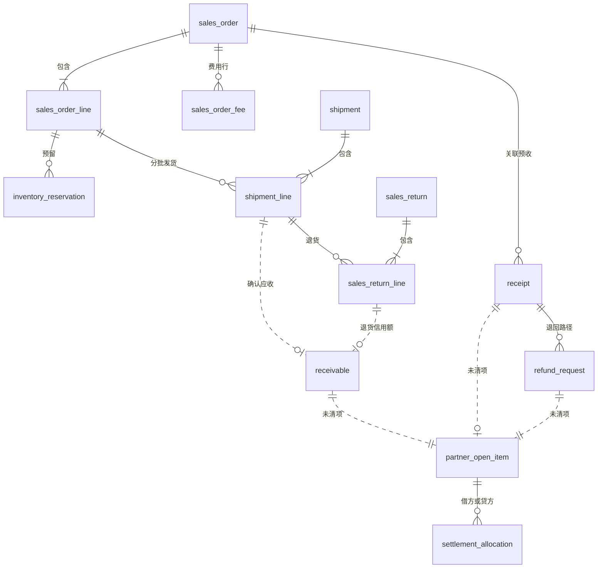
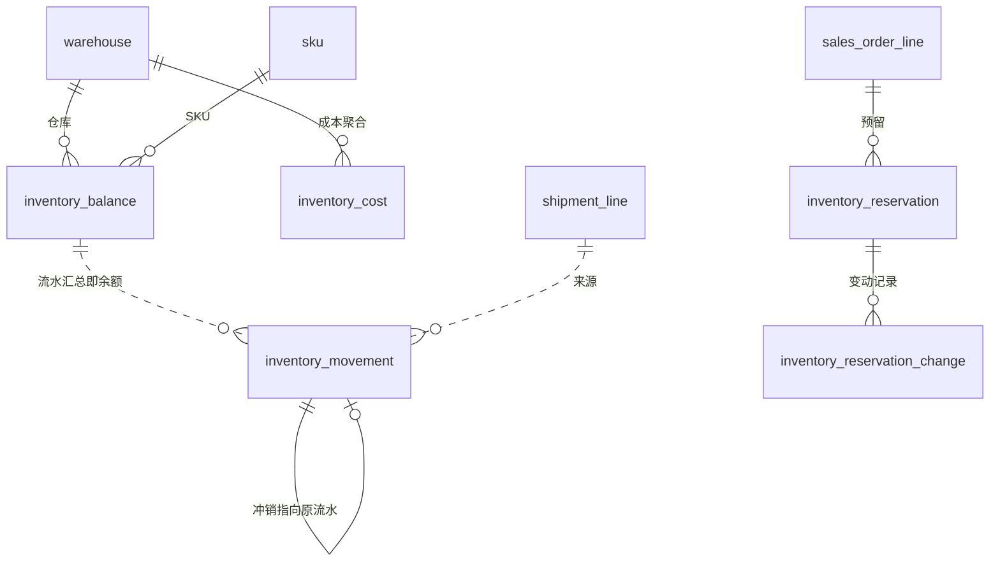

# ERP 数据库设计

- 文档版本：1.1.2。
- 编写日期：2026-11-15，Asia/Shanghai。
- 1.0.1 修订：编写《接口设计》时补充 `sys_user` 的登录锁定字段和 `company` 的打印抬头字段，`document_change` 去掉与 `applied` 重复的 `approved` 状态。修改后重新建表，46 项约束测试全部通过。
- 1.1.0 修订：应收改为按客户签收确认（《业务规则》1.2.0，R2 组）。发货单增加签收字段和状态，发货行增加签收数量、签收差异，订单行增加已签收数量，新增“拒收退回入库”流水类型和“发出商品”账户。约束测试增至 54 项，全部通过。
- 1.1.1 修订：Q02 确认审批时预留，表结构不变；第 11 节补充“待审核需求”（R1-11）的查询路径。
- 1.1.2 修订：开发、集成测试和部署统一使用 MySQL 8.0.46，与已验证建表草案的本机版本一致。
- 依据：《重构设计方案》第 6—10 节，《业务规则》1.3.0。
- 建表脚本：[sql/schema-draft.sql](sql/schema-draft.sql)。字段的完整定义以脚本为准，本文说明表的职责、约束落在哪里、写入时怎么写，不逐列重复。
- 文档维护：maorongkang@gmail.com。

## 1. 结论与验证情况

| 项目 | 结果 |
|---|---|
| 表 | 80 张，分 11 组，见第 3 节 |
| 约束 | 主键 80、唯一 120、外键 162、CHECK 221 |
| 索引 | 368 个，含主键、唯一键和外键自动建立的索引 |
| 建表 | 在本机 MySQL 8.0.46 的临时库中执行通过 |
| 约束测试 | 54 项全部通过：41 项违规写入均被预期的约束拦截，13 项合法写入和写法验证结果正确 |

约束测试先原样写入《业务规则》第 5 节 SO-4 订单的全部金额，确认文档样例满足表上的金额约束；然后逐项构造违规写入，并断言错误信息中出现的是预期的约束名，避免“因为别的原因失败”被误判为通过。测试编号（N、P 开头）在第 5 节引用。

- M1 已在 MySQL 8.0.46 独立空库执行 V1—V3，54 项 JUnit 约束测试通过。其中 47 项对应原编号，7 项依据规则重建，详见《测试报告》。

后续验证项目：

- 多连接并发下的锁行为。本次只证明了约束在单连接下生效，并发用例（T01、T02、T07 等）在阶段 C 实测。
- 数据量下的执行计划。阶段 F 结合压测数据确认索引。

设计阶段使用的临时库已删除。M1 使用项目专用的开发库和测试库。

## 2. 通用约定

### 2.1 命名

- 表名、字段名用小写加下划线，表名用单数名词。
- 用户和角色表命名为 `sys_user`、`sys_role`，没有沿用方案 9.1 的 `user`、`role`，避免和 MySQL 的 `USER()` 函数、系统表 `mysql.user` 混淆。
- 约束和索引前缀：`uk_` 唯一键、`idx_` 普通索引、`fk_` 外键、`ck_` 检查约束。MySQL 中外键名和 CHECK 名在整个库内必须唯一，所以一律以表名开头。
- 违反约束时 MySQL 的错误信息带约束名。后端按约束名映射成中文提示和规则编号，例如 `ck_inventory_balance_available` 映射为“可用库存不足（R4-01）”。

### 2.2 主键

主键为 `BIGINT UNSIGNED`，由应用生成按时间递增的 64 位 ID，不用自增列。原因：

1. 单据头和行在同一事务里批量插入，行需要引用头的 ID，不必先插头再回读自增值。
2. 多个 API 实例同时写入，不依赖数据库分配。
3. 按时间递增，InnoDB 聚簇索引顺序追加，避免随机插入引起页分裂。
4. 不能从 ID 推算业务量。

接口中 ID 以字符串传输（方案第 4 节），防止前端 JavaScript 丢失精度。

### 2.3 租户、公司与复合外键

- 所有业务表都带 `tenant_id`，公司级的表再带 `company_id`。
- 父表提供 `uk_<表>_scope (tenant_id, company_id, id)`，租户级的表为 `(tenant_id, id)`。子表用复合外键引用它。
- 效果：子记录和父记录在数据库层面一定属于同一租户、同一公司。例如发货单的仓库外键是 `(tenant_id, company_id, warehouse_id)`，公司一的发货单引用不到公司二的仓库（N09）；租户二的订单引用不到租户一的客户（N10）。
- 父表的 scope 唯一键为复合外键提供完整的引用目标，使数据库在校验记录 ID 时也校验租户和公司归属。
- 外键一律使用默认的 RESTRICT，不使用级联删除（方案 9.2）。
- 跨模块的外键保留。外键只保证同库引用正确，不代表其他模块可以直接写这张表，写入仍然走所属模块的接口（方案 5.1）。

复合外键只防止写错，不负责查询隔离。所有查询、导出和后台任务仍然必须带 `tenant_id` 和数据范围条件。

### 2.4 数值

| 用途 | 类型 | 说明 |
|---|---|---|
| 金额 | `DECIMAL(24,2)` | 人民币分 |
| 单价、单位成本 | `DECIMAL(24,8)` | R3-03 |
| 数量 | `DECIMAL(24,6)` | |
| 单位换算率 | `DECIMAL(18,6)` | |
| 税率 | `DECIMAL(7,6)` | 13% 存为 `0.130000` |
| 百分比参数 | `DECIMAL(5,2)` | 如超收容差 |

- 订单进度一律用基础单位（`*_base_qty`）比较和扣减，单据单位的数量和换算率作为快照保留。这样不会因为换算舍入把“刚好发完”判成“超发”。
- 应收应付（`kind`）、未清项（`direction`）、分录（`direction`）的金额恒为正，方向单独存。库存流水、成本调整这类需要直接求和的流水用带符号的数值。

### 2.5 时间

- 时间点用 `DATETIME(3)`，统一存 UTC。应用连接时设置 `time_zone = '+00:00'`，列默认值 `CURRENT_TIMESTAMP(3)` 才是 UTC。
- 业务日期用 `DATE`，存业务所在地（Asia/Shanghai）的日期，决定会计期间和账龄。
- 不用 `TIMESTAMP`：它有 2038 年上限，并且会随会话时区做隐式转换。

### 2.6 状态与枚举

状态用 `VARCHAR` 加 `CHECK (status IN (...))`，可读性好，出错时能直接看出是哪个值。新增状态需要新迁移修改 CHECK。

状态迁移是否合法（《业务规则》第 11 节）由应用的条件更新保证：

```sql
UPDATE shipment
   SET status = 'posted', posted_at = :now, period_id = :period_id, version = version + 1
 WHERE id = :id AND status = 'submitted';
-- 影响 0 行：单据已被其他请求改动，返回 409
```

### 2.7 公共列与只追加表

可变的表都带 `version`（乐观锁）、`created_by`、`created_at`、`updated_by`、`updated_at`。

下列表只追加、不修改，只有 `created_*`：`inventory_movement`、`inventory_reservation_change`、`cost_adjustment`、`journal`、`journal_line`、`approval_record`、`audit_log`。应用的数据库账号对这些表只授予 SELECT 和 INSERT（第 15 节）。

`receivable`、`payable` 记录的业务事实过账后不变，唯一会变的是已开票金额 `invoiced_amount`，所以保留了 `version` 和 `updated_at`。

### 2.8 不做软删除

- 草稿：物理删除，删除前写 `audit_log`（R7-01）。
- 主数据：`status` 改为 `disabled` 停用。
- 已过账的单据、流水、分录：永不删除，更正走冲销。

理由是软删除标记会让唯一约束失效：已删除的单号会一直占着唯一键；如果把删除标记拼进唯一键，同一个单号又能出现两次。

### 2.9 可选维度的默认键

库存的 `location_key`、`lot_key` 定义为 `NOT NULL DEFAULT ''`，`ledger_balance` 的维度键定义为 `NOT NULL DEFAULT 0`。唯一键里的列如果允许 NULL，MySQL 允许多行 NULL 并存，唯一约束就形同虚设（方案 8.1）。

### 2.10 用生成列表达“有条件的唯一”

MySQL 没有部分索引，用 STORED 生成列加唯一键实现：

| 表 | 生成列 | 保证的内容 | 测试 |
|---|---|---|---|
| `inventory_reservation` | `active_order_line_key = IF(status = 'active', order_line_id, NULL)` | 一个订单行同时只有一条有效预留，用完后可以再建 | N03、P03 |
| `document_change` | `pending_doc_key` | 一张单据同时只有一张待审核的变更单 | N23 |
| `document_reversal` | `active_source_key` | 一张单据只能有一张未驳回的冲销单 | P07 |
| `unit_conversion` | `base_sku_key` | 每个 SKU 只有一个基础单位 | N27 |
| `sys_user_data_scope` | `warehouse_key` | 同一用户的数据范围不重复 | |
| `settlement_allocation` | `debit_direction = 'D'`、`credit_direction = 'C'` | 参与复合外键，保证核销一借一贷 | N13b |

### 2.11 字符集与排序规则

脚本里每张表都显式指定 `utf8mb4` 和 `utf8mb4_0900_ai_ci`。本机服务器的默认排序规则是 `utf8mb4_general_ci`，不显式指定的话，库里会混用两种排序规则，跨表比较字符串时直接报错。

`0900_ai_ci` 不区分大小写，`SKU-a` 和 `SKU-A` 视为同一编码，不能同时存在。

## 3. 表清单

### 3.1 组织与权限（10 张）

| 表 | 用途 |
|---|---|
| `tenant` | 租户，数据隔离边界 |
| `company` | 公司，业务主体 |
| `company_policy` | 公司级业务参数，即《业务规则》中标记为【参】的取值 |
| `warehouse` | 仓库，只属于一家公司 |
| `sys_user`、`sys_role` | 用户、角色 |
| `sys_permission` | 权限目录，全局共用，由迁移脚本维护 |
| `sys_user_role`、`sys_role_permission` | 关系表 |
| `sys_user_data_scope` | 数据范围：整个公司或指定仓库 |

### 3.2 基础资料（6 张）

| 表 | 用途 |
|---|---|
| `business_partner` | 往来单位，客户和供应商共用一个主体 |
| `partner_role` | 客户或供应商角色，以及该角色下的默认价格口径（R3-01） |
| `partner_contact` | 联系人，属于敏感字段 |
| `cash_account` | 结算账户 |
| `cash_account_balance` | 账户余额投影 |
| `income_expense_item` | 收支项目，用于非往来的收付款 |

### 3.3 商品（6 张）

`unit`、`product_category`、`product`（SPU，定义基础单位）、`sku`、`unit_conversion`、`sku_barcode`。

### 3.4 销售（7 张）

`sales_order`、`sales_order_line`、`sales_order_fee`、`shipment`、`shipment_line`、`sales_return`、`sales_return_line`。

### 3.5 采购（9 张）

`purchase_requisition`、`purchase_requisition_line`、`purchase_order`、`purchase_order_line`、`purchase_order_fee`、`goods_receipt`、`goods_receipt_line`、`purchase_return`、`purchase_return_line`。

### 3.6 库存与成本（12 张）

`inventory_balance`、`inventory_cost`、`inventory_movement`、`inventory_reservation`、`inventory_reservation_change`、`stock_transfer`、`stock_transfer_line`、`stock_count`、`stock_count_line`、`stock_adjustment`、`stock_adjustment_line`、`cost_adjustment`。

### 3.7 往来、资金与发票（11 张）

`opening_entry`、`receivable`、`payable`、`receipt`、`payment`、`refund_request`、`account_transfer`、`partner_open_item`、`settlement_allocation`、`invoice_registration`、`invoice_registration_line`。

### 3.8 账本（5 张）

`accounting_period`、`ledger_account`、`journal`、`journal_line`、`ledger_balance`。

### 3.9 单据流转（5 张）

`document_sequence`、`approval_record`、`document_change`、`document_reversal`、`attachment`。

### 3.10 可靠性（3 张）

`idempotency_record`、`outbox_event`、`inbox_event`。

### 3.11 运维（6 张）

`audit_log`、`reconciliation_run`、`reconciliation_diff`、`import_job`、`import_job_error`、`export_job`。

### 3.12 与方案 9.1 的差异

| 变化 | 原因 |
|---|---|
| 新增 `partner_open_item` | 把所有核销余额集中到一张表，核销可以建外键，见第 7.1 节 |
| 新增 `inventory_cost`、`cost_adjustment` | 成本按仓库 + SKU 核算，与带库位批次的余额分开（R6-01），尾差单独留痕（R6-06） |
| 新增 `company_policy` | 承载【参】类参数，修改留审计 |
| 新增 `opening_entry` | 上线时录入往来和资金期初（方案第 13 节） |
| 新增 `document_reversal` | 冲销单需要单独审核（《业务规则》第 12 节） |
| 新增 `invoice_registration` | 开票登记只关联已有应收应付（R2-03） |
| 新增费用行表、请购表、调整单表 | 对应 R2-06、R3-10 和 P0 范围里的请购、期初、冻结、报废 |
| `user`、`role` 改名 | 见第 2.1 节 |
| `external_request` 暂不建 | 首期不接支付渠道，见第 13 节 |

## 4. 表关系

### 4.1 销售到收款

实线是数据库外键，虚线是按 `source_type`、`source_id` 关联的对应关系，由应用维护，没有外键。



### 4.2 库存



## 5. 约束落在哪里

### 5.1 由数据库保证的规则

| 规则 | 约束 | 测试 |
|---|---|---|
| R4-01 不允许负库存 | `ck_inventory_balance_available`：在库 − 预留 − 冻结 ≥ 0 | N01、P01、P02 |
| R4-02 不超发 | `ck_sales_order_line_progress`：关闭 + 已发 + 待发占用 ≤ 批准数量 | N05 |
| R4-03 超收不超过容差 | `ck_purchase_order_line_progress`：关闭 + 已收 + 待收占用 ≤ 可收上限 | N30、P06 |
| R5-02 不超退 | `ck_shipment_line_return`：已退 + 待退占用 ≤ 签收数量 | N24 |
| R2-01 签收不超过已发 | `ck_sales_order_line_signed` | N38 |
| R2-10 一次签收、签收数量 + 差异 = 发货数量 | `ck_shipment_line_sign` | N34、P11 |
| R2-10 已签收必须有签收日期和期间，签收日期不早于发货日期 | `ck_shipment_signed`、`ck_shipment_sign_date` | N36、N37 |
| R2-11 有差异必须选择处理方式 | `ck_shipment_line_diff` | N35、P11 |
| R1-02 一行一条有效预留 | `uk_inventory_reservation_active` | N03、P03 |
| R1-04、R1-07 预留只能被消费或释放一次 | `ck_inventory_reservation_state`、`uk_inventory_reservation_change` | N04、N22 |
| R2-03 一个来源行只产生一笔应收 | `uk_receivable_source` | N20 |
| R3-08 累计确认不超过行金额 | `ck_sales_order_line_recognized` | N33 |
| R3-12 行内金额勾稽 | `ck_sales_order_line_net`、`ck_sales_order_line_tax`、`ck_sales_order_total`、`ck_sales_order_tax` | N06、N07 |
| R4-08 核销双方同公司、同往来单位、同币种，一借一贷 | `fk_settlement_allocation_debit`、`fk_settlement_allocation_credit` | N13a、N13b |
| R4-08 核销不超过剩余额 | `ck_partner_open_item_amount` | N13c |
| R4-10 资金账户不为负 | `ck_cash_account_balance_nonneg` | N12 |
| R5-07 第 2 条 原收款累计退款不超额 | `ck_receipt_refund` | N14 |
| R5-07 退回路径属于同一客户 | `fk_refund_request_receipt` | N15 |
| R6-06 数量为 0 时总成本为 0 | `ck_inventory_cost_zero` | N11 |
| R7-05 撤销核销必须填原因 | `ck_settlement_allocation_revoked` | N32 |
| R7-07 关闭期间留痕 | `ck_accounting_period_closed` | N26、P08 |
| R8-04 同时只有一张待审核变更 | `uk_document_change_pending` | N23 |
| R8-08 单号唯一、号段上限 | `uk_<表>_no`、`ck_document_sequence_value` | N08、P09 |
| 方案 6.3 凭证借贷平衡 | `ck_journal_balanced` | N18 |
| 方案 9.2 同一来源只过账一次 | `uk_journal_source`、`uk_inventory_movement_source` | N19、N21 |
| 方案 6.4 转账限同公司、同币种 | `fk_account_transfer_from`、`fk_account_transfer_to` | N17a、N17b |
| 业务规则第 12 节 退款、冲销经办审核分离 | `ck_refund_request_reviewer`、`ck_document_reversal_approver` | N16、N31 |
| 仓库属于一家公司、跨租户隔离（T15） | 复合外键 | N09、N10、N28、N29b |

### 5.2 必须由应用保证的规则

CHECK 只能看到同一行，外键只能检查引用是否存在。下列规则由领域代码保证，偏差由第 10 节的对账发现：

| 规则 | 数据库为什么管不了 | 应用做法 |
|---|---|---|
| 单据头合计等于各行合计（R3-12） | 跨行求和 | 保存时服务端重算全部金额，不采用前端传来的合计 |
| 凭证头借贷合计等于分录合计 | 跨行求和 | 同一事务内由分录汇总写入凭证头；对账项 `journal_balance` |
| 发货行的 SKU、客户与订单一致 | 跨表比对 | 创建发货单时校验。加复合外键要给订单行再建一个唯一索引，暂不加 |
| 客户单据只能选择客户角色 | 角色在 `partner_role` 中 | 应用校验 |
| 状态迁移合法 | 依赖迁移前的状态 | 条件更新 `WHERE status = 原状态`，见第 2.6 节 |
| 过账时期间必须开放（R7-09） | 跨表 | 加锁读取期间，见第 8.4 节 |
| 应收和应付不互相核销（R4-11） | 依赖未清项类型 | 核销时校验两侧都属于应收侧或都属于应付侧，见第 7.2 节 |
| 分批金额按累计法计算（R3-08） | 计算逻辑 | 领域服务计算；数据库只兜底“累计不超过行金额” |
| 余额预留量等于有效预留之和 | 跨表 | 同一事务更新；对账项 `reservation` |
| 订单的履约、结算、售后状态 | 由多张表推导的投影 | 根据事实计算后写入，可以重算 |
| 审批后不能改价格口径（R3-01） | 依赖状态 | 已批准单据的更新语句不包含这一列 |
| 订单审批、收款确认的经办审核分离 | 由公司参数决定是否启用 | 按 `company_policy` 校验。退款和冲销属于【定】，由数据库强制 |

## 6. 库存

### 6.1 四类数据

| 表 | 性质 | 说明 |
|---|---|---|
| `inventory_movement` | 事实 | 只追加，同一来源行同一动作只能有一条 |
| `inventory_balance` | 投影 | 在库、预留、冻结，与流水同事务更新，可由流水重算 |
| `inventory_cost` | 成本聚合 | 按公司 + 仓库 + SKU；首期不启用库位批次，数量等于余额的在库量 |
| `inventory_reservation`、`inventory_reservation_change` | 预留及其变动 | 变动记录只追加 |

成本单独建表的原因：R6-01 规定成本按“仓库 + SKU”核算，而余额的自然键还包含库位和批次。首期两者一一对应；以后启用批次，余额会拆成多行，成本仍是一行，表结构不用动。

### 6.2 流水类型

| `movement_type` | 在库 | 冻结 | 成本 | 来源 |
|---|:---:|:---:|:---:|---|
| `opening_in` | + | | + | 期初调整单行 |
| `purchase_in` | + | | + | 收货单行 |
| `purchase_return_out` | − | | − | 采购退货单行 |
| `sales_out` | − | | − | 发货单行；成本转入发出商品（R2-09） |
| `sales_return_in` | + | 待检、不合格时 + | + | 销售退货单行（R5-04） |
| `sales_reject_in` | + | + | + | 发货单行；签收时被拒收的货退回，进入冻结待检，按原出库单位成本入库（R2-11） |
| `transfer_out` | − | | − | 调拨单行，成本转入在途 |
| `transfer_in` | + | | + | 调拨单行 |
| `count_gain`、`count_loss` | ± | | ± | 盘点单行 |
| `adjust_in`、`adjust_out` | ± | | ± | 调整单行 |
| `block` | | + | | 冻结 |
| `unblock` | | − | | 解冻，包括质检合格 |
| `scrap` | − | − | − | 报废，只能报废已冻结的货 |

冲销时写一条 `posting_action = 'reverse'` 的流水，数值取反，`reverses_movement_id` 指向原流水。

### 6.3 写法

**审批时预留**：多行订单按 `(warehouse_id, sku_id)` 升序逐行执行，任一行影响 0 行，整单回滚（R1-03）。

```sql
UPDATE inventory_balance
   SET reserved_qty = reserved_qty + :qty, version = version + 1
 WHERE tenant_id = :tenant_id AND company_id = :company_id
   AND warehouse_id = :warehouse_id AND sku_id = :sku_id
   AND location_key = '' AND lot_key = ''
   AND on_hand_qty - reserved_qty - blocked_qty >= :qty;
-- 影响 1 行后，再插入 inventory_reservation 和一条 reserve 变动记录
```

条件更新是主防线（P01、P02），`ck_inventory_balance_available` 是兜底（N01）。不能先 SELECT 可用量，再无条件 UPDATE。

**发货过账时消费预留**：

```sql
UPDATE inventory_balance
   SET on_hand_qty = on_hand_qty - :qty, reserved_qty = reserved_qty - :qty, version = version + 1
 WHERE tenant_id = :tenant_id AND company_id = :company_id
   AND warehouse_id = :warehouse_id AND sku_id = :sku_id
   AND location_key = '' AND lot_key = ''
   AND reserved_qty >= :qty AND on_hand_qty >= :qty;

UPDATE inventory_reservation
   SET remaining_qty = remaining_qty - :qty,
       status = IF(remaining_qty = 0, 'consumed', 'active'),
       version = version + 1
 WHERE id = :reservation_id AND status = 'active' AND remaining_qty >= :qty;
```

MySQL 单表 UPDATE 的赋值从左到右求值，`status` 表达式里的 `remaining_qty` 已经是减过之后的值（已在本机验证）。其他数据库不一定如此，迁移时要改写。

订单行的预留已经到期（R1-06），或本次发货数量超过剩余预留时，超出部分按无预留出库处理，条件改为可用量足够。

**更新成本**：

```sql
SELECT qty, total_cost, version
  FROM inventory_cost
 WHERE tenant_id = :tenant_id AND company_id = :company_id
   AND warehouse_id = :warehouse_id AND sku_id = :sku_id
   FOR UPDATE;
-- 应用按 R6-03 ~ R6-08 算出新数量、新总成本和需要的尾差调整
UPDATE inventory_cost
   SET qty = :new_qty, total_cost = :new_total, version = version + 1
 WHERE id = :id AND version = :version;
```

CHECK 在每条语句执行完时检查，中间结果也必须合法。R6-08 样例中“冲减后总成本为 −10.00”只是计算过程：应用要先算出最终值 0.00 一次写入，同时插入一条 +10.00 的 `cost_adjustment`。如果先写 −10.00 再补一条更新，第一条就会被 `ck_inventory_cost_nonneg` 拒绝。

### 6.4 加锁顺序

全系统按固定顺序加锁（方案 10.4）。以发货过账为例：

1. `accounting_period`，共享锁（第 8.4 节）
2. 单据头，条件更新状态
3. 来源订单行，按 `id` 升序
4. `inventory_balance`，按 `(warehouse_id, sku_id, location_key, lot_key)` 升序
5. `inventory_cost`，按 `(warehouse_id, sku_id)` 升序
6. `inventory_reservation`，按 `id` 升序
7. `partner_open_item`，按 `id` 升序
8. `cash_account_balance`，按 `id` 升序
9. 插入流水、应收、分录、Outbox 事件和幂等结果

审批、退款、取消、回调都按这个顺序取锁，不涉及的步骤直接跳过。

## 7. 往来与核销

### 7.1 为什么加一张未清项表

方案 9.1 只列了 `receivable`、`payable`、`receipt`、`payment` 和 `settlement_allocation`。如果核销直接引用这四张表，核销记录只能用“类型 + ID”指向其中任意一张，建不了外键；四张表还要各自维护一份“未核销金额”。

加上 `partner_open_item` 之后：

- 应收、收款这些业务记录只记录发生了什么，过账后基本不变。
- “还剩多少没核销”集中在 `partner_open_item.open_amount`，核销只有一种写法：条件扣减。
- 核销表的两个外键都指向这张表，并带上公司、往来单位、币种和方向，R4-08 由数据库保证（N13a、N13b）。
- 账龄分析和对账单只查一张表。

这和库存拆成“流水 + 余额”是同一个思路。

### 7.2 方向对照

`direction = 'D'` 表示这一项让“对方欠我方”的金额增加，`C` 相反。

| 业务记录 | `item_type` | 方向 | 所属侧 |
|---|---|:---:|---|
| 应收：出库、买方运费、期初应收 | `receivable`（`kind = charge`） | D | 应收 |
| 退货信用额、客户预收期初 | `receivable`（`kind = credit`） | C | 应收 |
| 客户收款 | `receipt`（`customer`） | C | 应收 |
| 客户退款申请 | `refund_request` | D | 应收 |
| 应付：收货、我方承担的运费、期初应付 | `payable`（`kind = charge`） | C | 应付 |
| 采购退货、预付供应商期初 | `payable`（`kind = credit`） | D | 应付 |
| 供应商付款 | `payment`（`supplier`） | D | 应付 |
| 供应商退款 | `receipt`（`supplier_refund`） | C | 应付 |

核销只能在同一侧内一借一贷。首期不做应收应付互抵（R4-11），应用校验两侧都属于应收侧或都属于应付侧。

### 7.3 核销写法

```sql
-- 两条扣减按未清项 id 升序执行；任一条影响 0 行即额度不足，整体回滚
UPDATE partner_open_item
   SET open_amount = open_amount - :amount, version = version + 1
 WHERE id = :smaller_id AND open_amount >= :amount;

UPDATE partner_open_item
   SET open_amount = open_amount - :amount, version = version + 1
 WHERE id = :larger_id AND open_amount >= :amount;

INSERT INTO settlement_allocation
  (id, tenant_id, company_id, partner_id, currency, debit_item_id, credit_item_id, amount, status, allocation_type, created_by)
VALUES (:id, :tenant_id, :company_id, :partner_id, 'CNY', :debit_item_id, :credit_item_id, :amount, 'active', 'manual', :user_id);
```

撤销核销（R7-05）：核销记录改为 `revoked` 并填写原因，两侧 `open_amount` 加回，在同一事务内完成。原核销记录不删除。

### 7.4 退款的额度占用

以《业务规则》第 7 节样例为例：退货信用额 45.83，退回路径是收款单 RC-1。

| 步骤 | 写入 |
|---|---|
| 提交退款申请 | 退款申请转为待审核；新建退款申请的未清项（D 45.83）；与退货信用额的未清项（C）建立 `status = reserved` 的核销 45.83，两侧 `open_amount` 各减 45.83；RC-1 的 `refund_pending_amount` 加 45.83 |
| 财务登记退款成功 | 核销改为 `active`；RC-1 处理中金额减 45.83、已退金额加 45.83；资金账户余额减 45.83；写分录 |
| 驳回或取消 | 核销改为 `released`，两侧 `open_amount` 加回；RC-1 处理中金额减 45.83 |

R5-07 的两条约束在提交时的同一事务里同时扣减：第 1 条由贷方未清项的 `open_amount >= 0` 保证，第 2 条由 `ck_receipt_refund` 保证。并发提交的退款申请不会超额。

### 7.5 按订单自动核销预收（R4-07）

签收生成应收后，在同一事务里找出 `receipt.related_order_id` 等于本订单、状态为 `confirmed` 的收款，按 `business_date`、`id` 升序取它们的未清项逐笔核销，`allocation_type = 'auto_order'`。

## 8. 运营账本

### 8.1 账户目录

账户由系统固定，首期不开放用户修改。种子数据在建表脚本末尾。

| 代码 | 名称 | 余额方向 | 必带维度 |
|---|---|:---:|---|
| `FUNDS` | 资金（现金及银行） | 借 | 结算账户 |
| `AR` | 应收账款 | 借 | 往来单位 |
| `AP` | 应付账款 | 贷 | 往来单位 |
| `INVENTORY` | 库存商品 | 借 | 仓库 |
| `GOODS_IN_TRANSIT` | 在途库存 | 借 | 仓库 |
| `INPUT_VAT` | 进项税额 | 借 | |
| `OUTPUT_VAT` | 销项税额 | 贷 | |
| `SALES_REVENUE` | 销售收入 | 贷 | |
| `FEE_INCOME` | 代收费用收入 | 贷 | |
| `OTHER_INCOME` | 其他收入 | 贷 | |
| `COGS` | 销售成本 | 借 | |
| `COST_VARIANCE` | 成本差异 | 借 | |
| `INVENTORY_ADJUSTMENT` | 库存盘盈盘亏、报废及运损 | 借 | 仓库 |
| `PURCHASE_FEE` | 采购费用 | 借 | |
| `TRANSFER_FEE` | 转账手续费 | 借 | 结算账户 |
| `OTHER_EXPENSE` | 其他支出 | 借 | |
| `OPENING_EQUITY` | 期初权益 | 贷 | |
| `GOODS_SHIPPED` | 发出商品：已出库、客户未签收 | 借 | 仓库 |

这是运营账本，用于内部对账，不是法定总账（《业务规则》第 1 节）。

### 8.2 过账规则

| 业务动作 | 借 | 贷 |
|---|---|---|
| 发货过账（出库） | GOODS_SHIPPED | INVENTORY |
| 客户签收 | AR（含税） | SALES_REVENUE（未税）、OUTPUT_VAT（税额） |
| 　同时结转签收部分的成本 | COGS | GOODS_SHIPPED |
| 　首次签收确认买方运费 | AR（含税） | FEE_INCOME（未税）、OUTPUT_VAT |
| 签收差异：拒收退回入库 | INVENTORY | GOODS_SHIPPED |
| 签收差异：运输损失 | INVENTORY_ADJUSTMENT | GOODS_SHIPPED |
| 销售退货过账 | SALES_REVENUE（未税）、OUTPUT_VAT | AR（含税） |
| 　同时按原出库成本冲回 | INVENTORY | COGS |
| 客户收款确认 | FUNDS | AR |
| 客户退款成功 | AR | FUNDS |
| 收货过账，一般纳税人 | INVENTORY（未税）、INPUT_VAT | AP（含税） |
| 收货过账，小规模纳税人（R6-04） | INVENTORY（含税） | AP（含税） |
| 我方承担的采购运费 | PURCHASE_FEE（未税）、INPUT_VAT | AP（含税） |
| 采购退货过账 | AP（含税） | INVENTORY（冲减成本）、INPUT_VAT；与按当前成本出库的差额记 COST_VARIANCE（R6-08） |
| 供应商付款确认 | AP | FUNDS |
| 供应商退款收款 | FUNDS | AP |
| 其他收入、其他支出 | FUNDS / OTHER_EXPENSE | OTHER_INCOME / FUNDS |
| 账户间转账 | FUNDS（转入账户） | FUNDS（转出账户） |
| 　手续费 | TRANSFER_FEE | FUNDS（转出账户） |
| 调拨调出 | GOODS_IN_TRANSIT | INVENTORY（调出仓） |
| 调拨调入 | INVENTORY（调入仓） | GOODS_IN_TRANSIT |
| 　少收差异处理 | INVENTORY_ADJUSTMENT | GOODS_IN_TRANSIT |
| 盘盈、其他入库 | INVENTORY | INVENTORY_ADJUSTMENT |
| 盘亏、其他出库、报废 | INVENTORY_ADJUSTMENT | INVENTORY |
| 冻结、解冻 | 不记账，只改变数量状态 | |
| 成本尾差：数量归零后仍有成本 | COST_VARIANCE | INVENTORY |
| 成本尾差：数量归零后成本为负 | INVENTORY | COST_VARIANCE |
| 期初库存、期初资金、期初应收 | INVENTORY / FUNDS / AR | OPENING_EQUITY |
| 期初客户预收、期初应付 | OPENING_EQUITY | AR / AP |
| 期初预付供应商 | AP | OPENING_EQUITY |
| 核销 | 不记账：收款确认时已经贷记 AR，核销只是匹配 | |
| 冲销 | 原分录借贷互换 | |

以《业务规则》第 8 节采购退货尾差样例核对：退回 GR-2 的 5 件，借 AP 70.00、贷 INVENTORY 70.00；结存成本按规则归零，再借 INVENTORY 10.00、贷 COST_VARIANCE 10.00。INVENTORY 合计贷方 60.00，正好等于退货前的结存成本，账本与 `inventory_cost` 一致。

### 8.3 账本余额为什么异步汇总

如果每次过账都同步更新 `ledger_balance`，“销售收入”这样的账户在一家公司的一个期间里只有一行，所有发货单都要排队锁这一行，整家公司的出库吞吐会被它卡住（方案 11.2）。所以：

- 过账事务只写 `journal` 和 `journal_line`，都是插入，互不争用。
- 必须在事务内校验的余额——库存、资金账户、往来未清项——各有粒度更细的投影表（按仓库 SKU、按账户、按单笔未清项），同步更新。
- `ledger_balance` 由后台任务按 `projected_journal_id` 水位增量汇总，报表上标明统计截止时间。关账前先汇总到最新。

### 8.4 期间控制（R7-09）

```sql
-- 过账事务开头
SELECT status FROM accounting_period
 WHERE tenant_id = :tenant_id AND company_id = :company_id AND id = :period_id
   FOR SHARE;
-- status <> 'open' 时拒绝过账

-- 关账事务
SELECT status FROM accounting_period
 WHERE tenant_id = :tenant_id AND company_id = :company_id AND id = :period_id
   FOR UPDATE;
UPDATE accounting_period
   SET status = 'closed', closed_by = :user_id, closed_at = :now, version = version + 1
 WHERE id = :period_id AND status = 'open';
```

- 必须用加锁读。REPEATABLE READ 隔离级别下，普通 SELECT 读的是事务快照，可能读到已经过时的“开放”状态。
- 共享锁之间不冲突，多个过账可以并行。关账要等进行中的过账提交；关账开始后到达的过账会排在它后面，读到“已关闭”后被拒绝。
- R7-08 中耗时的对账检查在加锁之前完成；持有排他锁期间只复核“已提交未过账的单据数为 0”，然后改状态，尽量缩短过账被阻塞的时间。
- 插入流水和分录时，InnoDB 检查 `period_id` 外键也会对期间行加共享锁，与上面的显式加锁一致。

## 9. 单号、幂等与 Outbox

### 9.1 单号

```sql
-- 在独立的短事务中执行，立即提交，与业务事务分开
UPDATE document_sequence
   SET next_value = LAST_INSERT_ID(next_value + 1)
 WHERE tenant_id = :tenant_id AND company_id = :company_id
   AND document_type = :document_type AND period = :yyyymm;
SELECT LAST_INSERT_ID() - 1;   -- 本次取得的序号
```

- 影响 0 行，说明本月这类单据还没有序列行，先 `INSERT IGNORE` 一行 `next_value = 1` 再重试。
- 取到 999999 号后 `next_value` 变为 1000000，再取号会被 `ck_document_sequence_value` 拒绝，提示号段已用完（P09）。
- 只锁“公司 + 单据类型 + 月份”这一行，并且一条 UPDATE 后立即提交，持锁时间不随业务事务变长。
- 业务事务回滚时，取到的号码作废，产生断号，R8-08 允许。单号唯一键兜底。
- 如果 Q14 确认不允许断号，取号就必须放进业务事务，锁持有到业务提交为止，同类单据的提交会串行化。

### 9.2 幂等

1. 业务事务开头插入 `idempotency_record`，状态为 `processing`。
2. 如果唯一键冲突，说明同一个键的请求已经存在：`request_hash` 不同返回 409；`operator_id` 不同返回 403，且不返回任何内容（T18）；状态为 `succeeded` 时直接返回保存的结果；仍是 `processing` 时返回“处理中”，客户端稍后用同一个键查询。
3. 业务完成后，在同一事务里把记录改为 `succeeded` 并保存响应。

幂等记录与业务数据在同一事务提交，不会出现“业务成功了，幂等记录却没有”。业务失败回滚时，幂等记录一起回滚，客户端可以用同一个键重新提交。`failed` 状态留给异步执行的命令（返回任务 ID 的那类），用来记录最终失败。

记录到 `expire_at` 后清理。之后的长期防重靠 `uk_receivable_source`、`uk_journal_source` 这类业务唯一键（方案 10.2）。

### 9.3 Outbox

```sql
START TRANSACTION;
SELECT id FROM outbox_event
 WHERE status = 'pending' AND next_attempt_at <= :now
 ORDER BY next_attempt_at, id
 LIMIT 100
   FOR UPDATE SKIP LOCKED;
UPDATE outbox_event
   SET status = 'processing', lease_owner = :worker_id,
       lease_until = :now + INTERVAL 60 SECOND, attempts = attempts + 1
 WHERE id IN (:ids);
COMMIT;
```

- `SKIP LOCKED` 只用来领取任务。库存和资金额度的校验绝不能用它：被别的事务锁住的余额行会被直接跳过，等于没有检查（方案 10.3）。
- 投递成功改为 `done`；失败改回 `pending`，`next_attempt_at` 按指数退避推后；重试次数超过上限改为 `dead`，触发告警，可以在后台查看原因和重放。
- 回收任务把 `lease_until` 已过期的 `processing` 记录改回 `pending`。
- 投递可能重复。消费者用 `inbox_event (consumer, event_id)` 去重，去重标记和消费者的业务副作用在同一事务提交。
- `uk_outbox_event_aggregate` 防止同一聚合、同一版本、同一事件被写入两次。

## 10. 对账

| `check_type` | 检查内容 |
|---|---|
| `inventory_balance` | 每个余额行的在库量、冻结量，等于对应流水的 `on_hand_delta`、`blocked_delta` 之和 |
| `inventory_cost` | 成本数量等于同仓同 SKU 余额在库量之和；总成本等于流水 `cost_delta` 加成本调整之和 |
| `reservation` | 余额的预留量等于有效预留的剩余量之和 |
| `cash_balance` | 账户余额等于该账户 `FUNDS` 分录的借贷差 |
| `open_item` | 未核销金额等于原金额减去有效和占用中的核销之和 |
| `journal_balance` | 每张凭证的分录借贷合计相等，并且等于凭证头 |
| `ledger_inventory` | `INVENTORY`、`GOODS_IN_TRANSIT`、`GOODS_SHIPPED` 的账本余额，分别等于全部成本聚合的总成本、在途调拨成本、已出库但尚未签收或差异尚未处理部分的出库成本 |
| `period_close` | 《业务规则》R7-08 的五项检查 |

以库存余额为例：

```sql
SELECT b.id, b.warehouse_id, b.sku_id, b.on_hand_qty,
       IFNULL(SUM(m.on_hand_delta), 0) AS expected_qty
  FROM inventory_balance b
  LEFT JOIN inventory_movement m
    ON m.tenant_id = b.tenant_id AND m.company_id = b.company_id
   AND m.warehouse_id = b.warehouse_id AND m.sku_id = b.sku_id
   AND m.location_key = b.location_key AND m.lot_key = b.lot_key
 WHERE b.tenant_id = :tenant_id AND b.company_id = :company_id
 GROUP BY b.id
HAVING b.on_hand_qty <> expected_qty;
```

这条只能发现“余额行与流水不符”。还要反向检查“有流水却没有余额行”的情况。

发现的差异写入 `reconciliation_diff`。修复必须通过业务单据（调整单、冲销单）完成，并在差异记录上写明修复单据；不允许直接 UPDATE 余额把差额抹平（方案 6.5）。

## 11. 索引

原则：

- 单据表建三个列表索引：业务日期、往来单位加日期、状态加日期，全部以 `tenant_id` 开头。
- 往来单位索引写成 `(tenant_id, customer_id, business_date)`，它同时满足外键对索引的要求，MySQL 就不会再自动建一份。
- 行表建 `(tenant_id, company_id, 头 id)`，既用于按单据取明细，也满足复合外键。
- 列表分页用 `(business_date, id)` 游标，不用 OFFSET（方案 11.1）。
- 现有索引是按推断的查询路径建立的。阶段 F 用压测数据和 EXPLAIN 逐个确认，删掉用不上的。

主要查询路径：

| 查询 | 索引 |
|---|---|
| 按日期查订单、待审核订单 | `idx_sales_order_date`、`idx_sales_order_status` |
| 某客户的订单 | `idx_sales_order_customer` |
| 订单明细、某 SKU 的未发订单 | `idx_sales_order_line_order`、`idx_sales_order_line_sku` |
| 订单行的发货记录 | `idx_shipment_line_order_line` |
| 待签收、签收超期的发货单（R2-13） | `idx_shipment_status` |
| 待审核需求（R1-11） | 先用 `idx_sales_order_status` 找出待审核订单，再用 `idx_sales_order_line_order` 取行，按仓库、SKU 汇总。待审核订单通常不多，不单独建索引，阶段 F 按实际数据复核 |
| 实时库存 | `uk_inventory_balance`、`idx_inventory_balance_sku` |
| 库存台账 | `idx_inventory_movement_sku` |
| 单据对应的流水 | `idx_inventory_movement_doc` |
| 扫描到期预留 | `idx_inventory_reservation_expire` |
| 客户未清项、账龄 | `idx_partner_open_item_partner` |
| 资金账户流水 | `idx_journal_line_cash` |
| Outbox 领取 | `idx_outbox_event_poll` |
| 按对象查审计 | `idx_audit_log_object` |

## 12. 容量与归档

- 增长最快的表：`inventory_movement`、`journal_line`、`audit_log`、`outbox_event`、`idempotency_record`。
- `outbox_event` 中已完成的事件、过期的 `idempotency_record` 定期清理，保留期在部署文档中确定。
- InnoDB 分区表不支持外键。`inventory_movement` 和 `journal_line` 有外键，暂不分区；数据量真正需要时，再评估“去掉外键改为按月分区”或“历史数据归档到只读库”。`audit_log` 本来就没有外键，可以直接按月分区。
- 首期不分库分表（方案 11.2）。

## 13. 暂不建的表

| 内容 | 原因 |
|---|---|
| `external_request` 支付渠道请求 | 首期不接支付渠道（《业务规则》第 1 节） |
| 价格表、客户协议价、阶梯价 | P1 |
| 信用额度 | R1-08，首期不做 |
| 库位、批次、序列号主数据 | 首期不启用，自然键已经预留 |
| BOM、工单 | P2 |
| 自定义打印模板 | P1 |

方案第 14 节要求“不一次性创建大量空模块”，这些表等需求确认后用新迁移追加。

## 14. 对业务规则的修订

设计过程中发现和补充的规则，已经同步到《业务规则》1.1.0：

| 编号 | 类型 | 内容 |
|---|---|---|
| R3-08 | 修正 | 原规则“最后一批取剩余金额”有两个问题。一是有关闭数量时，“剩余”包含已关闭部分的金额：8 件发 3 件、关闭 2 件、再发 3 件，第二批会被算成 229.17 而不是 137.50。二是逐批四舍五入可能累加超过行金额：0.05 元分 7 批，每批进位为 0.01，前 6 批已是 0.06，最后一批变成 −0.01。改为累计法：本次金额 = 四舍五入(行金额 × 累计数量 ÷ 行数量) − 此前已确认金额。原有样例的结果不变 |
| R4-03 | 补充 | 超收容差在订单审批时写入订单行的可收上限；之后修改公司参数不影响已批准的订单 |
| R4-10 | 新增 | 【默】资金账户余额不能为负，付款、退款、转出时余额不足拒绝过账；对应 Q16 |
| R4-11 | 新增 | 【默】首期应收和应付不互相核销 |
| R7-12 | 新增 | 【默】冲销发货单时货物回到在库，原预留不自动恢复，订单行标记为预留失效；对应 Q17 |
| Q18 | 新增待确认 | 请购单的审批和转单规则 |

## 15. 阶段 B 落地事项

1. 把脚本拆成 Flyway 迁移：`V1__init_schema.sql`（结构）、`V2__seed_ledger_account.sql`（账户目录）。交付后只追加新迁移。
2. 集成测试使用 MySQL 8.0.46 的独立测试库。从空库执行 Flyway 迁移后，复跑第 5.1 节的 54 项约束测试（方案 12.1）。
3. 数据库账号分开：迁移账号负责 DDL；应用账号对第 2.7 节的只追加表只授予 SELECT、INSERT，不授予 DROP、ALTER。
4. 连接参数：`time_zone = '+00:00'`；`sql_mode` 至少包含 `STRICT_TRANS_TABLES`（本机已是）；字符集 utf8mb4；隔离级别保持 REPEATABLE READ，第 6、8 节的加锁写法以此为前提。
5. 后端 common 模块建立“约束名 → 中文提示 + 规则编号”的映射，覆盖第 5.1 节全部约束。
6. 阶段 C 用多个连接实测并发用例（T01、T02、T07、T16、T19），验证第 6.4 节的加锁顺序不产生死锁。
