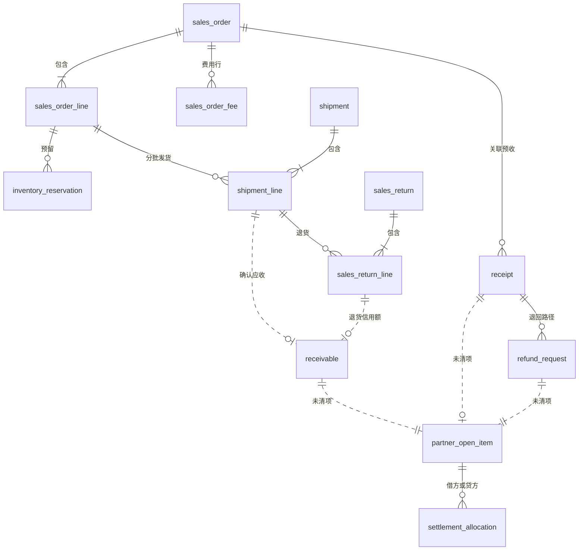
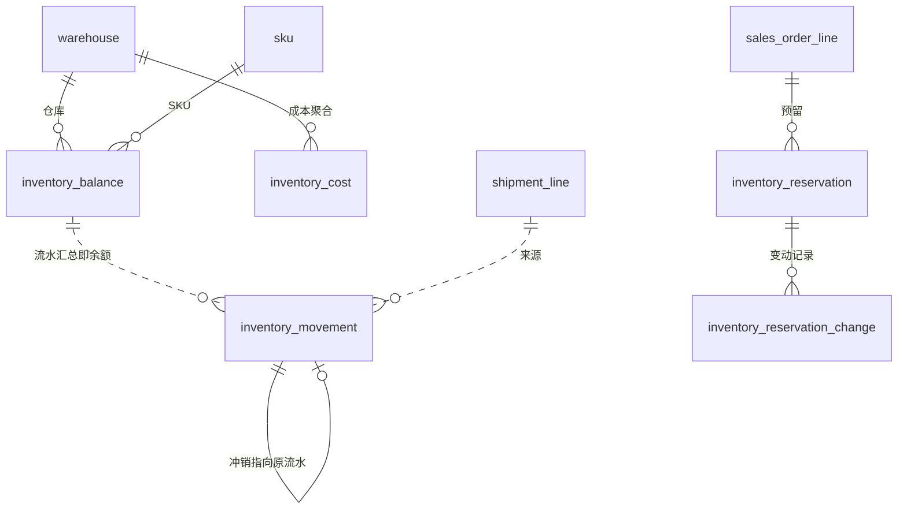

# ERP 数据库设计

## 进项发票核对底层（V107，业务实施中）

`company_policy.invoice_match_tolerance` 默认 1.00。`einv_inbound` 新增 `source`、供应商、接收日期、备注和核对提示；手工来源必须绑定供应商和接收日期，旧 `payable_id` 字段保留，移除其跨发票唯一限制。

`einv_inbound_match` 按发票、应付保存票面未税/税额及应付覆盖未税/税额，两个差异及合计由生成列保持一致。有效发票与应付对唯一，释放后保留时间、日期和原因，可保存多条历史。关联使用租户和公司复合外键；金额与释放信息配有 CHECK。

`inbound_invoice_lock` 每公司一行，供后续核对与来源变更统一加锁。旧关联均映射进核对表，失效来源及变化金额保留为带原因的已释放记录；迁移行以 `legacy_migrated` 标记旧时间的取证边界，不伪造原核对时间。

V106→V107 独立升级演练与约束验证通过，原票、应付、版本及时间戳保持不变，V107 已冻结。该迁移是 B-04 的底层结构，业务接口、冲销联动、报表及页面尚在实施，不能据此认定 B-04 功能已完成。

## 采购费用分摊（V106）

公司参数新增默认开启的资本化开关和金额、数量、重量分摊方式。订单费用新增 `recognized_amount/recognized_tax`，保留原 `recognized_receipt_id`，历史已确认费用只映射进度，不改应付与库存。采购费用类型增加装卸费 `loading`。

`purchase_fee_doc` 保存手工/自动收货来源、承运商、金额税额、成本含税口径、归属、状态和版本。手工费用批准时冻结承运商账期，自动费用逐行沿原订单到期日。`purchase_fee_doc_line` 保存费用、税率及自动行的 `order_fee_id`。`purchase_fee_allocation` 每单每收货行一条，冻结来源版本、剩余数量、已退量、有效货款、SKU 重量、分摊权重及金额。`purchase_fee_cost` 每分摊行每仓一条，保存份额、在库成本、已出库差异和数量流水水位，多仓不会重复计算分摊费用。

手工应付来源为 `purchase_fee_doc_line`。自动应付保留 `purchase_order_fee` 来源及原收货头，明细编号使用本次费用明细 ID，避免分批收货撞唯一键；查询和结算兼容原费用编号。成本类型为 `purchase_fee_stock/purchase_fee_issued`，来源为手工 `purchase_fee_cost` 或自动 `goods_receipt_fee`；已出库差异不改变库存余额。

新表使用租户、公司复合外键；确认进度、费用税额、成本和平衡状态有 CHECK 约束。权重为 `DECIMAL(60,18)`，逐仓份额为 `DECIMAL(24,12)`。V106 已在隔离库应用并冻结，后续结构修正只能新增迁移。

## 采购调价与成本归属（V105）

`price_adjustment` 保存单据类型、供应商、原收货仓、业务日、原因、部门归属、状态、版本及审批和过账记录。`kind` 预留销售，但本批仅开放采购。状态为草稿、待审、已批准、已驳回、已过账、已作废、已冲销，不能直接删除已过账事实。

`price_adjustment_line` 引用原收货行，冻结来源版本、尚未退货数量、原剩余货款和税额、输入方式、新单价和有符号调整额。交易数量保存 18 位小数，金额 2 位、单价 6 位；原税种成本口径随行冻结。`prior_return_basis` 用于冲销恢复调价前的退货计价规则。

`price_adjustment_cost` 保存每行每仓库的数量份额、在库成本与已出库差异，以及库存流水的时间和 ID 水位。复合外键限制租户、公司及单据关系。`cost_adjustment.adjust_type` 新增 `purchase_price_stock`、`purchase_price_issued`，仅前者改变库存总成本；两者均进入账本和总账。

`goods_receipt_line` 新增 `price_adjusted_amount`、`price_adjusted_tax`、`pricing_return_basis`。原收货快照保留；后续退货按当时剩余数量基准累计分摊，最后一次补尾差。数据库约束允许退货累计金额达到原货款加累计调价，但不能超退。V105 不追溯修改历史货款或成本。

新增 `price_adjustment:view/create/update/submit/approve/post/void` 权限，审批和成本处理还需公司完整范围及 `cost:view`。往来沿用 `payable` 和 `partner_open_item`，来源为 `price_adjustment_line`；反向往来沿原事实的到期日和既有冲销关系。

## 账期与到期日（V104）

`partner_role.term_type/term_value` 按客户、供应商角色分别保存账期；为空时继承 `company_policy.default_term_type/default_term_value`。`days` 允许 0—365，0 为现结；`monthly` 表示业务日期所在月的次月 1—28 日。类型和值必须同时为空或同时有效，数据库 CHECK 与服务层同时校验。

`sales_order`、`purchase_order` 的 `term_type/term_value` 在审批时保存最终账期；`term_override` 表示审批前是否由订单指定。审批后的变更单不能修改账期。修改往来单位或公司参数不会改变已审批订单的快照。

签收和收货产生的 `receivable.due_date`、`payable.due_date` 根据业务确认日期及订单快照计算，同单费用沿用同一规则。退货和冲销反向项沿用原往来到期日。`opening_entry.due_date` 支持手填，不填时在过账时按当前账期计算。到期日不改变金额、核销顺序和总账分录。

V104 只建立订单账期快照，不回填历史未清往来的到期日。财务可使用[升级指南](../运维/1.x升级到2.0指南.md)中的只读预览工具单独审核。

## 定时任务与工单短交（V101、V102）

V101 使用 `job_item_failure` 按任务及对象记录逐项失败次数和重试时间。运行日志支持部分失败，仍可完整审计本次调度。总账增量更新复用既有 `gl_balance` 复合主键。

V102 新增 `mfg_work_order_short_close`，每企业、公司和工单仅有一条当前申请。跨企业、跨公司关联由工单和会计期间复合外键约束，记录业务日、工单版本、逐项材料快照、经办人和独立复核人。生产成本项使用 `mfg_cost_item.short_close_expense` 分列短交差异。

## M19 驾驶舱、打印与预警（V95–V97）

`dash_layout` 按企业、公司及用户保存有版本的指标布局。指标结果走只读查询，Redis 缓存键包含用户、公司、仓库、部门和当前权限范围。

`print_template` 按企业、公司及单据类型保存毫米坐标、纸型和布局。每一作用域和单据类型仅有一个启用的默认模板。`print_log` 追加记录单据、使用的模板版本、份数和后台任务。

`alert_rule` 按企业和公司保存阈值、调度和投递对象。`alert_event` 用公司范围内的指纹约束重复触发，将仓库及归属字段用于当前权限判断。SKU 的公司级安全库存覆盖保存在 `alert_sku_safety_stock`。

## M18 生产一期（V92–V94）

V92 增加 BOM 版本、明细、替代料、工单和冻结用料。V93 增加领退料和完工入库单、原领料行引用、库存流水类型及冲销来源。V94 增加生产成本期间、费用池、分摊输入、工单成本和过账留档。单据与成本行通过企业、公司和业务标识建立复合约束，清单和单据查询继续取仓库与部门范围交集。

`mfg_cost_movement` 从原库存流水及冲销指针汇总本期事实。`mfg_cost_posting` 保存实际过账涉及的库存差异、已出库差异和分录标识。`cost_adjustment` 新增 `production_variance`，与原库存成本和运营账本对账。 [生产详细设计](详细设计/09-生产一期.md)

## M17 仓储作业迁移（候选）

V88 添加 `warehouse.wms_task_mode`，初值为 `off`。新增 `wms_task`、`wms_task_line`、`wms_task_confirmation`。按企业、公司和来源单据限制一张上架任务，作业行保留原入库流水和源库位，确认记录保留目标库位、操作人与数量。每次部分确认产生两条零成本库位流水，以确认编号关联。原仓级库存与成本余额保持原值。

V89 新增 `wms_wave`、`wms_pack`、`wms_pack_line`，并扩展任务的波次、拣货预留快照与序列扫描字段。V90 新增 `wms_location_rule`、`wms_move_doc`、`wms_move_line`、`wms_count_group` 和定时补货任务。库位内动作按原仓级汇总锁及有序库位锁执行，内部移库不计入仓级收发。

V91 的 `auth_device_token` 保存凭据摘要、所属用户、设备名、过期和撤销时间。原始令牌只在激活时返回，Redis 保存短时配对记录及设备会话关联。

## M16 CRM 与客户门户迁移（候选）

MySQL 8.0.46 使用下列增量迁移。往来单位和联系人继续使用原主数据，CRM 资料通过企业、公司和往来单位标识关联。订单来源和收款合同字段为历史记录保留默认值。

| 迁移 | 用途 |
| --- | --- |
| V79—V80 | 新增公司级客户画像、团队、联系人画像、线索、公海规则、领取限制和跟进记录。已存在的客户按公司补齐画像。线索手机号密文与查重摘要分列。 |
| V81—V82 | 新增商机阶段和事件、合同及分单关联、回款计划、收款关联、业绩目标及业务权限。 |
| V83—V84 | 新增门户账号、对账确认、物流号、工单和回复。对账确认按企业、公司、客户、日期范围及摘要去重。门户登录会话在隔离 Redis 中维护。 |
| V85 | 新增价格表、商品数量阶梯及价格适用对象。 |
| V87 | 新增公司级门户敏感词和过滤命中记录。 |
| AI 独立库 V5 | 增加客服模型路由及内部分类请求的防重放记录。 |

## M14 平台二期迁移（候选）

V53 扩展统一登录身份、应用用户类型及租户 MFA 策略；V56 增加通用表单、审批申请、字段权限和延迟节点相关表；V60 与 V61 增加开放应用、公司授权、调用审计、Webhook 与权限；V63 和 V64 增加编码规则、流水、字段定义及业务 JSON 与索引列。所有写入均以租户为边界，涉及业务单据时继续检查当前公司及原数据范围。编码流水行锁和自定义字段 JSON 结构按 MySQL 8.0 验证。[MySQL 锁定读](https://dev.mysql.com/doc/refman/8.0/en/innodb-locking-reads.html) · [MySQL JSON](https://dev.mysql.com/doc/refman/8.0/en/json.html)

## M13 AI 迁移（未发布）

主库 V52 登记 `ai:use` 和四项 `ai_admin:*` 权限。独立库 `erp_ai` 的 V1 创建模型配置、额度预占和用量、会话和来源收据、评测；V2 创建知识库、资料版本、片段、重试和索引清理、Wiki 修订和体检；V3 创建以修订为粒度的 Wiki 加工队列。AI 应用账号仅访问 AI 库。会话和评测按企业、公司、用户或操作权限过滤。资料、Wiki 和模型管理按企业隔离，知识库还按授权角色和当前公司任职部门过滤。结果按最新片段及权限计算摘要校验，搜索索引源自 SQL 记录。

## M11 V38—V43 增量迁移（未发布）

沿用MySQL8.0.46，不修改V1—V37。独立V37样例升级至V43已验证历史业务员、默认权限、区划及原有金额库存凭证事实；测试过程不改变开发库。

| 迁移 | 表及关键约束 |
| --- | --- |
| V38 business_representatives | 8类业务头增加sales_user_id或buyer_user_id（非空、默认0）及tenant/company/业务员/业务日期索引。优先owner_user_id，其次created_by，无法确定保留0。权限归属不改。 |
| V39 platform_dictionaries_configuration | sys_dict_type、sys_dict_item：企业编码/值唯一，tenant=0为只读预置；sys_dict_item_override仅覆盖本企业停用标记；sys_dict_revision保存版本；sys_config采用tenant/config_key复合主键，类型、敏感标记及版本；sys_area采用官方代码、parent_id及来源版本。往来单位增加area_id/source_code，联系人增加area_id，销售订单增加delivery_area_id/delivery_address。 |
| V40 official_administrative_areas | 导入3213条MCA-2024区划，保持官方层级及代码；来源、SHA-256和缺层处理见区划数据来源。 |
| V41 notices_messages_delivery | sys_notice/target/read保存公告、收件规则和确认；notify_template按tenant/code/channel唯一；notify_message按tenant/company/user/event_key唯一，待办键包含来源动作及版本；notify_subscription按用户/类别/渠道唯一，仅外部渠道可关；notify_send_log按tenant/message/channel唯一，支持密文载荷、行租约、重试及脱敏结果。 |
| V42 authentication_api_logs | sys_login_log保存认证元数据；sys_api_access_log和sys_api_error_log以request_id唯一，分别保存模板路径及安全定位信息，异常处理标记有版本。日志允许企业或用户0表示未识别主体，不保存原始请求或异常消息。 |
| V43 managed_jobs_platform_permissions | job_definition按tenant/code唯一，含调度、启停、执行租约及版本；job_run_log持久化单次请求、节点、租约、结果。tenant=0预置9项任务；新增24项细分权限，只有保留既有管理能力的指定系统管理角色取得默认授权，自定义角色明确授权。 |

新平台表均保留created_at/updated_at。业务待办、消息、模板及日志的状态为固定CHECK约束，不通过数据字典驱动。在线会话索引及撤销标记保存在同环境Redis命名空间，数据库不存登录会话凭据。

升级先停写并备份，再迁移并等待报表备库追平。V38含8张业务头历史回填及索引，V39增加地址列，正式数据量下需测量锁等待、磁盘和迁移窗口；不把新增DDL当作可回滚的普通事务。

## M11 Y-02 增量迁移（未发布）

V37 `department_data_scope` 沿用MySQL8.0.46，追加两张授权表及业务归属字段，V1—V36不改。

| 变更 | 约束及用途 |
| --- | --- |
| org_role_data_scope | 主键tenant_id/company_id/role_id；scope_type限制五种取值；version按公司角色递增；复合外键约束企业角色及公司。 |
| org_role_data_scope_dept | 主键增加department_id；复合外键同时约束范围配置及同公司部门，防止跨公司自定义引用。 |
| 17类单据头 | owner_department_id、owner_user_id均为BIGINT UNSIGNED NOT NULL DEFAULT 0。分别增加tenant/company/owner/business_date索引；开票使用invoice_date。归属为服务端快照，不随任职变化更新。 |
| import_job | org_scope_snapshot JSON保存发起时部门条件，逐行执行时与当前授权取交集；历史NULL保持旧任务兼容。 |
| export_job | 复用已有范围JSON，增加organization条件；旧JSON缺失字段按全部范围解码，受限用户不能下载旧全范围结果。 |

17类头为sales_order、shipment、receipt、sales_return、refund_request、purchase_requisition、purchase_order、goods_receipt、purchase_return、payment、account_transfer、opening_entry、stock_adjustment、stock_count、stock_transfer、document_reversal、invoice_registration。历史按created_by连接同企业、同公司主部门回填，缺失保持0；冲销随后按八种来源继承原单归属。0作为历史未归属值保留，不建立必须引用真实部门的外键。

升级需停写并排空API和Worker，备份后执行新增迁移；ALTER及全量回填的耗时须在目标数据副本验证。本机验证不等同大表在线升级评估。文档维护：maorongkang@gmail.com。

## M11 Y-01 增量迁移（未发布）

V36 `organization_departments_posts` 新增组织模块，不改已交付迁移和业务单据。使用 MySQL 8.0.46，迁移随 API 启动执行，Worker 继续校验版本。

| 表 | 作用与约束 |
| --- | --- |
| `org_department` | 公司部门树；编码在公司内唯一，上级复合外键限定同企业同公司；物化路径索引包含企业和公司，根深度1、最多20层；根上级库内为 NULL |
| `org_post` | 企业共享岗位定义；编码在企业内唯一 |
| `org_user_company` | 企业、公司、用户联合主键；该用户在该公司的独立组织版本，保留空配置避免撤权前的旧版本再次生效 |
| `org_user_department` | 多部门关联；复合外键同时引用用户公司配置和同公司部门；`primary_company_key=IF(is_primary=1,company_id,NULL)` 唯一索引限制每公司最多一个主部门 |
| `org_user_post` | 岗位定义共享，任职按公司保存；复合外键关联企业岗位和用户公司配置 |

部门集合非空时必须恰有一个主部门，由服务校验；数据库唯一约束兜底“最多一个”。移动、分配、停用先锁企业管理屏障，避免子树互移和检查关联后并发写入。公司撤权同步删除该公司任职、清空负责人并递增组织版本，其他公司不受影响。组织关系不增加 `sys_user_data_scope`。六项权限为 `org_department:view/create/update` 和 `org_post:view/create/update`；迁移授予边界见《M11部门岗位本机验收报告》。

## M10 增量迁移（未发布）

- V34 `default_cash_accounts`：`cash_account` 增加 `default_for_receipt/default_for_payment`（默认 0）、用途生成列和租户 + 公司用途唯一索引；约束默认标记只能为 0/1，停用账户不能保留默认标记。历史账户迁移后均非默认，由管理员选择。
- V35 `report_snapshot_watermark`：单行全局运维水位，`id=1`，`observed_at` 为 UTC 毫秒时间。Worker 只在启用报表备库配置时每五秒更新，随 binlog 复制。报表账号只需 SELECT；运行账号需 UPDATE。该表不保存租户业务数据。
- 原迁移保持原样，迁移仍仅在主库执行，备库通过复制同步 DDL。默认账户变更沿用账户版本和审计规则，详见《M10功能优化实施说明》。

- 文档版本：1.9.0，对应工程 0.9.0。
- 0.8.1 维持 V31，无新迁移。长单据按完整租户、公司和仓库/SKU 维度排序加锁，已有维度不重复 UPSERT；批量预留、出库、成本、凭证和预收核销共用原单据事务。重复 SKU 逐行维护移动成本和剩余预留，任何一行失败仍整单回滚。未降低 RR 隔离级别、事务刷盘或唯一约束。
- 编写日期：2026-11-15，Asia/Shanghai。
- 1.0.1 修订：编写《接口设计》时补充 `sys_user` 的登录锁定字段和 `company` 的打印抬头字段，`document_change` 去掉与 `applied` 重复的 `approved` 状态。修改后重新建表，46 项约束测试全部通过。
- 1.1.0 修订：应收改为按客户签收确认（《业务规则》1.2.0，R2 组）。发货单增加签收字段和状态，发货行增加签收数量、签收差异，订单行增加已签收数量，新增“拒收退回入库”流水类型和“发出商品”账户。约束测试增至 54 项，全部通过。
- 1.1.1 修订：Q02 确认审批时预留，表结构不变；第 11 节补充“待审核需求”（R1-11）的查询路径。
- 1.1.2 修订：开发、集成测试和部署统一使用 MySQL 8.0.46，与已验证建表草案的本机版本一致。
- 依据：《重构设计方案》第 6—10 节，《业务规则》1.5.0。
- 建表脚本：[sql/schema-draft.sql](sql/schema-draft.sql)。当前完整定义以 Flyway 迁移为准，草案保留初始版本，本文说明表的职责、约束落在哪里、写入时怎么写，不逐列重复。
- 文档维护：maorongkang@gmail.com。

## M10 登录凭据存储格式

`tenant_login_provider.secret_ciphertext` 新写入的 AES-GCM 密文使用 `2.` 前缀及 HKDF 派生的渠道加密子密钥，附加认证数据包含企业与登录渠道。读取旧 `1.` 密文成功后，使用 `tenant_id/method/version` 和原密文的二进制精确比较限制更新，写回新格式。格式转换沿用管理员配置版本，管理员并发保存优先。主密钥继续使用原有私有 `ERP_LOGIN_SETTINGS_KEY`，升级步骤见[多方式登录配置](../使用说明/多方式登录配置.md#凭据更换)。

## M9 登录方式设置授权迁移

Flyway V33 在 `sys_permission` 增加 `tenant:login_settings`。数据库对现有 `SYSTEM_ADMIN` 角色和本机演示企业的 `WAREHOUSE_ADMIN` 角色保留原有配置渠道的能力，前提是角色仍为启用状态且持有原有企业管理权限。角色授权记录写入 `sys_role_permission`。新建企业时，初始化工具为系统管理员读取最新的权限目录。

## 0.9.0 多方式登录迁移

- Flyway V32 在 MySQL 8.0.46 新增 `tenant_login_provider`，以 `tenant_id/method` 为主键，保存开关、渠道配置、加密凭据和配置版本。
- `user_login_identity` 以 `tenant_id/user_id/method` 限制每个账号每种方式绑定一次，并以 `tenant_id/method/subject` 防止同企业的同一登录身份绑定多个账号。微信身份包含 `AppID` 和区分大小写的 `OpenID`。
- 短信和邮箱验证码、限流计数、微信授权状态保存在 Redis，按用途和租户隔离并自动过期。原用户手机号字段和已有账号状态沿用原数据。

## 0.8.0 修订

本轮不改写既有迁移，数据库结构保持 V31。第 2.8 节按 V15/V20 和实际业务服务统一草稿删除及行退役口径；预留投影以有效 active 剩余事实为准，过期历史不覆盖仍有效的预留。数据库版本继续锁定 MySQL 8.0.46；迁移 DDL 与运行 DML 账号分离，部署权限生成脚本位于 `scripts/database-grants.ps1`。容量执行计划与索引复核结果见《容量测试报告》，未因推测批量添加索引。

## M7 报表、文件任务与私有文件迁移

0.7.0 新增 V28—V31，保留全部既有迁移。运行环境沿用 MySQL 8.0.46。以下描述对应已实现结构，独立测试库迁移与回归已通过，结果见《测试报告》。

| 迁移 | 表结构与权限 |
|---|---|
| V28 `report_export_permissions` | 新增十组 `report:*`、`export:*` 权限（820—839）；`export_job` 增加提交范围 `request_scope`、成品范围 `result_scope`、`attempts/error_message/checksum/as_of/object_deleted_at` 和状态租约索引。旧任务缺少可信快照时置为失败，要求重新导出 |
| V29 `import_permissions` | 新增 `import:sku/import:partner/import:opening_stock`（860—862）；`import_job` 增加 `file_fingerprint/options_json/warehouse_snapshot/requires_cost/error_message`、按原操作人索引和公司内唯一文件指纹。新增 `import_job_target`，同租户、公司、任务、CSV 行号唯一，并通过复合外键关联任务 |
| V30 `document_file_permissions` | 新增 17 类单据打印权限（880—896）；`file_ticket` 保存租户、公司、用户、用途、资源和五分钟有效期，仅保存令牌 SHA-256 摘要；`object_cleanup` 保存未关联或待删除对象键及重试次数，物理对象由补偿任务清理 |
| V31 `import_retry_checkpoint` | `import_job` 增加 `attempts/next_attempt_at` 与状态、退避时间、租约组合索引；基础设施错误有限自动重试，人工恢复重排队沿用同一任务和行断点，避免文件唯一指纹阻断恢复 |

报表读取现有库存流水、余额、履约、往来、资金及凭证事实，不新增第二套业务台账。一次报表快照在 MySQL 可重复读只读事务内完成，响应含 `asOf`；CSV 序列化和对象仓 I/O 在事务外进行。导出任务领取使用短租约与 `SKIP LOCKED`，成品关联附件和任务完成在短事务提交，下载再次核对当前范围是否覆盖成品实际范围。

销售、采购默认查询按往来单位、SKU 和业务日期汇总，`detail=true` 使用逐单行事实，`feesOnly=true` 限定无 SKU 的费用组穿透。报表 CSV 由 Worker 根据报表类型选取固定中文业务列，不直接序列化查询结果的全部键；内部 ID、URL 均不入成品，无成本权限时不生成相应表头。文件下载强制验证 `file_ticket` 的五分钟期限、原操作人、公司、用途和资源。

导入创建时先在服务端计算文件摘要和业务条件指纹，串行锁定公司后关联 `attachment` 与 `import_job`，使用唯一索引兜底并发防重。源附件的 `owner_type='import_job'`；成品附件为 `export_job`，均不开放通用单据附件接口。后台每个数据行在一个事务内完成领域创建、`import_job_target`、成功计数和 `checkpoint_row`；错误行先回滚领域写入，再在独立事务保存 `import_job_error` 和失败断点。工作进程退出后可从过期租约和已提交断点继续，不重复生成资料或期初草稿。

`warehouse_snapshot` 保存提交时允许的有效仓库集合。后台逐行重取原操作人的账号、公司、角色和仓库授权，使用初始范围与当前范围交集；`requires_cost` 记录源文件是否要求成本权限，撤权后任务停止且读取受限。期初只调用已有 `OpeningService.createStock`，不生成库存流水、资金事实或凭证。

导入领取递增 `attempts`，对象仓 503、瞬态数据库异常按 2、4 秒退避并最多领取 3 次，`checkpoint_row`、行目标和计数均保留。只有数据完整性约束错误会落为业务错误行；连接与锁故障不会把有效行判错。人工 `retry` 用既有 `idempotency_record` 的 `import_job.retry` 记录，锁任务后复核原操作人及当前授权，限失败且仍有未处理行，清零尝试次数后重排队。已成功或已判错误行不再执行。

对象写入前先登记 `object_cleanup` 候选，关联元数据的事务内撤销候选；失败、幂等重放或进程中断遗留的候选由后台重试。清理前检查有效附件引用，避免删除已关联对象。本机存储和 S3 仅保存私有对象，数据库不保存访问凭据。

附件删除通过 `retire` 随逻辑删除事务登记回收候选，一小时后补偿任务检查 `attachment.status='active'` 的引用；没有有效引用时才删除物理对象。文件仓失败保留候选并增加重试计数，不能因为已删除附件仍保留历史元数据就跳过物理回收。

## M2 已执行迁移

工程的数据库结构以 `erp-server/src/main/resources/db/migration/` 为准。V4、V6、V8 新增权限目录。V5 给计量单位增加 `version`，用于防止并发覆盖。V7 将 17 个业务单号字段从 32 字符扩到 64 字符，支持既有 16 字符公司编码生成的 33 字符单号。既有迁移和 `schema-draft.sql` 保留其历史定义。

## M3 价格快照迁移

V11 给销售、采购订单头增加 `pricing_version`，历史数据默认 1，M3 试算新快照为 2。订单行和费用行增加 `price_tax_inclusive`，历史数据默认 1。新快照保留录价口径下的行金额与优惠，含税应收或应付为该净额加上未包含在报价中的税。表头同样在未税录价时增加逐行税额。费用行新增生成列 `total_amount`，表达含税费用。既有 CHECK 名称保留，按对应版本或行内含税标记校验，历史金额不重算。新快照的头、行、费用字段须原样保存，接口示例见《接口设计》6.1。

## M3 任务与成本迁移

V9、V10 新增价格试算、对账和失败事件管理权限。V12 增加调拨行的 `received_cost_amount` 和 `diff_cost_amount`，按实际发生额累计扣减在途成本，最后一笔包含剩余分币。V13 将对账数值扩为 `DECIMAL(38,6)`，可存储金额及数量的差异。V14 新增 `ledger_projection_lock`，按公司协调短事务投影，避免与业务表的外键共享锁竞争。当前共 80 张原有业务及可靠性表、1 张投影协调表。

库存流水与成本调整、借贷分录、核销及资金余额均在本地数据库事务内维护。Redis 不可用时，库存与账务约束继续由 MySQL 保证。Outbox 消费的 Inbox、投影结果与事件完成状态同事务提交，租约失效后可恢复，达到失败上限后进入死信。

## M4 销售迁移与事务

0.4.0 追加 V15、V16、V18、V19，不改写历史迁移。V15 给 `sales_order`、`sales_order_line` 增加 `is_deleted` 及布尔约束，删除草稿和变更移除的旧行保留历史ID、预留与来源关联；有效列表及可发候选过滤退役行。V16 增加发货签收权限，V18 增加开票权限，V19 增加收款、退货退款和核销权限，并给 `refund_request` 增加 `credit_item_ids` JSON。迁移序号有间隔，版本与实际已应用历史保持一致。

订单头、商品行和费用写入 `pricing_version=2` 对应快照。审批在同事务完成整单预留、状态、版本与审批记录；变更先保存 `document_change` 前后快照，需审批时保留原有效行。批准后释放旧预留、写新版本、重新预留，任一库存不足时整体回滚。待发占用中的行更换仓库前须先作废对应待发单。

发货提交占用订单行 `pending_ship_base_qty`；过账减少库存及预留，记发出商品成本，签收时才生成 `receivable` 和收入、税额、销售成本分录。签收差异立即恢复订单可发量，后续拒收退回入冻结库存或确认运输损失。订单完成发货进入 `closed`，拒收恢复剩余可发量后重新为 `approved`；履约、结算、售后分别投影，待审核变更状态不被履约刷新覆盖。

退货提交占用原发货行可退量，过账按原签收金额、税额和出库成本累计拆分信用额，形成贷方未清项。退款提交同时占用未清项额度和原收款可退额度，审核、取消、登记支付在事务内更新对应状态与余额。重复命令由 `idempotency_record` 返回首次安全结果；期间锁、订单头及行、排序库存键、预留、未清项与资金行锁沿用既有顺序。

`invoice_registration` 和行表关联已确认正向应收。创建增加 `receivable.invoiced_amount`，作废减少；它们只维护开票元数据，既不新增 `receivable`/`partner_open_item`，也不改写原应收税额和收入分录。发票税额与来源累计税额的分差保存在 `tax_diff_amount`。

## M5 采购、资金与期初迁移和事务

0.5.0 追加 V20—V23，继续使用本机 MySQL 8.0.46，不修改既有迁移。原始建表草案不重复回写，当前结构以 Flyway 为准。

| 迁移 | 字段、约束与权限 |
|---|---|
| V20 `purchase_permissions` | `purchase_order.is_deleted`、`purchase_order_line.is_deleted`、`purchase_requisition.is_deleted` 均为非空布尔退役标记，默认 0 并有 CHECK；`purchase_order.over_receipt_pct DECIMAL(5,2)` 默认 0，CHECK 限制 0—10，保存审批时超收容差百分比。新增请购权限 600—609、采购权限 610—622，采购创建沿用原权限 |
| V21 `receiving_permissions` | `goods_receipt.cost_tax_inclusive` 可空布尔快照并有 CHECK，过账时记录该次入库成本是否含税；新增收货及采购退货权限 640—651 |
| V22 `purchase_finance_permissions` | `payment.related_order_id` 可空，新增 `(tenant_id,company_id,related_order_id)` 索引及到 `purchase_order` 的公司范围复合外键；新增付款及账户转账权限 670—681 |
| V23 `opening_permissions` | 新增库存期初权限 700—707、往来和资金期初权限 708—713；复用既有 `stock_adjustment`、`stock_adjustment_line`、`opening_entry`，不新增业务表 |

Q18 的请购可转数量采用基础单位。采购草稿创建和修改关联行时，在同一事务按 ID 排序锁定请购头及行，校验已批准来源和 SKU，再对 `purchase_requisition_line.ordered_base_qty` 原子增加或释放差量。草稿也占用可转量，删除、取消或移除来源会释放；采购提交和审批不重复占用。关闭请购阻止新转单，既有采购草稿保留或减少原关联量仍可执行。并发竞争不能使已转量超过请购基础数量。

采购订单金额、税额、优惠及费用由价格引擎保存为版本 2 快照。审批将公司参数 `over_receipt_pct` 复制到订单头，并写入 `purchase_order_line.receive_limit_base_qty`；后续公司参数修改不改变历史上限，订单变更也沿用冻结容差。变更待审核时保留原有效行，批准后更新快照和来源占用；移除的采购行用退役标记保留收货历史引用。采购审批、变更和关闭不改库存余额或预留。

收货提交原子增加采购行 `pending_receive_base_qty`，作废释放；过账把待收转成已收，累计更新已确认金额，写 `goods_receipt_line` 金额、税额与成本快照，入库并生成 `payable`、贷方未清项和凭证。纳税人身份只在本次收货过账时决定入库成本含税口径，保存在 `cost_tax_inclusive`；退货不重新读取公司当前税身份。买方费用按首次收货规则确认。提交采购退货占用原收货行 `pending_return_base_qty`，作废释放，过账累计拆分原金额、税额及成本，扣库存并生成借方信用额；移动加权差额记成本调整，最后一笔处理尾差。

采购、收货及退货共享订单头、行的加锁顺序；采购变更只普通读取下游依赖，不反向锁收货头。收货和退货在期间锁之后，按来源头、订单头、订单行、来源明细、排序库存键顺序锁定。库存、往来、金额快照和账本在同一数据库事务提交，失败整体回滚。已收或待收行冻结 SKU、单位、价格、税率和分摊后单位净额；已提交待收的行改仓前必须先作废对应收货单。

供应商付款确认扣资金、借记 `AP` 并生成借方付款未清项。关联采购订单的已确认预付，在后续收货确认应付时按业务日期及 ID 顺序自动核销；订单取消保留已确认预付款。供应商退款使用 `receipt_type='supplier_refund'`，确认增加资金、贷记 `AP`，生成贷方未清项。应付核销只能在付款、应付、采购退货信用额和供应商退款之间进行，禁止与应收混用。转账同事务借记转入 `FUNDS` 本金、贷记转出 `FUNDS` 本金加手续费，手续费借记 `TRANSFER_FEE`，余额不足整体回滚。

库存期初使用 `stock_adjustment.adjust_type='opening'` 和既有行表，逐行保存 `unit_id/unit_rate/qty/base_qty/input_total_cost`；换算严格校验精度，不静默截断。另一人审核后过账，入库流水为 `opening_in`，借记 `INVENTORY`、贷记 `OPENING_EQUITY`。往来及资金期初使用 `opening_entry`：资金仅 `cash/D`；客户往来 `receivable/D` 为欠款、`receivable/C` 为预收；供应商往来 `payable/C` 为欠款、`payable/D` 为预付。过账生成对应事实、未清项或资金余额，以及与 `OPENING_EQUITY` 平衡的分录。期初审核始终与制单人分离，已过账只读，通用冲销留待 M6。

## M6 调拨、盘点、冲销和关账迁移

0.6.0 追加 V24—V27，M6 已通过验收。旧迁移保留，已经应用的本轮迁移也不再修改；后续修表继续追加新版本。

| 迁移 | 本轮变化 |
|---|---|
| V24 | 增加 `period:close`、`period:reopen` 权限，期间状态、版本、关闭人与时间、重开次数沿用 `accounting_period` |
| V25 | 增加调拨操作权限和 `stock_transfer_event_line` 事实表，逐笔记录 ship、receive、returned、lost 的来源行、基础数量、成本、业务日期与期间；调拨头、行继续使用原有表与 V12 的累计成本字段 |
| V26 | 增加盘点操作权限、`stock_count_line.input_unit_cost` 非负单价字段；沿用库存调整权限并将名称由“库存期初”统一为“库存调整” |
| V27 | 增加冲销权限；应收、应付来源唯一键扩为 `(tenant_id,company_id,source_type,source_id,source_line_id,posting_action)`，包含履约来源头，允许旧履约冲销后由新履约单再次确认费用，同时阻止同一履约来源同行同动作重复入账 |

调拨按“期间共享锁 → 调拨头 → 来源行 → 排序库存键”过账。调出按当前移动加权成本减少调出仓库存并增加在途；分批调入按原总成本累计分配，最后一笔取剩余成本。每笔分批事实有独立 ID，作为库存流水来源行，既保留与原调拨行的关联，也避免同一行多次实收被当作重复过账。最后一批未收量保留在 `diff_base_qty`、`diff_status='pending'`；退回与损失处理后累计到 `diff_cost_amount`，在途量及在途成本同时归零。未实收前目标仓可用库存不增加。

盘点首期采用 `count_mode='watermark'`。开始盘点在一次排序库存锁中取得全部选定商品的 `book_qty`、`snapshot_at` 和流水水位，避免较小 ID 的延迟提交污染快照。录入的 `counted_qty` 表示快照时点实物数，`diff_qty` 仍由数据库生成。过账对当前库存应用这个差额，保留盘点期间后续的收发货；不把实盘数写成当前余额。盘盈优先使用过账时移动加权价、历史最后入库价，无历史价格才使用审核过的 `input_unit_cost`；盘亏按当前移动加权价。

`stock_adjustment` 复用六种 `adjust_type`：opening、gain、loss、block、unblock、scrap。类型建单后固定；opening、gain 保存整行 `input_total_cost`，其余类型不接受人工成本。冻结和解冻只改变冻结量并追加流水；报废扣减冻结库存，出入库及报废按对应库存、盘盈盘亏或成本差异账户记账。各类型均经另一人审核后过账。

冲销沿用 `document_reversal`，一张来源单只能存在一张未驳回的冲销单。八类来源为 shipment、sales_return、goods_receipt、purchase_return、receipt、payment、account_transfer、stock_adjustment。创建及过账重新核查下游引用、活动核销或退款占用、开票登记；原事实不删除，库存、应收应付及凭证追加反向记录并指向原事实。原单改为 reversed，原订单和退货进度相应回退，发货消费的预留不恢复，订单行标为失效。冲销生成的 `allocation_type='reversal'` 抵销核销结清正反未清项，禁止单独撤销。已冲销原应收和冲销生成的抵销应收不作为可开票事实，候选与登记写入同时校验。

提交、期初及退款审核同样先按原业务日期取得期间共享锁，再锁业务头，防止关闭完成后并发写入待处理单据；不得借请求中的另一日期切换提交屏障。关账仅允许整家公司范围，先用独立短事务同步待处理凭证投影，沿用 `ledger_projection` Inbox 去重和公司协调锁，随后预检查。期间排他锁内再次读取最新五项检查和待投影事件；存在新事实即保持开放并要求重试，不持期间排他锁等待投影。关闭按年月顺序，重开仅限最近已关闭期间，原因记审计。

## 1. 结论与验证情况

| 项目 | 结果 |
|---|---|
| 表 | 80 张，分 11 组，见第 3 节 |
| 约束 | 主键 80、唯一 120、外键 162、CHECK 221 |
| 索引 | 368 个，含主键、唯一键和外键自动建立的索引 |
| 建表 | 在本机 MySQL 8.0.46 的临时库中执行通过 |
| 约束测试 | 54 项全部通过：41 项违规写入均被预期的约束拦截，13 项合法写入和写法验证结果正确 |

约束测试先原样写入《业务规则》第 5 节 SO-4 订单的全部金额，确认文档样例满足表上的金额约束；然后逐项构造违规写入，并断言错误信息中出现的是预期的约束名，避免“因为别的原因失败”被误判为通过。测试编号（N、P 开头）在第 5 节引用。

- M1 已在 MySQL 8.0.46 独立空库执行 V1—V3，54 项 JUnit 约束测试通过。其中 47 项对应原编号，7 项依据规则重建，详见《测试报告》。

后续验证项目：

- 多连接并发下的锁行为。本次只证明了约束在单连接下生效，并发用例（T01、T02、T07 等）在阶段 C 实测。
- 数据量下的执行计划。阶段 F 结合压测数据确认索引。

设计阶段使用的临时库已删除。M1 使用项目专用的开发库和测试库。

## 2. 通用约定

### 2.1 命名

- 表名、字段名用小写加下划线，表名用单数名词。
- 用户和角色表命名为 `sys_user`、`sys_role`，没有沿用方案 9.1 的 `user`、`role`，避免和 MySQL 的 `USER()` 函数、系统表 `mysql.user` 混淆。
- 约束和索引前缀：`uk_` 唯一键、`idx_` 普通索引、`fk_` 外键、`ck_` 检查约束。MySQL 中外键名和 CHECK 名在整个库内必须唯一，所以一律以表名开头。
- 违反约束时 MySQL 的错误信息带约束名。后端按约束名映射成中文提示和规则编号，例如 `ck_inventory_balance_available` 映射为“可用库存不足（R4-01）”。

### 2.2 主键

主键为 `BIGINT UNSIGNED`，由应用生成按时间递增的 64 位 ID，不用自增列。原因：

1. 单据头和行在同一事务里批量插入，行需要引用头的 ID，不必先插头再回读自增值。
2. 多个 API 实例同时写入，不依赖数据库分配。
3. 按时间递增，InnoDB 聚簇索引顺序追加，避免随机插入引起页分裂。
4. 不能从 ID 推算业务量。

接口中 ID 以字符串传输（方案第 4 节），防止前端 JavaScript 丢失精度。

### 2.3 租户、公司与复合外键

- 所有业务表都带 `tenant_id`，公司级的表再带 `company_id`。
- 父表提供 `uk_<表>_scope (tenant_id, company_id, id)`，租户级的表为 `(tenant_id, id)`。子表用复合外键引用它。
- 效果：子记录和父记录在数据库层面一定属于同一租户、同一公司。例如发货单的仓库外键是 `(tenant_id, company_id, warehouse_id)`，公司一的发货单引用不到公司二的仓库（N09）；租户二的订单引用不到租户一的客户（N10）。
- 父表的 scope 唯一键为复合外键提供完整的引用目标，使数据库在校验记录 ID 时也校验租户和公司归属。
- 外键一律使用默认的 RESTRICT，不使用级联删除（方案 9.2）。
- 跨模块的外键保留。外键只保证同库引用正确，不代表其他模块可以直接写这张表，写入仍然走所属模块的接口（方案 5.1）。

复合外键只防止写错，不负责查询隔离。所有查询、导出和后台任务仍然必须带 `tenant_id` 和数据范围条件。

### 2.4 数值

| 用途 | 类型 | 说明 |
|---|---|---|
| 金额 | `DECIMAL(24,2)` | 人民币分 |
| 单价、单位成本 | `DECIMAL(24,8)` | R3-03 |
| 数量 | `DECIMAL(24,6)` | |
| 单位换算率 | `DECIMAL(18,6)` | |
| 税率 | `DECIMAL(7,6)` | 13% 存为 `0.130000` |
| 百分比参数 | `DECIMAL(5,2)` | 如超收容差 |

- 订单进度一律用基础单位（`*_base_qty`）比较和扣减，单据单位的数量和换算率作为快照保留。这样不会因为换算舍入把“刚好发完”判成“超发”。
- 应收应付（`kind`）、未清项（`direction`）、分录（`direction`）的金额恒为正，方向单独存。库存流水、成本调整这类需要直接求和的流水用带符号的数值。

### 2.5 时间

- 时间点用 `DATETIME(3)`，统一存 UTC。应用连接时设置 `time_zone = '+00:00'`，列默认值 `CURRENT_TIMESTAMP(3)` 才是 UTC。
- 业务日期用 `DATE`，存业务所在地（Asia/Shanghai）的日期，决定会计期间和账龄。
- 不用 `TIMESTAMP`：它有 2038 年上限，并且会随会话时区做隐式转换。

### 2.6 状态与枚举

状态用 `VARCHAR` 加 `CHECK (status IN (...))`，可读性好，出错时能直接看出是哪个值。新增状态需要新迁移修改 CHECK。

状态迁移是否合法（《业务规则》第 11 节）由应用的条件更新保证：

```sql
UPDATE shipment
   SET status = 'posted', posted_at = :now, period_id = :period_id, version = version + 1
 WHERE id = :id AND status = 'submitted';
-- 影响 0 行：单据已被其他请求改动，返回 409
```

### 2.7 公共列与只追加表

可变的表都带 `version`（乐观锁）、`created_by`、`created_at`、`updated_by`、`updated_at`。

下列表只追加、不修改，只有 `created_*`：`inventory_movement`、`inventory_reservation_change`、`cost_adjustment`、`journal`、`journal_line`、`approval_record`、`audit_log`。应用的数据库账号对这些表只授予 SELECT 和 INSERT（第 15 节）。

`receivable`、`payable` 记录的业务事实过账后不变，唯一会变的是已开票金额 `invoiced_amount`，所以保留了 `version` 和 `updated_at`。

### 2.8 删除与退役边界

- 销售订单、采购订单、请购单的草稿删除写 `is_deleted=1`，保留原单号及审计；销售、采购订单变更移除的旧行同样退役，历史履约引用不变。有效列表、需求和可履约候选过滤退役记录。对应 V15、V20。
- 其他单据采用各自已定义的取消、作废或状态命令；未过账草稿在重存时可物理替换无历史引用的明细。不能把“草稿可物理删除”当作所有业务表的通用规则。
- 主数据通过 `status=disabled` 停用；已过账的单据、流水、分录永不删除，更正走冲销。
- 单号唯一键不包含删除标记，退役单号仍占用，禁止回收后创建同号记录。

### 2.9 可选维度的默认键

库存的 `location_key`、`lot_key` 定义为 `NOT NULL DEFAULT ''`，`ledger_balance` 的维度键定义为 `NOT NULL DEFAULT 0`。唯一键里的列如果允许 NULL，MySQL 允许多行 NULL 并存，唯一约束就形同虚设（方案 8.1）。

### 2.10 用生成列表达“有条件的唯一”

MySQL 没有部分索引，用 STORED 生成列加唯一键实现：

| 表 | 生成列 | 保证的内容 | 测试 |
|---|---|---|---|
| `inventory_reservation` | `active_order_line_key = IF(status = 'active', order_line_id, NULL)` | 一个订单行同时只有一条有效预留，用完后可以再建 | N03、P03 |
| `document_change` | `pending_doc_key` | 一张单据同时只有一张待审核的变更单 | N23 |
| `document_reversal` | `active_source_key` | 一张单据只能有一张未驳回的冲销单 | P07 |
| `unit_conversion` | `base_sku_key` | 每个 SKU 只有一个基础单位 | N27 |
| `sys_user_data_scope` | `warehouse_key` | 同一用户的数据范围不重复 | |
| `settlement_allocation` | `debit_direction = 'D'`、`credit_direction = 'C'` | 参与复合外键，保证核销一借一贷 | N13b |

### 2.11 字符集与排序规则

脚本里每张表都显式指定 `utf8mb4` 和 `utf8mb4_0900_ai_ci`。本机服务器的默认排序规则是 `utf8mb4_general_ci`，不显式指定的话，库里会混用两种排序规则，跨表比较字符串时直接报错。

`0900_ai_ci` 不区分大小写，`SKU-a` 和 `SKU-A` 视为同一编码，不能同时存在。

## 3. 表清单

### 3.1 组织与权限（10 张）

| 表 | 用途 |
|---|---|
| `tenant` | 租户，数据隔离边界 |
| `company` | 公司，业务主体 |
| `company_policy` | 公司级业务参数，即《业务规则》中标记为【参】的取值 |
| `warehouse` | 仓库，只属于一家公司 |
| `sys_user`、`sys_role` | 用户、角色 |
| `sys_permission` | 权限目录，全局共用，由迁移脚本维护 |
| `sys_user_role`、`sys_role_permission` | 关系表 |
| `sys_user_data_scope` | 数据范围：整个公司或指定仓库 |

### 3.2 基础资料（6 张）

| 表 | 用途 |
|---|---|
| `business_partner` | 往来单位，客户和供应商共用一个主体 |
| `partner_role` | 客户或供应商角色，以及该角色下的默认价格口径（R3-01） |
| `partner_contact` | 联系人，属于敏感字段 |
| `cash_account` | 结算账户 |
| `cash_account_balance` | 账户余额投影 |
| `income_expense_item` | 收支项目，用于非往来的收付款 |

### 3.3 商品（6 张）

`unit`、`product_category`、`product`（SPU，定义基础单位）、`sku`、`unit_conversion`、`sku_barcode`。

### 3.4 销售（7 张）

`sales_order`、`sales_order_line`、`sales_order_fee`、`shipment`、`shipment_line`、`sales_return`、`sales_return_line`。

### 3.5 采购（9 张）

`purchase_requisition`、`purchase_requisition_line`、`purchase_order`、`purchase_order_line`、`purchase_order_fee`、`goods_receipt`、`goods_receipt_line`、`purchase_return`、`purchase_return_line`。

### 3.6 库存与成本（12 张）

`inventory_balance`、`inventory_cost`、`inventory_movement`、`inventory_reservation`、`inventory_reservation_change`、`stock_transfer`、`stock_transfer_line`、`stock_count`、`stock_count_line`、`stock_adjustment`、`stock_adjustment_line`、`cost_adjustment`。

### 3.7 往来、资金与发票（11 张）

`opening_entry`、`receivable`、`payable`、`receipt`、`payment`、`refund_request`、`account_transfer`、`partner_open_item`、`settlement_allocation`、`invoice_registration`、`invoice_registration_line`。

### 3.8 账本（5 张）

`accounting_period`、`ledger_account`、`journal`、`journal_line`、`ledger_balance`。

### 3.9 单据流转（5 张）

`document_sequence`、`approval_record`、`document_change`、`document_reversal`、`attachment`。

### 3.10 可靠性（3 张）

`idempotency_record`、`outbox_event`、`inbox_event`。

### 3.11 运维（6 张）

`audit_log`、`reconciliation_run`、`reconciliation_diff`、`import_job`、`import_job_error`、`export_job`。

### 3.12 与方案 9.1 的差异

| 变化 | 原因 |
|---|---|
| 新增 `partner_open_item` | 把所有核销余额集中到一张表，核销可以建外键，见第 7.1 节 |
| 新增 `inventory_cost`、`cost_adjustment` | 成本按仓库 + SKU 核算，与带库位批次的余额分开（R6-01），尾差单独留痕（R6-06） |
| 新增 `company_policy` | 承载【参】类参数，修改留审计 |
| 新增 `opening_entry` | 上线时录入往来和资金期初（方案第 13 节） |
| 新增 `document_reversal` | 冲销单需要单独审核（《业务规则》第 12 节） |
| 新增 `invoice_registration` | 开票登记只关联已有应收应付（R2-03） |
| 新增费用行表、请购表、调整单表 | 对应 R2-06、R3-10 和 P0 范围里的请购、期初、冻结、报废 |
| `user`、`role` 改名 | 见第 2.1 节 |
| `external_request` 暂不建 | 首期不接支付渠道，见第 13 节 |

## 4. 表关系

### 4.1 销售到收款

实线是数据库外键，虚线是按 `source_type`、`source_id` 关联的对应关系，由应用维护，没有外键。



### 4.2 库存



## 5. 约束落在哪里

### 5.1 由数据库保证的规则

| 规则 | 约束 | 测试 |
|---|---|---|
| R4-01 不允许负库存 | `ck_inventory_balance_available`：在库 − 预留 − 冻结 ≥ 0 | N01、P01、P02 |
| R4-02 不超发 | `ck_sales_order_line_progress`：关闭 + 已发 + 待发占用 ≤ 批准数量 | N05 |
| R4-03 超收不超过容差 | `ck_purchase_order_line_progress`：关闭 + 已收 + 待收占用 ≤ 可收上限 | N30、P06 |
| R5-02 不超退 | `ck_shipment_line_return`：已退 + 待退占用 ≤ 签收数量 | N24 |
| R2-01 签收不超过已发 | `ck_sales_order_line_signed` | N38 |
| R2-10 一次签收、签收数量 + 差异 = 发货数量 | `ck_shipment_line_sign` | N34、P11 |
| R2-10 已签收必须有签收日期和期间，签收日期不早于发货日期 | `ck_shipment_signed`、`ck_shipment_sign_date` | N36、N37 |
| R2-11 有差异必须选择处理方式 | `ck_shipment_line_diff` | N35、P11 |
| R1-02 一行一条有效预留 | `uk_inventory_reservation_active` | N03、P03 |
| R1-04、R1-07 预留只能被消费或释放一次 | `ck_inventory_reservation_state`、`uk_inventory_reservation_change` | N04、N22 |
| R2-03 一个来源行只产生一笔应收 | `uk_receivable_source` | N20 |
| R3-08 累计确认不超过行金额 | `ck_sales_order_line_recognized` | N33 |
| R3-12 行内金额勾稽 | `ck_sales_order_line_net`、`ck_sales_order_line_tax`、`ck_sales_order_total`、`ck_sales_order_tax` | N06、N07 |
| R4-08 核销双方同公司、同往来单位、同币种，一借一贷 | `fk_settlement_allocation_debit`、`fk_settlement_allocation_credit` | N13a、N13b |
| R4-08 核销不超过剩余额 | `ck_partner_open_item_amount` | N13c |
| R4-10 资金账户不为负 | `ck_cash_account_balance_nonneg` | N12 |
| R5-07 第 2 条 原收款累计退款不超额 | `ck_receipt_refund` | N14 |
| R5-07 退回路径属于同一客户 | `fk_refund_request_receipt` | N15 |
| R6-06 数量为 0 时总成本为 0 | `ck_inventory_cost_zero` | N11 |
| R7-05 撤销核销必须填原因 | `ck_settlement_allocation_revoked` | N32 |
| R7-07 关闭期间留痕 | `ck_accounting_period_closed` | N26、P08 |
| R8-04 同时只有一张待审核变更 | `uk_document_change_pending` | N23 |
| R8-08 单号唯一、号段上限 | `uk_<表>_no`、`ck_document_sequence_value` | N08、P09 |
| 方案 6.3 凭证借贷平衡 | `ck_journal_balanced` | N18 |
| 方案 9.2 同一来源只过账一次 | `uk_journal_source`、`uk_inventory_movement_source` | N19、N21 |
| 方案 6.4 转账限同公司、同币种 | `fk_account_transfer_from`、`fk_account_transfer_to` | N17a、N17b |
| 业务规则第 12 节 退款、冲销经办审核分离 | `ck_refund_request_reviewer`、`ck_document_reversal_approver` | N16、N31 |
| 仓库属于一家公司、跨租户隔离（T15） | 复合外键 | N09、N10、N28、N29b |

### 5.2 必须由应用保证的规则

CHECK 只能看到同一行，外键只能检查引用是否存在。下列规则由领域代码保证，偏差由第 10 节的对账发现：

| 规则 | 数据库为什么管不了 | 应用做法 |
|---|---|---|
| 单据头合计等于各行合计（R3-12） | 跨行求和 | 保存时服务端重算全部金额，不采用前端传来的合计 |
| 凭证头借贷合计等于分录合计 | 跨行求和 | 同一事务内由分录汇总写入凭证头；对账项 `journal_balance` |
| 发货行的 SKU、客户与订单一致 | 跨表比对 | 创建发货单时校验。加复合外键要给订单行再建一个唯一索引，暂不加 |
| 客户单据只能选择客户角色 | 角色在 `partner_role` 中 | 应用校验 |
| 状态迁移合法 | 依赖迁移前的状态 | 条件更新 `WHERE status = 原状态`，见第 2.6 节 |
| 过账时期间必须开放（R7-09） | 跨表 | 加锁读取期间，见第 8.4 节 |
| 应收和应付不互相核销（R4-11） | 依赖未清项类型 | 核销时校验两侧都属于应收侧或都属于应付侧，见第 7.2 节 |
| 分批金额按累计法计算（R3-08） | 计算逻辑 | 领域服务计算；数据库只兜底“累计不超过行金额” |
| 余额预留量等于有效预留之和 | 跨表 | 同一事务更新；对账项 `reservation` |
| 订单的履约、结算、售后状态 | 由多张表推导的投影 | 根据事实计算后写入，可以重算 |
| 审批后不能改价格口径（R3-01） | 依赖状态 | 已批准单据的更新语句不包含这一列 |
| 订单审批、收款确认的经办审核分离 | 由公司参数决定是否启用 | 按 `company_policy` 校验。退款和冲销属于【定】，由数据库强制 |

## 6. 库存

### 6.1 四类数据

| 表 | 性质 | 说明 |
|---|---|---|
| `inventory_movement` | 事实 | 只追加，同一来源行同一动作只能有一条 |
| `inventory_balance` | 投影 | 在库、预留、冻结，与流水同事务更新，可由流水重算 |
| `inventory_cost` | 成本聚合 | 按公司 + 仓库 + SKU；首期不启用库位批次，数量等于余额的在库量 |
| `inventory_reservation`、`inventory_reservation_change` | 预留及其变动 | 变动记录只追加 |

成本单独建表的原因：R6-01 规定成本按“仓库 + SKU”核算，而余额的自然键还包含库位和批次。首期两者一一对应；以后启用批次，余额会拆成多行，成本仍是一行，表结构不用动。

### 6.2 流水类型

| `movement_type` | 在库 | 冻结 | 成本 | 来源 |
|---|:---:|:---:|:---:|---|
| `opening_in` | + | | + | 期初调整单行 |
| `purchase_in` | + | | + | 收货单行 |
| `purchase_return_out` | − | | − | 采购退货单行 |
| `sales_out` | − | | − | 发货单行；成本转入发出商品（R2-09） |
| `sales_return_in` | + | 待检、不合格时 + | + | 销售退货单行（R5-04） |
| `sales_reject_in` | + | + | + | 发货单行；签收时被拒收的货退回，进入冻结待检，按原出库单位成本入库（R2-11） |
| `transfer_out` | − | | − | 调拨单行，成本转入在途 |
| `transfer_in` | + | | + | 调拨单行 |
| `count_gain`、`count_loss` | ± | | ± | 盘点单行 |
| `adjust_in`、`adjust_out` | ± | | ± | 调整单行 |
| `block` | | + | | 冻结 |
| `unblock` | | − | | 解冻，包括质检合格 |
| `scrap` | − | − | − | 报废，只能报废已冻结的货 |

冲销时写一条 `posting_action = 'reverse'` 的流水，数值取反，`reverses_movement_id` 指向原流水。

### 6.3 写法

**审批时预留**：多行订单按 `(warehouse_id, sku_id)` 升序逐行执行，任一行影响 0 行，整单回滚（R1-03）。

```sql
UPDATE inventory_balance
   SET reserved_qty = reserved_qty + :qty, version = version + 1
 WHERE tenant_id = :tenant_id AND company_id = :company_id
   AND warehouse_id = :warehouse_id AND sku_id = :sku_id
   AND location_key = '' AND lot_key = ''
   AND on_hand_qty - reserved_qty - blocked_qty >= :qty;
-- 影响 1 行后，再插入 inventory_reservation 和一条 reserve 变动记录
```

条件更新是主防线（P01、P02），`ck_inventory_balance_available` 是兜底（N01）。不能先 SELECT 可用量，再无条件 UPDATE。

**发货过账时消费预留**：

```sql
UPDATE inventory_balance
   SET on_hand_qty = on_hand_qty - :qty, reserved_qty = reserved_qty - :qty, version = version + 1
 WHERE tenant_id = :tenant_id AND company_id = :company_id
   AND warehouse_id = :warehouse_id AND sku_id = :sku_id
   AND location_key = '' AND lot_key = ''
   AND reserved_qty >= :qty AND on_hand_qty >= :qty;

UPDATE inventory_reservation
   SET remaining_qty = remaining_qty - :qty,
       status = IF(remaining_qty = 0, 'consumed', 'active'),
       version = version + 1
 WHERE id = :reservation_id AND status = 'active' AND remaining_qty >= :qty;
```

MySQL 单表 UPDATE 的赋值从左到右求值，`status` 表达式里的 `remaining_qty` 已经是减过之后的值（已在本机验证）。其他数据库不一定如此，迁移时要改写。

订单行的预留已经到期（R1-06），或本次发货数量超过剩余预留时，超出部分按无预留出库处理，条件改为可用量足够。

**更新成本**：

```sql
SELECT qty, total_cost, version
  FROM inventory_cost
 WHERE tenant_id = :tenant_id AND company_id = :company_id
   AND warehouse_id = :warehouse_id AND sku_id = :sku_id
   FOR UPDATE;
-- 应用按 R6-03 ~ R6-08 算出新数量、新总成本和需要的尾差调整
UPDATE inventory_cost
   SET qty = :new_qty, total_cost = :new_total, version = version + 1
 WHERE id = :id AND version = :version;
```

CHECK 在每条语句执行完时检查，中间结果也必须合法。R6-08 样例中“冲减后总成本为 −10.00”只是计算过程：应用要先算出最终值 0.00 一次写入，同时插入一条 +10.00 的 `cost_adjustment`。如果先写 −10.00 再补一条更新，第一条就会被 `ck_inventory_cost_nonneg` 拒绝。

### 6.4 加锁顺序

全系统按固定顺序加锁（方案 10.4）。以发货过账为例：

1. `accounting_period`，共享锁（第 8.4 节）
2. 单据头，条件更新状态
3. 来源订单行，按 `id` 升序
4. `inventory_balance`，按 `(warehouse_id, sku_id, location_key, lot_key)` 升序
5. `inventory_cost`，按 `(warehouse_id, sku_id)` 升序
6. `inventory_reservation`，按 `id` 升序
7. `partner_open_item`，按 `id` 升序
8. `cash_account_balance`，按 `id` 升序
9. 插入流水、应收、分录、Outbox 事件和幂等结果

审批、退款、取消、回调都按这个顺序取锁，不涉及的步骤直接跳过。

## 7. 往来与核销

### 7.1 为什么加一张未清项表

方案 9.1 只列了 `receivable`、`payable`、`receipt`、`payment` 和 `settlement_allocation`。如果核销直接引用这四张表，核销记录只能用“类型 + ID”指向其中任意一张，建不了外键；四张表还要各自维护一份“未核销金额”。

加上 `partner_open_item` 之后：

- 应收、收款这些业务记录只记录发生了什么，过账后基本不变。
- “还剩多少没核销”集中在 `partner_open_item.open_amount`，核销只有一种写法：条件扣减。
- 核销表的两个外键都指向这张表，并带上公司、往来单位、币种和方向，R4-08 由数据库保证（N13a、N13b）。
- 账龄分析和对账单只查一张表。

这和库存拆成“流水 + 余额”是同一个思路。

### 7.2 方向对照

`direction = 'D'` 表示这一项让“对方欠我方”的金额增加，`C` 相反。

| 业务记录 | `item_type` | 方向 | 所属侧 |
|---|---|:---:|---|
| 应收：出库、买方运费、期初应收 | `receivable`（`kind = charge`） | D | 应收 |
| 退货信用额、客户预收期初 | `receivable`（`kind = credit`） | C | 应收 |
| 客户收款 | `receipt`（`customer`） | C | 应收 |
| 客户退款申请 | `refund_request` | D | 应收 |
| 应付：收货、我方承担的运费、期初应付 | `payable`（`kind = charge`） | C | 应付 |
| 采购退货、预付供应商期初 | `payable`（`kind = credit`） | D | 应付 |
| 供应商付款 | `payment`（`supplier`） | D | 应付 |
| 供应商退款 | `receipt`（`supplier_refund`） | C | 应付 |

核销只能在同一侧内一借一贷。首期不做应收应付互抵（R4-11），应用校验两侧都属于应收侧或都属于应付侧。

### 7.3 核销写法

```sql
-- 两条扣减按未清项 id 升序执行；任一条影响 0 行即额度不足，整体回滚
UPDATE partner_open_item
   SET open_amount = open_amount - :amount, version = version + 1
 WHERE id = :smaller_id AND open_amount >= :amount;

UPDATE partner_open_item
   SET open_amount = open_amount - :amount, version = version + 1
 WHERE id = :larger_id AND open_amount >= :amount;

INSERT INTO settlement_allocation
  (id, tenant_id, company_id, partner_id, currency, debit_item_id, credit_item_id, amount, status, allocation_type, created_by)
VALUES (:id, :tenant_id, :company_id, :partner_id, 'CNY', :debit_item_id, :credit_item_id, :amount, 'active', 'manual', :user_id);
```

撤销核销（R7-05）：核销记录改为 `revoked` 并填写原因，两侧 `open_amount` 加回，在同一事务内完成。原核销记录不删除。

### 7.4 退款的额度占用

以《业务规则》第 7 节样例为例：退货信用额 45.83，退回路径是收款单 RC-1。

| 步骤 | 写入 |
|---|---|
| 提交退款申请 | 退款申请转为待审核；新建退款申请的未清项（D 45.83）；与退货信用额的未清项（C）建立 `status = reserved` 的核销 45.83，两侧 `open_amount` 各减 45.83；RC-1 的 `refund_pending_amount` 加 45.83 |
| 财务登记退款成功 | 核销改为 `active`；RC-1 处理中金额减 45.83、已退金额加 45.83；资金账户余额减 45.83；写分录 |
| 驳回或取消 | 核销改为 `released`，两侧 `open_amount` 加回；RC-1 处理中金额减 45.83 |

R5-07 的两条约束在提交时的同一事务里同时扣减：第 1 条由贷方未清项的 `open_amount >= 0` 保证，第 2 条由 `ck_receipt_refund` 保证。并发提交的退款申请不会超额。

### 7.5 按订单自动核销预收（R4-07）

签收生成应收后，在同一事务里找出 `receipt.related_order_id` 等于本订单、状态为 `confirmed` 的收款，按 `business_date`、`id` 升序取它们的未清项逐笔核销，`allocation_type = 'auto_order'`。

## 8. 运营账本

### 8.1 账户目录

账户由系统固定，首期不开放用户修改。种子数据在建表脚本末尾。

| 代码 | 名称 | 余额方向 | 必带维度 |
|---|---|:---:|---|
| `FUNDS` | 资金（现金及银行） | 借 | 结算账户 |
| `AR` | 应收账款 | 借 | 往来单位 |
| `AP` | 应付账款 | 贷 | 往来单位 |
| `INVENTORY` | 库存商品 | 借 | 仓库 |
| `GOODS_IN_TRANSIT` | 在途库存 | 借 | 仓库 |
| `INPUT_VAT` | 进项税额 | 借 | |
| `OUTPUT_VAT` | 销项税额 | 贷 | |
| `SALES_REVENUE` | 销售收入 | 贷 | |
| `FEE_INCOME` | 代收费用收入 | 贷 | |
| `OTHER_INCOME` | 其他收入 | 贷 | |
| `COGS` | 销售成本 | 借 | |
| `COST_VARIANCE` | 成本差异 | 借 | |
| `INVENTORY_ADJUSTMENT` | 库存盘盈盘亏、报废及运损 | 借 | 仓库 |
| `PURCHASE_FEE` | 采购费用 | 借 | |
| `TRANSFER_FEE` | 转账手续费 | 借 | 结算账户 |
| `OTHER_EXPENSE` | 其他支出 | 借 | |
| `OPENING_EQUITY` | 期初权益 | 贷 | |
| `GOODS_SHIPPED` | 发出商品：已出库、客户未签收 | 借 | 仓库 |

这是运营账本，用于内部对账，不是法定总账（《业务规则》第 1 节）。

### 8.2 过账规则

| 业务动作 | 借 | 贷 |
|---|---|---|
| 发货过账（出库） | GOODS_SHIPPED | INVENTORY |
| 客户签收 | AR（含税） | SALES_REVENUE（未税）、OUTPUT_VAT（税额） |
| 　同时结转签收部分的成本 | COGS | GOODS_SHIPPED |
| 　首次签收确认买方运费 | AR（含税） | FEE_INCOME（未税）、OUTPUT_VAT |
| 签收差异：拒收退回入库 | INVENTORY | GOODS_SHIPPED |
| 签收差异：运输损失 | INVENTORY_ADJUSTMENT | GOODS_SHIPPED |
| 销售退货过账 | SALES_REVENUE（未税）、OUTPUT_VAT | AR（含税） |
| 　同时按原出库成本冲回 | INVENTORY | COGS |
| 客户收款确认 | FUNDS | AR |
| 客户退款成功 | AR | FUNDS |
| 收货过账，一般纳税人 | INVENTORY（未税）、INPUT_VAT | AP（含税） |
| 收货过账，小规模纳税人（R6-04） | INVENTORY（含税） | AP（含税） |
| 我方承担的采购运费 | PURCHASE_FEE（未税）、INPUT_VAT | AP（含税） |
| 采购退货过账 | AP（含税） | INVENTORY（冲减成本）、INPUT_VAT；与按当前成本出库的差额记 COST_VARIANCE（R6-08） |
| 供应商付款确认 | AP | FUNDS |
| 供应商退款收款 | FUNDS | AP |
| 其他收入、其他支出 | FUNDS / OTHER_EXPENSE | OTHER_INCOME / FUNDS |
| 账户间转账 | FUNDS（转入账户） | FUNDS（转出账户） |
| 　手续费 | TRANSFER_FEE | FUNDS（转出账户） |
| 调拨调出 | GOODS_IN_TRANSIT | INVENTORY（调出仓） |
| 调拨调入 | INVENTORY（调入仓） | GOODS_IN_TRANSIT |
| 　少收差异处理 | INVENTORY_ADJUSTMENT | GOODS_IN_TRANSIT |
| 盘盈、其他入库 | INVENTORY | INVENTORY_ADJUSTMENT |
| 盘亏、其他出库、报废 | INVENTORY_ADJUSTMENT | INVENTORY |
| 冻结、解冻 | 不记账，只改变数量状态 | |
| 成本尾差：数量归零后仍有成本 | COST_VARIANCE | INVENTORY |
| 成本尾差：数量归零后成本为负 | INVENTORY | COST_VARIANCE |
| 期初库存、期初资金、期初应收 | INVENTORY / FUNDS / AR | OPENING_EQUITY |
| 期初客户预收、期初应付 | OPENING_EQUITY | AR / AP |
| 期初预付供应商 | AP | OPENING_EQUITY |
| 核销 | 不记账：收款确认时已经贷记 AR，核销只是匹配 | |
| 冲销 | 原分录借贷互换 | |

以《业务规则》第 8 节采购退货尾差样例核对：退回 GR-2 的 5 件，借 AP 70.00、贷 INVENTORY 70.00；结存成本按规则归零，再借 INVENTORY 10.00、贷 COST_VARIANCE 10.00。INVENTORY 合计贷方 60.00，正好等于退货前的结存成本，账本与 `inventory_cost` 一致。

### 8.3 账本余额为什么异步汇总

如果每次过账都同步更新 `ledger_balance`，“销售收入”这样的账户在一家公司的一个期间里只有一行，所有发货单都要排队锁这一行，整家公司的出库吞吐会被它卡住（方案 11.2）。所以：

- 过账事务只写 `journal` 和 `journal_line`，都是插入，互不争用。
- 必须在事务内校验的余额——库存、资金账户、往来未清项——各有粒度更细的投影表（按仓库 SKU、按账户、按单笔未清项），同步更新。
- `ledger_balance` 由后台任务按 `projected_journal_id` 水位增量汇总，报表上标明统计截止时间。关账前先汇总到最新。

### 8.4 期间控制（R7-09）

```sql
-- 过账事务开头
SELECT status FROM accounting_period
 WHERE tenant_id = :tenant_id AND company_id = :company_id AND id = :period_id
   FOR SHARE;
-- status <> 'open' 时拒绝过账

-- 关账事务
SELECT status FROM accounting_period
 WHERE tenant_id = :tenant_id AND company_id = :company_id AND id = :period_id
   FOR UPDATE;
UPDATE accounting_period
   SET status = 'closed', closed_by = :user_id, closed_at = :now, version = version + 1
 WHERE id = :period_id AND status = 'open';
```

- 必须用加锁读。REPEATABLE READ 隔离级别下，普通 SELECT 读的是事务快照，可能读到已经过时的“开放”状态。
- 共享锁之间不冲突，多个过账可以并行。关账要等进行中的过账提交；关账开始后到达的过账会排在它后面，读到“已关闭”后被拒绝。
- R7-08 的投影补齐与预检查在加锁之前完成；持有排他锁后按 READ COMMITTED 读取最新事实，复核全部五项及未汇总凭证，再修改状态。排他锁内不调用同步投影，避免与后台投影协调锁形成等待环。
- 插入流水和分录时，InnoDB 检查 `period_id` 外键也会对期间行加共享锁，与上面的显式加锁一致。

## 9. 单号、幂等与 Outbox

### 9.1 单号

```sql
-- 在独立的短事务中执行，立即提交，与业务事务分开
UPDATE document_sequence
   SET next_value = LAST_INSERT_ID(next_value + 1)
 WHERE tenant_id = :tenant_id AND company_id = :company_id
   AND document_type = :document_type AND period = :yyyymm;
SELECT LAST_INSERT_ID() - 1;   -- 本次取得的序号
```

- 影响 0 行，说明本月这类单据还没有序列行，先 `INSERT IGNORE` 一行 `next_value = 1` 再重试。
- 取到 999999 号后 `next_value` 变为 1000000，再取号会被 `ck_document_sequence_value` 拒绝，提示号段已用完（P09）。
- 只锁“公司 + 单据类型 + 月份”这一行，并且一条 UPDATE 后立即提交，持锁时间不随业务事务变长。
- 业务事务回滚时，取到的号码作废，产生断号，R8-08 允许。单号唯一键兜底。
- 如果 Q14 确认不允许断号，取号就必须放进业务事务，锁持有到业务提交为止，同类单据的提交会串行化。

### 9.2 幂等

1. 业务事务开头插入 `idempotency_record`，状态为 `processing`。
2. 如果唯一键冲突，说明同一个键的请求已经存在：`request_hash` 不同返回 409；`operator_id` 不同返回 403，且不返回任何内容（T18）；状态为 `succeeded` 时直接返回保存的结果；仍是 `processing` 时返回“处理中”，客户端稍后用同一个键查询。
3. 业务完成后，在同一事务里把记录改为 `succeeded` 并保存响应。

幂等记录与业务数据在同一事务提交，不会出现“业务成功了，幂等记录却没有”。业务失败回滚时，幂等记录一起回滚，客户端可以用同一个键重新提交。`failed` 状态留给异步执行的命令（返回任务 ID 的那类），用来记录最终失败。

记录到 `expire_at` 后清理。之后的长期防重靠 `uk_receivable_source`、`uk_journal_source` 这类业务唯一键（方案 10.2）。

### 9.3 Outbox

```sql
START TRANSACTION;
SELECT id FROM outbox_event
 WHERE status = 'pending' AND next_attempt_at <= :now
 ORDER BY next_attempt_at, id
 LIMIT 100
   FOR UPDATE SKIP LOCKED;
UPDATE outbox_event
   SET status = 'processing', lease_owner = :worker_id,
       lease_until = :now + INTERVAL 60 SECOND, attempts = attempts + 1
 WHERE id IN (:ids);
COMMIT;
```

- `SKIP LOCKED` 只用来领取任务。库存和资金额度的校验绝不能用它：被别的事务锁住的余额行会被直接跳过，等于没有检查（方案 10.3）。
- 投递成功改为 `done`；失败改回 `pending`，`next_attempt_at` 按指数退避推后；重试次数超过上限改为 `dead`，触发告警，可以在后台查看原因和重放。
- 回收任务把 `lease_until` 已过期的 `processing` 记录改回 `pending`。
- 投递可能重复。消费者用 `inbox_event (consumer, event_id)` 去重，去重标记和消费者的业务副作用在同一事务提交。
- `uk_outbox_event_aggregate` 防止同一聚合、同一版本、同一事件被写入两次。

## 10. 对账

| `check_type` | 检查内容 |
|---|---|
| `inventory_balance` | 每个余额行的在库量、冻结量，等于对应流水的 `on_hand_delta`、`blocked_delta` 之和 |
| `inventory_cost` | 成本数量等于同仓同 SKU 余额在库量之和；总成本等于流水 `cost_delta` 加成本调整之和 |
| `reservation` | 余额的预留量等于有效预留的剩余量之和 |
| `cash_balance` | 账户余额等于该账户 `FUNDS` 分录的借贷差 |
| `open_item` | 未核销金额等于原金额减去有效和占用中的核销之和 |
| `journal_balance` | 每张凭证的分录借贷合计相等，并且等于凭证头 |
| `ledger_inventory` | `INVENTORY`、`GOODS_IN_TRANSIT`、`GOODS_SHIPPED` 的账本余额，分别等于全部成本聚合的总成本、在途调拨成本、已出库但尚未签收或差异尚未处理部分的出库成本 |
| `period_close` | 《业务规则》R7-08 的五项检查 |

以库存余额为例：

```sql
SELECT b.id, b.warehouse_id, b.sku_id, b.on_hand_qty,
       IFNULL(SUM(m.on_hand_delta), 0) AS expected_qty
  FROM inventory_balance b
  LEFT JOIN inventory_movement m
    ON m.tenant_id = b.tenant_id AND m.company_id = b.company_id
   AND m.warehouse_id = b.warehouse_id AND m.sku_id = b.sku_id
   AND m.location_key = b.location_key AND m.lot_key = b.lot_key
 WHERE b.tenant_id = :tenant_id AND b.company_id = :company_id
 GROUP BY b.id
HAVING b.on_hand_qty <> expected_qty;
```

这条只能发现“余额行与流水不符”。还要反向检查“有流水却没有余额行”的情况。

发现的差异写入 `reconciliation_diff`。修复必须通过业务单据（调整单、冲销单）完成，并在差异记录上写明修复单据；不允许直接 UPDATE 余额把差额抹平（方案 6.5）。

## 11. 索引

原则：

- 单据表建三个列表索引：业务日期、往来单位加日期、状态加日期，全部以 `tenant_id` 开头。
- 往来单位索引写成 `(tenant_id, customer_id, business_date)`，它同时满足外键对索引的要求，MySQL 就不会再自动建一份。
- 行表建 `(tenant_id, company_id, 头 id)`，既用于按单据取明细，也满足复合外键。
- 列表分页用 `(business_date, id)` 游标，不用 OFFSET（方案 11.1）。
- 现有索引是按推断的查询路径建立的。阶段 F 用压测数据和 EXPLAIN 逐个确认，删掉用不上的。

主要查询路径：

| 查询 | 索引 |
|---|---|
| 按日期查订单、待审核订单 | `idx_sales_order_date`、`idx_sales_order_status` |
| 某客户的订单 | `idx_sales_order_customer` |
| 订单明细、某 SKU 的未发订单 | `idx_sales_order_line_order`、`idx_sales_order_line_sku` |
| 订单行的发货记录 | `idx_shipment_line_order_line` |
| 待签收、签收超期的发货单（R2-13） | `idx_shipment_status` |
| 待审核需求（R1-11） | 先用 `idx_sales_order_status` 找出待审核订单，再用 `idx_sales_order_line_order` 取行，按仓库、SKU 汇总。待审核订单通常不多，不单独建索引，阶段 F 按实际数据复核 |
| 实时库存 | `uk_inventory_balance`、`idx_inventory_balance_sku` |
| 库存台账 | `idx_inventory_movement_sku` |
| 单据对应的流水 | `idx_inventory_movement_doc` |
| 扫描到期预留 | `idx_inventory_reservation_expire` |
| 客户未清项、账龄 | `idx_partner_open_item_partner` |
| 资金账户流水 | `idx_journal_line_cash` |
| Outbox 领取 | `idx_outbox_event_poll` |
| 按对象查审计 | `idx_audit_log_object` |

## 12. 容量与归档

- 增长最快的表：`inventory_movement`、`journal_line`、`audit_log`、`outbox_event`、`idempotency_record`。
- `outbox_event` 中已完成的事件、过期的 `idempotency_record` 定期清理，保留期在部署文档中确定。
- InnoDB 分区表不支持外键。`inventory_movement` 和 `journal_line` 有外键，暂不分区；数据量真正需要时，再评估“去掉外键改为按月分区”或“历史数据归档到只读库”。`audit_log` 本来就没有外键，可以直接按月分区。
- 首期不分库分表（方案 11.2）。

## 13. 暂不建的表

| 内容 | 原因 |
|---|---|
| `external_request` 支付渠道请求 | 首期不接支付渠道（《业务规则》第 1 节） |
| 价格表、客户协议价、阶梯价 | P1 |
| 信用额度 | R1-08，首期不做 |
| 库位、批次、序列号主数据 | 首期不启用，自然键已经预留 |
| BOM、工单 | P2 |
| 自定义打印模板 | P1 |

方案第 14 节要求“不一次性创建大量空模块”，这些表等需求确认后用新迁移追加。

## 14. 对业务规则的修订

设计过程中发现和补充的规则，已经同步到《业务规则》1.1.0：

| 编号 | 类型 | 内容 |
|---|---|---|
| R3-08 | 修正 | 原规则“最后一批取剩余金额”有两个问题。一是有关闭数量时，“剩余”包含已关闭部分的金额：8 件发 3 件、关闭 2 件、再发 3 件，第二批会被算成 229.17 而不是 137.50。二是逐批四舍五入可能累加超过行金额：0.05 元分 7 批，每批进位为 0.01，前 6 批已是 0.06，最后一批变成 −0.01。改为累计法：本次金额 = 四舍五入(行金额 × 累计数量 ÷ 行数量) − 此前已确认金额。原有样例的结果不变 |
| R4-03 | 补充 | 超收容差在订单审批时写入订单行的可收上限；之后修改公司参数不影响已批准的订单 |
| R4-10 | 新增 | 【默】资金账户余额不能为负，付款、退款、转出时余额不足拒绝过账；对应 Q16 |
| R4-11 | 新增 | 【默】首期应收和应付不互相核销 |
| R7-12 | 新增 | 【默】冲销发货单时货物回到在库，原预留不自动恢复，订单行标记为预留失效；对应 Q17 |
| Q18 | 新增待确认 | 请购单的审批和转单规则 |

## 15. 阶段 B 落地事项

1. 把脚本拆成 Flyway 迁移：`V1__init_schema.sql`（结构）、`V2__seed_ledger_account.sql`（账户目录）。交付后只追加新迁移。
2. 集成测试使用 MySQL 8.0.46 的独立测试库。从空库执行 Flyway 迁移后，复跑第 5.1 节的 54 项约束测试（方案 12.1）。
3. 数据库账号分开：迁移账号负责 DDL；应用账号对第 2.7 节的只追加表只授予 SELECT、INSERT，不授予 DROP、ALTER。
4. 连接参数：`time_zone = '+00:00'`；`sql_mode` 至少包含 `STRICT_TRANS_TABLES`（本机已是）；字符集 utf8mb4；隔离级别保持 REPEATABLE READ，第 6、8 节的加锁写法以此为前提。
5. 后端 common 模块建立“约束名 → 中文提示 + 规则编号”的映射，覆盖第 5.1 节全部约束。
6. 阶段 C 用多个连接实测并发用例（T01、T02、T07、T16、T19），验证第 6.4 节的加锁顺序不产生死锁。

## M11 工作流追加V44—V46（未发布）

V44保留Flowable 8.0.0原版common/engine/history MySQL DDL及来源摘要；运行时关闭自动DDL。V45新增8张wf_*表及五类单据的wf_instance_id；V46新增SKU最低售价、公司控制策略、销售行判定快照、10项权限、workflow.timeout固定动作和4个站内模板。旧单据wf_instance_id默认0，最低价0不控制，公司默认warn。自定义角色不自动提权。

结构、唯一约束、冻结发布版本、运行epoch、父任务和价格hash见[详细设计](详细设计/02-工作流.md#3-数据结构与升级)。实例/任务按企业公司查询，始终复核来源仓库与部门交集。wf_task_action、wf_model_version按追加式数据授予SELECT/INSERT，ACT_*运行需DML，不授予DDL。不可删除引擎历史或直接改任务状态处理业务故障。正式迁移只执行新文件，不修改V1—V43。

## M12 财务总账增量（V47—V51，未发布）

V47建立公司账套、记账协调锁、七维辅助、科目、现金流、运营映射、凭证字摘要模板、凭证及分录、期初余额、余额缓存、结转/报表/输出配置、关账快照及生成错误。所有可编辑配置带公司字段，复合外键约束同公司引用；journal关联唯一，凭证号在公司期间凭证字内唯一，原凭证仅允许一张有效红字申请。

V48保存两套只读准则模板，V49校正模板公式和导出字段并增加158—184共27项财务权限。V50新增信用额度、临时调增、账龄、催收、坏账及客户协调锁，扩展原未清项和核销类型、工作流信用证据；增加19—21运营账户及固定催收任务。V51补准备转回与催收站内信模板。已执行迁移不得回写，后续只追加新编号。

金额24位2小数、数量6位、单价8位，七维辅助未填以0表示。总账只计posted及reversed原事实和红字，不能排除原reversed凭证。gl_balance为缓存，不能代替凭证事实；gl_standard_preset运行账号只读。企业科目与小企业科目、报表口径及启用期初由财务确认，完整结构、状态和索引见[详细设计03](详细设计/03-财务总账.md)。

## M14 供应链一期增量（V65—V78，未发布）

| 迁移 | 业务表和关键约束 |
| --- | --- |
| V65—V68 | `inv_batch` 和 `inv_serial` 在企业、公司、SKU 内唯一。新增单据行坐标、序列号流水、发货占用、冻结原因与冻结流水，旧冻结量回填为 `legacy`，过期任务按业务日期扫描。 |
| V69—V70 | `wms_zone`、`wms_location` 的归属由企业、公司、仓库复合外键约束。`inv_location_opening` 记录启用库位时的实际数量和冻结量。`catalog_brand` 与 SKU 通过企业外键关联。 |
| V71—V74 | 质检规则和实际检验记录按公司使用，检验按收货行唯一；其他出入库使用 `stock_misc_doc/line`，冲销追加反向流水，运营账本使用 `MISC_STOCK_IN/OUT`。 |
| V75—V77 | 数电发票请求、凭据配置、版式文件、进项匹配及任务按公司约束，税收分类编码维护在企业 SKU。 |
| V78 | 对账增加批次与序列、库存冻结明细、库位余额类型，同时覆盖现有总账对账类型。 |

库存汇总以空 `location_key` 与空 `lot_key` 的行作为仓库与 SKU 口径。实体库存按实际坐标维护，以订单仓级预留、发货实物占用分别控制总量与实物并发。报表备库需要复制并授予新增的品牌和其他出入库读取权限。 [供应链详细设计](详细设计/06-供应链一期.md)
