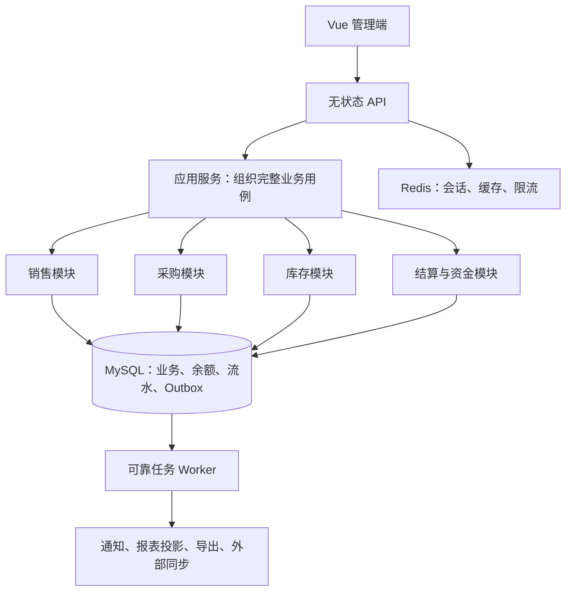

# ERP 重构设计方案

- 方案版本：1.0.1。
- 编写日期：2026-11-15，Asia/Shanghai。
- 开发方式：参考 jshERP 的业务，重新开发；不直接改造其原工程。
- 项目根目录：`F:/桌面/ERP/`，项目文档统一保存在 `docs/`。
- 已确认技术栈：Vue 3 + TypeScript + Vite、Element Plus、Pinia + Vue Router、Axios、辅助使用 Tailwind CSS；后端 Spring Boot。
- 当前交付：需求范围、模块边界、关键规则、技术建议和验收方案。截至 M1，登录、公司切换及仓库管理已通过构建和测试。后续模块与容量验证按《开发计划》推进。
- 文档维护：maorongkang@gmail.com。

## 1. 范围与假设

先以商贸、批发、电商企业的多仓进销存为主线，首期使用人民币单币种，建立租户与公司边界。正式多法人合并报表、跨币种和生产计划列为扩展范围。租户是数据隔离边界，公司是业务主体；两者不能混用。

首期建立完整的采购、销售、库存、应收应付、收付款和对账闭环。资金模块首先记录并核实资金发生；银行、支付渠道真实扣款或转账属于可选外部集成，必须单独设计结果确认。

需求尚未给出具体行业、服务器资源、日订单量、单据明细规模、热点分布和峰值吞吐。本文给出可压测的阶梯与正确性要求，不声明已达到任何并发数。

参考系统核查见《源码核查记录》。官方区分开源与全部功能版本，本文下表是新系统的目标，不表示参考仓库已实现全部目标。

## 2. 功能模块和交付边界

P0 表示形成可验收的首期业务闭环；P1 表示按行业需求完善；P2 表示独立评估的扩展系统。

| 模块 | P0 必须完成 | P1 / P2 扩展 |
|---|---|---|
| 身份与组织 | 登录、组织、用户、角色、菜单及操作权限、公司和仓库数据范围、审计 | 单点登录、外部组织同步 |
| 基础资料 | 客户、供应商、联系人、结算账户、收支项目、仓库、期初数据 | 客户分层、信用额度、业务员提成 |
| 商品与定价 | SPU/SKU、分类、条码、单位及换算、采购和销售价格、停用规则 | 多价格表、阶梯价、客户协议价、复杂促销 |
| 销售 | 销售订单、审批、库存预留、分批出库、退货、关闭剩余量 | 报价、合同、跨渠道订单、代发和组合履约 |
| 采购 | 请购、采购订单、分批收货、采购退货、供应商结算 | 询价比价、订单/收货/发票匹配、采购计划 |
| 库存 | 余额、预留、可用量、出入库流水、多仓调拨及在途、盘点调整、负库存拦截 | 库位、批次、保质期、序列号、拣货波次 |
| 应收应付 | 应收单、应付单、分次结算、核销分配、账龄、对账单 | 信用控制、坏账审批、往来抵销 |
| 资金 | 收款、付款、退款、预收预付、账户间转账、不可变流水、内部对账 | 银行流水自动匹配、支付渠道、资金预算 |
| 成本 | 明确核算维度，首期一种成本方法，出库成本和退货成本可追溯 | FIFO、采购费用分摊、受控成本重估 |
| 审批和单据 | 编号、状态规则、版本、审计、基本审核与驳回 | 多级审批、金额分流、代理和超时处理 |
| 报表 | 库存、销售采购、未收未付、资金流水、毛利口径及明细穿透 | 经营看板、独立分析库、复杂预算报表 |
| 数据与运维 | 导入校验、导出、附件、打印、任务记录、备份恢复、监控告警 | 自定义打印模板、条码标签、归档管理 |
| 零售与会员 | 在企业确有零售需求时纳入首期范围 | 收银、会员预付款、退货、班次交接 |
| 发票与总账 | 保留业务对接边界；有要求时先提供开票登记 | 完整凭证、会计期间、税务接口、财务报表作为独立范围 |
| 生产 | 预留成品和物料类型 | P2：BOM、工单、领退料、完工、委外、MRP |

销售、仓管、采购、财务、审核人和系统管理员分别配置权限。金额、成本、客户联系方式和导出权限可以独立限制。金额修改、付款登记、退款和关账保留经办人和审核人。

## 3. 业务规则应当先于页面

开发前先确定下列规则，并附具体示例：

1. 哪个时点预留库存，哪些订单会占用信用额度，预留何时到期或释放。
2. 应收应付按出入库确认，还是按业务发票确认；不能同时生成两遍。
3. 整单和行级优惠的顺序、含税口径、运费承担者、税额与尾差处理。
4. 是否允许负库存、超交、少交关闭、超收款和预收款。
5. 退货是否恢复原订单的可交数量，退款依据原收款还是客户往来余额。
6. 库存成本按公司、仓库还是其他维度核算；是否允许历史日期补录。
7. 过账和关账规则，哪些操作能够撤回，哪些必须生成冲销单。
8. 单据合并、拆分、源单引用以及下游已执行后的上游变更限制。

以上 8 项的首期取值、数字样例、状态机和待业务方确认的问题，见 [业务规则](../产品/业务规则.md)。

一个功能交付时同时包含权限、合法状态、输入校验、事务边界、幂等、审计、错误恢复、测试和报表口径。只有新增、编辑、删除页面不能算业务功能完成。

## 4. 推荐技术与部署架构

| 层次 | 建议技术 | 选择原因和边界 |
|---|---|---|
| 前端构建 | Vue 3、TypeScript 严格模式、Vite | 用户已确认；负责组件、类型和构建 |
| 组件和样式 | Element Plus；Tailwind CSS 仅辅助自定义 | 用户已确认；组件交互统一由 Element Plus 提供 |
| 状态和路由 | Pinia、Vue Router | 用户已确认；区分全局状态与页面状态，统一注册路由 |
| HTTP 客户端 | Axios | 用户已确认；在 `src/api/` 对接 Spring Boot，统一认证、错误和请求契约 |
| 接口 | REST API、统一响应、OpenAPI | 金额和大整数以字符串传输；错误使用有意义的 HTTP 状态和中文提示 |
| 后端 | Java 21、Spring Boot 4.1.x、Spring Security、Bean Validation | 作为新工程候选基线，启动时选择稳定补丁并验证依赖，不套用旧工程版本 |
| 数据访问 | MyBatis Spring Boot Starter 4.0 系列 | 兼容 Boot 4.x；库存和资金关键 SQL 显式编写和评审 |
| 事务数据 | MySQL 8.0.46、InnoDB、Flyway | 开发、集成测试和部署使用相同版本，余额、流水和业务约束由数据库保证 |
| 缓存 | Redis | 用于缓存、会话、限流与短期协调，不保存资金或库存唯一事实 |
| 异步处理 | 数据库 Outbox、带租约的 Worker | 先满足可靠投递和恢复；需要跨服务分发时再接消息中间件 |
| 模块约束 | Spring Modulith 或 ArchUnit | 在测试中验证循环依赖和跨模块内部访问 |
| 附件 | S3 兼容对象存储 | 元数据留库，下载校验权限，大文件不占用数据库事务 |
| 可观测性 | Actuator、Micrometer、OpenTelemetry；指标平台按部署选择 | 记录延迟、锁等待、失败率、消息积压和账实差异 |
| 测试 | JUnit、真实 MySQL 集成测试、前端组件测试、Playwright、k6 | 分别验证规则、事务并发、端到端流程和容量 |
| 部署 | Nginx、无状态 API 实例、独立 Worker；容器按环境使用 | API 可水平扩展，导出和批处理与在线请求隔离 |

Boot 与 MyBatis 的基线来自官方兼容资料，具体依赖锁定、框架集成和构建验证在工程初始化阶段完成。本机已验证 Maven 可以使用 `E:\JDK21` 下的 JDK 21.0.3，项目终端设置见《环境检查》。

采用模块化单体作为第一阶段：业务模块共用一个事务数据库，各模块拥有自己的表和公开接口。库存预留、订单状态和必要账务过账可在一次本地事务内完成。通知、导出、报表投影和外部同步通过可靠异步处理。



读写负载或团队协作确实需要时，优先拆独立报表、导入导出和外部渠道适配。拆资金和库存服务之前，必须增加跨服务一致性和补偿设计。

## 5. 高内聚、低耦合如何落实

### 5.1 后端模块边界

建议后端以业务模块组织，每个模块内部再划分接口、应用、领域、基础设施：

```text
erp-server/
  identity/
  masterdata/
  catalog/
  sales/
    api/              对其他模块开放的契约
    interfaces/       HTTP 接口与请求响应
    application/      组织事务和业务用例
    domain/           订单规则、状态、金额计算
    infrastructure/   Mapper、持久化和适配器
  purchasing/
  inventory/
  settlement/
  treasury/
  workflow/
  reporting/
  integration/
  shared/             少量稳定基础类型
```

约束必须通过自动检查执行：

- 销售通过 `InventoryApi.reserve` 申请预留，通过 `SettlementApi` 发起结算动作；不能直接改库存和资金表。
- 应用服务负责事务编排；领域规则不依赖 HTTP、Redis、SQL Mapper 或页面类型。
- Repository 和 Mapper 只在所属模块内使用，向外返回稳定 DTO 或值对象。
- 模块间禁止循环依赖，报表通过只读投影查询，不反向更新交易模块。
- 同一业务必须原子完成的步骤明确同步调用；报表、通知等次要动作采用持久化事件。
- `shared` 只保留 Money、Quantity、标识、错误和必要契约，不放入万能工具类或通用业务 Service。
- 状态枚举、编号规则和通用表格可以复用；采购、销售、退货各自保留业务规则。
- 先实现实际差异，再提取重复；不把所有单据塞进一个含大量类型判断的通用服务。

Spring Modulith 可以检查模块无环和跨模块内部访问。普通异步事件监听本身不保证进程崩溃后的交付，必须配套持久化发布或 Outbox。

### 5.2 前端目录与责任

```text
erp-web/src/
  api/
    http.ts           Axios 实例、认证、统一错误和请求标识
    sales.ts          销售接口
    purchasing.ts     采购接口
    inventory.ts      库存接口
    settlement.ts     应收应付与核销接口
    treasury.ts       收付款和退款接口
  components/         可复用表格、表单、金额展示和状态组件
  hooks/              页面用例与可复用交互逻辑
  pages/
    sales/
    purchasing/
    inventory/
    settlement/
    treasury/
    system/
  router/             Vue Router 路由、元信息与导航守卫
  stores/             Pinia 用户、权限、当前公司、布局状态
  types/              API、金额、数量和业务 DTO 类型
  utils/              无业务副作用的格式化和辅助函数
  styles/             Element Plus 主题变量及辅助样式入口
```

Pinia 保存跨页面共享的用户、权限、当前公司和布局状态。单据编辑草稿、查询条件、明细行和提交状态优先留在页面或对应组合函数，服务端订单和余额通过接口获取。前端缓存不构成可发货或可退款的凭据。

Vue Router 统一注册页面。路由守卫和按钮权限用于交互呈现；所有接口仍由 Spring Boot 校验主体和数据权限。切换公司或租户时失效旧范围的页面数据和未完成请求，避免旧响应覆盖新页面。

组件内不直接调用 Axios。`src/api/http.ts` 统一配置服务地址、超时、认证、响应类型和中文错误，领域接口文件定义请求与响应 DTO。查询可以配置有限重试；审批、出库、付款、退款不能由通用拦截器无条件自动重发。需要重试时复用原业务幂等键，先核实结果。

前端取消网络等待不表示后端已经取消交易。超时后显示“结果确认中”，按原请求标识查询；成功后刷新单据版本和相关余额，不能在页面自行补改真实账务。

金额和数量以字符串接收并保留精度，前端只预览和格式化，正式计算与规则校验由后端完成。表格、弹窗、抽屉和表单统一采用 Element Plus，明细过多时采用合适的分页或虚拟列表。

Tailwind CSS 仅用于页面容器、间距、Flex/Grid、响应式和少量辅助样式。主题色、表单尺寸、弹层、校验和交互组件由 Element Plus 统一管理，不直接重写其内部 DOM 样式。按 Tailwind 官方方式省略 Preflight 全局重置，保留所需主题和工具类，减少组件样式冲突；主版本和导入方式在初始化时锁定。

## 6. 金额、账本与资金控制

### 6.1 数值和计算口径

建立不可变 `Money` 和 `Quantity` 值对象。金额包含币种；不同币种不能直接求和。Java 使用 `BigDecimal`，不从 `double` 构造金额。前端预估只辅助展示，服务端按有效价格、审批权限和规则重新计算。

首期人民币场景建议：结算金额存 `DECIMAL(24,2)`，单价存 `DECIMAL(24,8)`，数量存 `DECIMAL(24,6)`。这是待业务样例验证的起始精度，不代表所有行业均应使用同一精度。限制数值范围、负数用途、精度和溢出，拒绝悄悄截断。

明确行级优惠、整单优惠、运费和税额的顺序。整单优惠分摊到行时使用确定性的余数分配，保证行合计等于单据合计；部分退货沿用原分摊，最后一笔处理剩余尾差。舍入规则、价格和规则版本随单据保存。

### 6.2 分开保存四类业务事实

| 事实 | 表达的含义 | 典型记录 |
|---|---|---|
| 应收应付 | 客户欠企业或企业欠供应商多少 | `receivable`、`payable` |
| 收付款 | 哪个账户发生了多少资金，是否已经确认 | `receipt`、`payment`、对应明细 |
| 核销 | 某笔已收已付款分配给哪些应收应付 | `settlement_allocation` |
| 会计或资金过账 | 经确认业务产生的不可覆盖账务效果 | `journal`、`journal_line`、余额投影 |

一笔收款可以核销多笔应收，一笔应收可以分次收款。核销改变分配关系，不再产生第二次银行收款。预收款在满足确认条件之前保留为未分配预收。系统登记付款成功也不能替代银行的真实成功确认。

### 6.3 过账必须留痕

- 草稿允许编辑；正式过账后保留原记录，通过冲销或调整单更正，并关联原单。
- 冲销后保留原分录和反向分录，汇总口径包含两者；不能先移除原影响再额外扣一笔，导致双重冲减。
- 每次过账有唯一来源标识、动作及版本，数据库唯一约束防止重复过账。
- 每笔凭证在同一公司、账簿、币种下借贷相等，明细非负，借贷方向单独表达。
- 科目规则和业务确认时点明确配置。运营资金账本与法定总账的范围分别定义；完整总账报表有单独验收。
- 余额可以作为同步更新的查询投影，原始流水和期初快照可重建余额，定期验证差额。
- 流水和余额更新处于同一事务。禁止仅改余额、不留业务来源。
- 已关闭会计期间的补录、冲销和调整走明确流程。关账与过账共享期间屏障，防止检查期间状态后发生并发穿透。

### 6.4 必须成立的金额约束

| 约束 | 处理方式 |
|---|---|
| 核销金额不超过剩余应收和可分配收款 | 同事务锁定或条件更新两侧剩余额度 |
| 同一来源只产生一次有效过账 | 数据库业务唯一键，重复请求返回原结果 |
| 账户余额等于期初加有效流水净额 | 在线增量维护、定时独立重算对账 |
| 普通内部转账限同一公司、同一币种 | 两边资金效果同时过账，手续费单独记录；跨公司另建往来业务 |
| 累计成功退款加处理中占用不超过可退实收 | 退款申请时原子占用额度，确认失败后才释放 |
| 业务失败不留下半笔账 | 凭证头、分录、余额、核销和状态同事务提交 |

退款请求超时后保持“处理中/待核实”，复用原退款请求号向渠道查询，不能换号盲目重发。作废付款记录不会自动撤销银行转账；外部资金回退必须有真实退款结果。

### 6.5 对账与资金权限

内部对账检查凭证平衡、余额与流水、应收应付与核销；外部对账检查银行或渠道账单。差异进入处理单，保留原因、经办、复核和修复来源，不能用数据库脚本直接抹平差额。

付款、退款、折扣、坏账和调账分别授权，支持金额阈值与经办复核分离。权限只影响能否发起动作，最终余额和额度校验仍在数据库事务内完成。

## 7. 订单、履约与售后

### 7.1 分别建模审批、履约和结算

| 状态维度 | 示例 | 由什么驱动 |
|---|---|---|
| 单据生命周期 | 草稿、待审核、已批准、已关闭、已取消 | 提交、审批、变更、关闭和取消命令 |
| 履约 | 未履约、部分履约、全部履约 | 有效收发货明细及关闭数量 |
| 结算 | 未结算、部分结算、已结算 | 应收应付、核销与调整 |
| 售后 | 无售后、处理中、部分退回、已完成 | 退货和退款子单据 |

结算和履约可以并行：已收预付款的订单可能尚未发货，已经发货的订单也可能尚未收款。列表状态可以是这些事实的投影，但不能代替各自的业务记录。

### 7.2 单据必须保留的内容

订单头、行明细、客户或供应商、公司、仓库策略、币种、单价、数量、单位换算、税率、优惠分摊、费用、审批版本和源单关系。价格名称或客户资料后续发生变化，不应悄悄改变历史订单。

每条订单行有稳定 ID。发货、退货、核销等引用行 ID 或业务单 ID，不依赖可以修改的显示单号或明细顺序。

### 7.3 操作规则

1. 审批通过时校验最新版本、权限、价格、数量和关键资料状态；库存预留时点按业务规则执行。
2. 同一订单重复审批只产生一次业务效果。并发编辑和审批必须有一个明确失败并提示刷新。
3. 分批发货以订单行剩余可履约量为上限；创建待执行发货单时也占用额度，避免两张草稿同时超量。
4. 退货按原出库行申请，待处理退货也占用剩余可退量。累计退回不能超过实际发出量。
5. 有下游出库、收款或退款时，上游变更先检查依赖；通过变更单、退货单、退款单和冲销处理。
6. 关闭剩余量释放未使用预留。已发出的货物通过退货处理，已确认资金通过结算或退款处理。
7. 部分退货默认不自动增加原订单待发数量；需要补发时创建明确的补发或重开记录。
8. 取消与支付回调、发货与关闭、退货与退款可能并发，必须分别设计合法的处理结果。

聚合计数由受控事务维护，并能够用有效明细重算。例如：

```text
本次新占用履约量 <= 批准数量 - 关闭数量 - 已发数量 - 其他待发占用
本次新占用退货量 <= 已签收数量 - 已退数量 - 其他待处理退货占用
```

批准订单不能直接更新金额和明细。变更后的审批版本、差额、库存和结算调整需要关联保存。是否重新审批由变更类型决定。

### 7.4 示例：分批发货、预收款和退货

下面只演示人民币、不含税费和优惠时的金额关系，发货后即视为签收。首期已确认应收按客户签收确认，规则和样例见《业务规则》R2 组。

| 步骤 | 单据和资金 | 库存变化 |
|---|---|---|
| 初始 | 商品 10 件，每件 100 元 | 在库 10，预留 0，可用 10 |
| 订单批准 | 订单 1000 元，预留 10 件 | 在库 10，预留 10，可用 0 |
| 预收 300 元 | 资金增加 300，未分配预收 300；尚未产生出库应收 | 库存不变 |
| 先发 4 件 | 出库应收 400，用预收核销 300，剩余应收 100 | 在库 6，预留 6，可用 0 |
| 再收 100 元 | 核销剩余应收；累计收款 400 | 库存不变 |
| 合格退回 1 件 | 生成 100 元退货信用额，申请退回 100 元 | 在库 7，预留 6，可用 1 |
| 退款成功 | 净实收 300，退货信用额与退款结清；原有效交付 3 件 | 库存不再变化 |

退款处理中保留额度占用；退回的货不合格时进入隔离库存，不能马上增加可用量。剩余 6 件订单仍按原规则履约。

## 8. 库存和成本

### 8.1 库存余额、预留和流水分开

```text
可用量 = 在库量 - 已预留量 - 冻结或隔离量
在库量 = 期初量 + 有效入库量 - 有效出库量
```

定义库存自然键：租户、公司、仓库、SKU，以及按商品启用的库位和批次维度。可选维度使用明确的默认键，避免 NULL 造成自然键唯一约束失效。

每次变化都写库存流水，包含来源单据、行、动作、数量、基础单位、原始单位与换算快照、业务日期和过账时间。预留也有独立来源记录和释放记录。全部变化可追溯到有效单据。

### 8.2 并发预留示意

以下 SQL 仅说明基础维度下的原子预留，完整实现还需在同一事务插入预留明细、更新订单和记录幂等结果。扩展批次后必须增加对应键条件。

```sql
UPDATE inventory_balance
SET reserved_qty = reserved_qty + :qty,
    version = version + 1
WHERE tenant_id = :tenant_id
  AND company_id = :company_id
  AND warehouse_id = :warehouse_id
  AND sku_id = :sku_id
  AND :qty > 0
  AND on_hand_qty - reserved_qty - blocked_qty >= :qty;
```

受影响行数必须为 1，否则按不存在、权限不符或不足量分别处理，不能继续完成订单。不能先普通查询“有库存”，随后无条件写入数量。

多 SKU 订单按固定键排序更新，任何一行失败则本次原子业务操作全部回滚。发货同时减少在库和对应预留；取消只释放尚未使用的预留。预留归属、释放次数和过期任务均受数据库约束。

### 8.3 调拨、盘点和退货

- 调拨有调出、在途和调入记录；货物尚未到达时不能直接成为目标仓可售库存。
- 简单同场地即时调拨可以同事务完成；真实跨仓运输保留两阶段实物过程及异常处理。
- 盘点记录盘点时点和库存版本。选择冻结相关库存或根据流水水位计算差异，不能直接用盘点数覆盖仍在出入库的余额。
- 库存调整必须有原因、审批和流水。首期禁止负库存，特殊行业需要时另行定义数量和成本规则。
- 序列号不可重复出库；批次、单位和保质期规则按商品类型校验。

### 8.4 成本

首期建议只实现一种经确认的成本方法，例如按公司和仓库、SKU 核算的移动加权平均。数量和成本价值在同一成本聚合上按顺序更新。展示单价可以舍入，但保留足够精度的总成本和尾差，不能反复用展示单价回算总价值。

销售出库保存当时确认的成本，退货引用原出库成本。剩余数量归零时处理残余成本，保留调整记录。补录历史单据、采购费用追加和成本差异通过受控重估任务执行，关联受影响记录和开放期间。

正常交易路径做增量过账，不在每次发货时扫描全部历史单据重算成本和库存。历史重算用于独立核验、迁移或明确授权的修复流程。

## 9. 数据结构与数据库约束

### 9.1 核心表组

落地后的完整表结构、约束和写入方式见 [数据库设计](数据库设计.md)，与本节的差异在其第 3.12 节说明。

| 领域 | 建议表组 | 关键约束 |
|---|---|---|
| 主体 | `tenant`、`company`、`user`、`role`、`warehouse` | 主体归属和权限映射明确 |
| 基础资料 | `business_partner`、`partner_role`、`product`、`sku`、`unit_conversion` | 客户和供应商可以是同一主体的不同角色 |
| 销售采购 | `sales_order` / `sales_order_line`、`purchase_order` / `purchase_order_line`、`document_change` | 版本、合法状态、单号唯一、行引用稳定 |
| 履约售后 | `shipment` / `shipment_line`、`goods_receipt` / 明细、`sales_return` / 明细、`purchase_return` / 明细 | 引用源单行，占用和已完成量受控 |
| 库存 | `inventory_balance`、`inventory_movement`、`inventory_reservation`、`stock_transfer`、`stock_count` | 自然键唯一，余额和流水一致 |
| 往来 | `receivable`、`payable`、`settlement_allocation` | 核销额度和币种、客户、公司一致 |
| 收付款 | `receipt` / 明细、`payment` / 明细、`refund_request`、`cash_account` | 外部单号唯一，退款占用受控 |
| 账本 | `journal`、`journal_line`、`ledger_balance`、`accounting_period` | 唯一过账、借贷平衡、期间控制、原记录不可覆盖 |
| 集成 | `idempotency_record`、`outbox_event`、`inbox_event`、`external_request` | 请求、投递与业务消费分别幂等 |
| 运维 | `audit_log`、`reconciliation_run` / 差异明细、`import_job` / 错误明细 | 可追溯、可重试、按权限查询 |

审批通过后，业务对象修改必须走领域接口；不能以通用 CRUD 接口更新所有字段。数据库账号和业务应用权限分离，运维修复也需有记录。

### 9.2 唯一、引用和检查约束

- 单号：`UNIQUE(tenant_id, company_id, document_type, document_no)`。
- 库存自然键：`UNIQUE(tenant_id, company_id, warehouse_id, sku_id, location_key, lot_key)`，键均不可为空。
- 幂等请求：`UNIQUE(tenant_id, company_id, operation, idempotency_key)`，保存规范化请求摘要；相同键不同内容返回冲突。
- 过账来源：`UNIQUE(tenant_id, company_id, source_type, source_id, posting_action, source_revision)`。
- 外部交易标识包含渠道和商户账户，避免不同商户的同名交易互相冲突。
- 数量、金额、状态值使用 NOT NULL 和适用的 CHECK；跨行额度在受锁保护的事务中校验。
- 财务和库存核心引用尽可能使用包含租户、公司的复合外键，并确保父表存在对应唯一键；跨模块通过公开接口写入，外键仍可保护同库引用。
- API 输入中的 tenant/company 不能取代服务端主体上下文；查询、导出、后台任务和事件消费均执行隔离。
- 单据索引从实际查询设计：主体、业务时间、状态、往来单位及分页游标。结合执行计划验证，避免对每列盲目加索引。
- 外键名称不能代替外键约束。核心依赖采用 `RESTRICT` 等明确策略，禁止级联删除已过账记录。

### 9.3 接口契约示意

完整接口约定、清单和核心接口说明见 [接口设计](接口设计.md)，与本节的差异在其第 9 节说明。

| 接口 | 关键要求 |
|---|---|
| `POST /api/v1/sales-orders` | 服务端计算金额，接收持久化幂等键 |
| `POST /api/v1/sales-orders/{id}/approve` | 版本检查、合法状态、重复效果幂等 |
| `POST /api/v1/shipments` | 引用订单行，原子占用剩余履约额度 |
| `POST /api/v1/shipments/{id}/post` | 出库、预留消耗、相关过账及源单进度原子提交 |
| `POST /api/v1/receipts` | 区分待确认与已确认资金，避免只凭表单宣告到账 |
| `POST /api/v1/settlement-allocations` | 核销两侧余额受并发保护 |
| `POST /api/v1/refund-requests` | 原子占用退款额度，外部请求在提交后执行 |
| `POST /api/v1/documents/{id}/reverse` | 核查依赖、权限和期间，创建可追溯冲销 |

所有修改命令返回业务 ID、版本和确定的状态。正在异步执行时返回任务或请求 ID；金额、数量与大整数均采用约定格式。状态冲突、版本冲突和同键异参返回明确的 409 类响应，业务校验返回适当的 4xx；错误信息使用中文。

## 10. 事务、幂等与可靠异步

### 10.1 一次本地业务命令的事务边界

以“确认出库”为例：

```text
校验身份及公司、仓库数据权限
  -> 校验并登记幂等请求
  -> 锁定或条件迁移发货单，核查订单版本与剩余履约量
  -> 按固定顺序锁定相关库存、预留与成本记录
  -> 校验期间、单位、数量和成本
  -> 扣减在库与对应预留，追加库存流水
  -> 根据业务确认策略生成应收、必要账务分录
  -> 更新源单累计进度与发货单状态
  -> 写审计、Outbox 和幂等结果
  -> 一次提交
```

任何一步失败，回滚本次相关数据库变化。不能把“先提交订单、然后另开事务扣库存”当作同库强一致流程。跨模块接口可参与同一事务，低耦合不要求把每一步拆成远程调用。

数据库事务内不请求银行、不上传附件、不生成大型报表，不等待人工审批。外部动作由已提交的请求记录驱动，回调再开启短事务确认结果。

明确异常回滚策略，避免捕获异常后返回成功。使用 Spring 事务时验证代理调用、事务传播、线程切换和检查型异常回滚，不能只检查方法上是否存在注解。

### 10.2 三层幂等

| 层次 | 防止什么 | 实现要求 |
|---|---|---|
| HTTP 命令 | 用户重试、代理重发、超时后的重复点击 | 持久化请求键、请求摘要和业务结果 |
| 业务动作 | 同一单据重复审批、出库、核销和退款 | 来源与动作唯一键、条件状态迁移、额度约束 |
| 事件和渠道 | 重复消息、重放回调和定时任务重跑 | Inbox 唯一记录与业务效果同事务；渠道请求号稳定 |

相同请求键必须校验操作者权限和请求摘要。业务提交后响应丢失，客户端带原键重试取得原结果。长期的资金效果去重不能因 Redis 过期或请求日志归档而消失。

### 10.3 Outbox 与消费

1. 交易表和 Outbox 在同一事务写入；事务回滚时不发布业务事件。
2. Worker 用租约、领取状态和重试时间领取已提交事件。队列领取可使用 `SKIP LOCKED`，库存不足校验不能跳过被锁记录后当作完成。
3. 投递确认丢失时允许重复发送；消费者用事件 ID 和业务唯一键去重。
4. Inbox 去重标记与消费者的数据库副作用一起提交，避免“先标记已处理，后续业务失败”。
5. 同一聚合携带版本。旧事件去重，版本缺口暂停或重新拉取权威状态，不依赖到达时间猜测顺序。
6. 超过重试上限进入异常队列并告警，支持查看原因、修复和重放。
7. 普通内存事件和仅提交后触发的异步方法不能替代持久化交付。

该机制承认消息可能重复，通过幂等使业务效果不重复；不声称网络消息天然只送达一次。

### 10.4 锁和重试规则

编辑采用版本号防止覆盖；余额和额度使用有索引的条件更新或事务内锁定读取。多资源按确定的资源类别、业务键顺序加锁，审批、退款、取消和回调遵循同一规范。不能全系统只锁一个租户或一张订单总表。

死锁或锁等待失败时，在事务外以有限次数重新执行整个幂等命令，每次使用新的事务上下文。权限、价格、余额不足等确定性失败不能自动盲重试。发生提交结果不确定时，以原幂等键查结果，不直接再扣一次。

## 11. 并发与性能设计

### 11.1 区分四种负载

| 负载 | 优化重点 | 正确性边界 |
|---|---|---|
| 商品、客户和订单列表查询 | 合理索引、游标分页、缓存、限制筛选范围 | 租户、公司和数据权限一致 |
| 不同订单、不同 SKU 的写入 | API 水平扩展、短事务、批量写入、连接池与限流 | 业务约束和事务不变 |
| 同一 SKU、同一预收账户等热点写入 | 缩短持锁时间、精细聚合、按键排队及过载控制 | 相同余额上的冲突不能靠扩实例消除 |
| 导入、导出、统计和成本重估 | 独立 Worker、分片、检查点、资源隔离 | 明确数据快照和恢复语义 |

Redis 缓存不决定能否出库、退款或核销；这些操作读取权威数据库并执行原子校验。缓存更新在提交后进行，缓存丢失可以重建。缓存失效时控制回源并发。

读副本只服务允许延迟的查询；刚提交的订单、实际可用库存和资金确认查询按要求读主库。报表展示统计时点和投影进度，避免用户把延迟报表当作实时余额。

### 11.2 必须避免的吞吐瓶颈

- 全局单号锁。数据库主键与展示单号分离，按租户、公司、单据类型和时间段分配业务序号，唯一索引兜底。断号是否允许另行定义。
- 查询每一行再单独查询客户、商品和金额，形成 N+1。
- 每次保存都汇总所有历史单据和解析多账户字符串。
- 在事务内调用外部网络、等待用户或执行大文件导出。
- 无界线程池和无界任务队列。设置连接、超时、重试、并发和排队长度上限。
- 把全部请求缓存穿透到数据库，或把所有慢报表直接运行在交易库主节点。
- 用主从延迟的查询结果批准发货、付款或核销。
- 先引入数据库分片再处理业务约束。跨分片资金和库存会显著扩大一致性成本。

热点库存需要按业务粒度串行协调。能否达到某一吞吐受锁持有时间、单据行数、数据库存储和网络影响，不能只由“用了 Redis、MQ、微服务”推出。

### 11.3 压测计划

下列数字是测试阶梯，不是承诺性能。项目启动时用真实日量、峰值和硬件确定最终验收线。

| 场景 | 初始测试安排 | 检查结果 |
|---|---|---|
| 普通查询 | 200、500、1000 RPS 阶梯提升 | 各接口 P50/P95/P99、数据库负载、错误率 |
| 分散写入 | 20、50、100、200 次单据操作/秒，单据行数分 1、20、100 三档 | 有效提交吞吐、持锁时间、死锁和回滚比例 |
| 热点抢库存 | 同一 SKU 可用 100 件，1000 个并发请求各预留 1 件，不发生释放 | 恰好 100 件成功预留，其他为可解释的业务拒绝，库存不为负 |
| 重复命令 | 同一幂等键并发提交 100 次 | 一个业务结果、一组有效库存或资金效果 |
| 退款争抢 | 对同一可退余额并发申请超过余额的多笔退款 | 成功和处理中占用之和不越限 |
| 混合读写 | 列表查询、审批、出入库、收款、退款与导出同时运行 | 业务错误与系统故障分开统计，交易不被报表拖垮 |
| 稳态与突发 | 目标负载稳定运行后增加突发，再回落 | 无持续积压或资源泄漏，延迟恢复，核对余额与流水 |

测试数据至少覆盖不同租户、公司、仓库、客户，以及长期历史数据；不能只用空库的一张单据。记录订单和明细数量、热点比例、缓存冷热、硬件、连接池、应用副本和持久化设置。

1000 个在线用户、1000 个并发请求和 1000 RPS 是不同指标。成功提交吞吐、业务拒绝和系统错误分别计算，不能通过快速返回“排队中”冒充交易已经完成。

压测结束必须执行独立对账。资金和库存差额、超量履约、重复过账容忍值为 0；延迟和吞吐线在资源和业务规模确定后设定。

## 12. 逻辑完整性的自动验收

### 12.1 测试层次

- 领域规则测试：金额、优惠分摊、单位换算、状态迁移、数量和额度边界。
- 数据库集成测试：使用实际 MySQL 类型和约束，不用内存数据库代替锁行为验证。
- 并发测试：多个独立连接、事务和同步屏障制造竞争，必要时运行两个应用实例。
- 属性测试：生成合法随机操作序列，检查库存、资金和分配关系始终满足不变量。
- 端到端测试：采购到付款、销售到收款、退货退款、审批驳回、取消和打印导出。
- 架构测试：无循环依赖，跨模块只访问公开 API，领域层不依赖基础设施。

### 12.2 必测故障和边界

| 编号 | 场景 | 预期 |
|---|---|---|
| T01 | 最后一件商品被两个订单同时预留 | 只有一个成功 |
| T02 | 两个发货单同时消费同一订单行剩余量 | 累计发货和待发占用不超量 |
| T03 | 同一单据两次并发审批 | 状态、预留和过账均只有一次有效效果 |
| T04 | 库存已更新后抛错 | 同事务的余额、流水、单据和应收全部回滚 |
| T05 | 数据库已提交但客户端未收到响应 | 原键重试返回原单，不重复记账 |
| T06 | Worker 在事件投递前后退出 | 重启后补投，业务副作用不重复 |
| T07 | 核销同一笔收款或同一笔应收发生竞争 | 两侧可分配额度都不为负 |
| T08 | 退款超时、重复回调、旧状态通知后到 | 维持可核实状态，不重复退款或倒退终态 |
| T09 | 取消订单同时收到付款成功或发生出库 | 只走定义的合法结果，必要时转待退款或拒绝取消 |
| T10 | 部分退货、多次退款、优惠和税额尾差 | 不超过原交付和可退实收，明细与合计一致 |
| T11 | 盘点时仍有出入库 | 按冻结或水位规则处理，无库存覆盖 |
| T12 | 调拨在途时服务重启、目标仓少收 | 在途数量可追溯，不能虚增可用库存 |
| T13 | Redis 不可用、数据库死锁、Worker 重启 | 核心约束仍成立，有限重试，有明确故障结果 |
| T14 | 修改商品单价、单位或税率后查看历史单据 | 历史快照和退货计算不被改变 |
| T15 | 越公司、越仓库、越租户直接请求或导出 | 服务端拒绝，后台任务也不能绕过 |
| T16 | 关账与过账竞争、在已关闭期间冲销 | 期间规则不能被并发绕过 |
| T17 | 从备份恢复并重放到指定时间点 | 交易、账本、余额和任务状态恢复后可对账 |
| T18 | 同幂等键使用不同参数或跨用户查询原结果 | 参数冲突或权限拒绝，不泄露他人的结果 |
| T19 | 库存预留到期释放与发货同时发生 | 同一预留只被释放或消费一次，不产生额外可用库存 |
| T20 | 负数、超大金额、非法精度、单位换算及舍入边界 | 输入被明确校验，金额和数量不溢出，尾差不丢失 |

测试数据不包含真实客户、银行卡或渠道凭据。对外支付调用使用可控制的测试适配器；故障演练只在隔离测试环境执行。

## 13. 部署、恢复与数据迁移

API 实例无状态部署。事务数据库使用明确的持久化、备份和故障切换策略；保存恢复检查点并实际演练。定义 RPO、RTO；如果要求已确认交易零丢失，需要相应复制和确认策略并以故障测试验证，普通异步主从加备份不能自动满足。

关键监控包括：资金和库存对账差额、重复过账拦截、退款待核实时长、Outbox 最旧积压、死锁、锁等待、连接池饱和、任务重试、单据各状态停留时间和权限拒绝异常。

如以后从旧系统迁移，先做主数据映射和期初余额核对，再导入未完成订单及关联明细。历史单据可先只读归档。迁移来源和映射版本必须保存，重复导入不能重复创建资金和库存。切换要有停写或明确增量水位，避免两套系统同时修改同一账本。

备份恢复不能只恢复业务表而丢掉幂等、渠道请求、Outbox 和账本记录。恢复后的外部支付状态通过原请求号核验，不重新发起所有尚未完成的付款。

## 14. 开发顺序和阶段验收

按里程碑拆分的任务、验收标准和工作量估算见 [开发计划](../规划/开发计划.md)。

| 阶段 | 主要工作 | 进入下一阶段的条件 |
|---|---|---|
| A：业务与契约 | 核对范围、角色、金额和库存口径；画状态图、表关系，定义接口 | 第 3 节规则有业务样例，关键异常有明确处理 |
| B：基础工程 | 工具链、登录权限、主体边界、迁移、测试和监控；统一金额类型 | 构建和检查通过，租户/公司隔离可验证 |
| C：核心底座 | 幂等、不可变资金和库存流水、余额、核销、Outbox | 重复请求、并发额度、事务回滚和对账测试通过 |
| D：一条完整业务 | 商品入库、销售订单、分批出库、收款、部分退货退款 | 第 7.4 节样例可端到端执行并对账 |
| E：采购和常规操作 | 采购、应付、调拨、盘点、报表、导入导出及审批 | 采购到付款闭环完整，模块依赖检查通过 |
| F：容量与恢复 | 热点、混合负载、异常注入、备份恢复、慢查询优化 | 达到约定性能目标，金额和库存差错为零 |
| G：行业扩展 | 零售、批次、序列号、发票或生产等实际需求 | 各扩展拥有独立规则、测试和升级迁移 |

阶段 C 通过小范围可执行用例建设，不一次性创建大量空模块。阶段 D 尽早形成可运行版本，后续以同样标准增加模块。所有新增迁移只追加，不修改已经交付的历史迁移。

不设定无依据的开发工期。单人和多人团队的进度、是否接真实银行、是否包含完整财务及生产，会显著改变投入。

## 15. 后续工程文档与未决项

建立独立工程后按中文文件名维护：需求规格说明书、概要设计说明书、详细设计说明书、数据库设计、接口设计、测试用例与报告、部署说明、用户使用手册、更新日志、项目总结和环境检查。

当前方案之外仍需确认的产品事实：

- 实际行业和商品类型，是否必须包含生产、零售、批次、有效期或序列号。
- 自用单企业还是对外 SaaS，是否有多个独立法人和币种。
- 应收确认、成本方法、发票及完整总账范围。
- 仅登记和对账，还是需要真实调用支付、退款或银行转账。
- 历史迁移数量、日单量、单据行数、峰值操作、热点程度和服务器资源。

这些信息影响具体字段和验收指标，不影响先确定订单状态、金额精度、不可变流水、原子额度、幂等及模块边界。

## 16. 资料和阅读顺序

本方案是面向新系统的建议。参考系统的已观察事实和固定提交链接见 [源码核查记录](../测试/验收记录/源码核查记录.md)，本机情况见 [环境检查](../运维/环境检查.md)，首期业务规则见 [业务规则](../产品/业务规则.md)，表结构和约束见 [数据库设计](数据库设计.md)，接口见 [接口设计](接口设计.md)。

- [jshERP 官方功能范围](https://www.gyjerp.com/doc/archive/fun-list.html)。
- [MySQL 锁定读取](https://dev.mysql.com/doc/refman/8.0/en/innodb-locking-reads.html) 与 [死锁处理](https://dev.mysql.com/doc/refman/8.0/en/innodb-deadlocks-handling.html)。
- [Spring 事务回滚规则](https://docs.spring.io/spring-framework/reference/data-access/transaction/declarative/rolling-back.html)。
- [Spring Modulith 架构验证](https://docs.spring.io/spring-modulith/reference/verification.html) 与 [事件交付](https://docs.spring.io/spring-modulith/reference/events.html)。
- [ERPNext 不可变账本](https://docs.frappe.io/erpnext/immutable-ledger-in-erpnext) 与 [收付款核销](https://docs.frappe.io/erpnext/payment-reconciliation)。
- [Spring Boot 系统要求](https://docs.spring.io/spring-boot/system-requirements.html) 与 [MyBatis 兼容矩阵](https://mybatis.org/spring-boot-starter/mybatis-spring-boot-autoconfigure/)。
- [Tailwind Preflight 与按需关闭](https://tailwindcss.com/docs/preflight)。前端样式约束来自已确认的“Tailwind 仅辅助自定义”要求。

建议评审顺序为：第 3 节业务规则，第 6 节资金，第 7—8 节订单库存，第 10 节一致性，第 12 节验收，最后按第 14 节实施。
